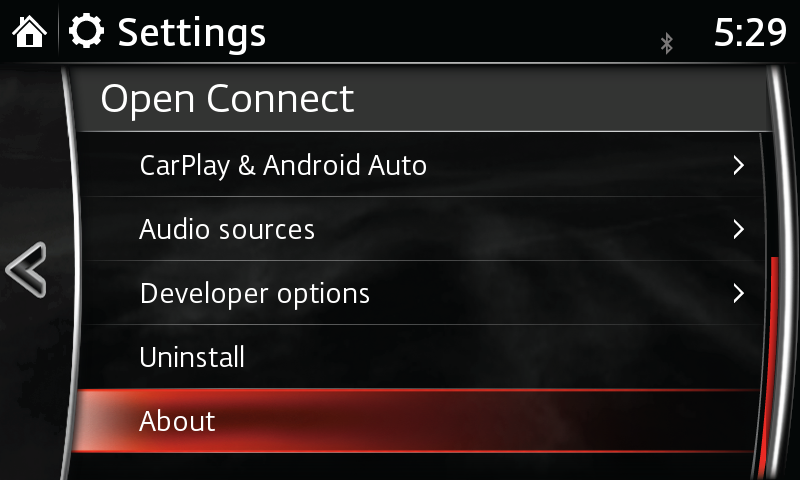

# About

See which version of Open Connect is installed.

<dl class="oc-spec">
  

    <dt>Menu</dt>
    <dd>Open Connect</dd>
  

  

    <dt>Default</dt>
    <dd>—</dd>
  

  

    <dt>Impact</dt>
    <dd>Read-only</dd>
  

  

    <dt>Applies</dt>
    <dd>Read-only</dd>
  

</dl>

<figure class="oc-screen">
  

  <figcaption>About highlighted (dev.19).</figcaption>
</figure>

## Notes

No preference; displays the installed Open Connect version.

<strong>Read-only</strong> — viewing version information changes no settings; no RAM/CPU/startup claim.

None; opening About does not change startup behavior.

Read-only; opens immediately and needs no restart.

The retained dev.19 screenshot shows the menu on <strong>74.00.324A NA</strong>; real-car qualification remains ahead. <a href="performance.md">Performance evidence</a> describes measured configurations. <strong>0.3.0-dev.21</strong> is a development prerelease.

## Check the version

Select **About**. The current development preview is **0.3.0-dev.21** for North American Mazda Connect **74.00.324**.

This is Open Connect’s About entry. To check Mazda’s firmware version, use **Mazda Settings → System → About → Version Information** instead.

[Back to Settings](settings.md)
