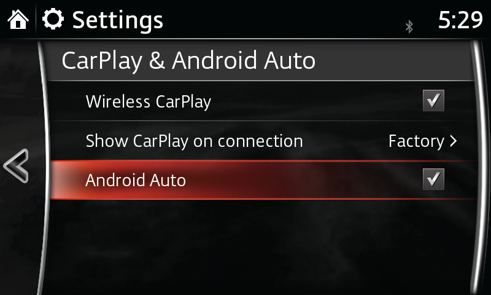

# Android Auto

Control Mazda’s built-in Android Auto support.

<dl class="oc-spec">
  

    <dt>Menu</dt>
    <dd>Open Connect → CarPlay &amp; Android Auto</dd>
  

  

    <dt>Default</dt>
    <dd>On</dd>
  

  

    <dt>Impact</dt>
    <dd>Neutral</dd>
  

  

    <dt>Applies</dt>
    <dd>Next full startup</dd>
  

</dl>

<figure class="oc-screen">
  

  <figcaption>Android Auto highlighted (dev.19).</figcaption>
</figure>

## Notes

<strong>Neutral</strong> — no isolated startup or free-RAM gain is established.

Turning it off makes built-in Android Auto unavailable. CarPlay, Bluetooth audio, USB music and audio CDs still work.

Saved automatically; takes effect on the <strong>next full Mazda Connect startup</strong>. See <a href="settings.md#apply-changes">restart guidance</a>.

<a href="performance.md">Performance evidence</a> covers combined service configurations, not an isolated Android Auto gain. Android-phone use remains unqualified. Dev.19 UI bench captures on <strong>74.00.324A NA</strong>; real-car qualification and matched dev.19 benchmarks remain pending. <strong>0.3.0-dev.19</strong> is a development prerelease.

## Change the setting

Turn **Android Auto** off and confirm **Disable** if you do not use it.
Turn it back on and confirm **Enable** to restore built-in support after a full restart.

This choice is independent of [Wireless CarPlay](wireless-carplay.md) and [Show CarPlay on connection](carplay-on-connection.md).

[Back to Settings](settings.md)
