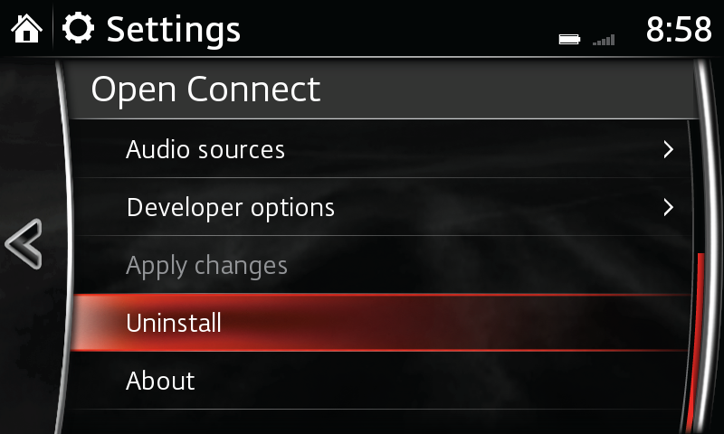

# Apply changes

Restart Mazda Connect to activate your saved choices. You don’t need a USB drive or computer.

<dl class="oc-spec">
  

    <dt>Menu</dt>
    <dd>Open Connect</dd>
  

  

    <dt>Default</dt>
    <dd>—</dd>
  

  

    <dt>Impact</dt>
    <dd>Restarts to apply</dd>
  

  

    <dt>Applies</dt>
    <dd>Auto restart</dd>
  

</dl>

<figure class="oc-screen">
  

  <figcaption>Apply changes is available when saved choices need a restart (dev.20).</figcaption>
</figure>

## Notes

No preference; this action asks for confirmation before restarting.

<strong>Restarts to apply your saved choices.</strong> No isolated RAM/CPU/startup improvement is measured for this action. Individual settings have their own effects.

Choices save automatically. You can change several settings before applying them together. <strong>restart needed</strong> means a choice is saved but not active yet.

<strong>Apply changes</strong> is disabled when there are no pending changes. The Commander Dial skips the disabled row.

Dev.20 Apply changes has software bench verification on <strong>74.00.324A NA</strong>. Real-car qualification remains pending; <a href="performance.md">Performance evidence</a> records the dev.20 cold ACC-off cohorts separately from this action. <strong>0.3.0-dev.21</strong> is a development prerelease.

## Restart now

1. Save your preferences, then return to the Open Connect menu.
2. Select **Apply changes**, just above **Uninstall**.
3. Confirm **Restart**. Keep the car on until Mazda Connect restarts.

<figure class="oc-screen">
  

  <figcaption>Choose Restart to apply saved changes, or Cancel to keep browsing.</figcaption>
</figure>

**Cancel** leaves your saved choices waiting for the next full Mazda Connect startup. A quick ignition off/on may resume the same session. If a save cannot be confirmed, reopen Open Connect and check the choice before trying again.

<figure class="oc-screen">
  

  <figcaption>No pending changes: Apply changes is disabled (dev.20).</figcaption>
</figure>

[Back to Settings](settings.md)
