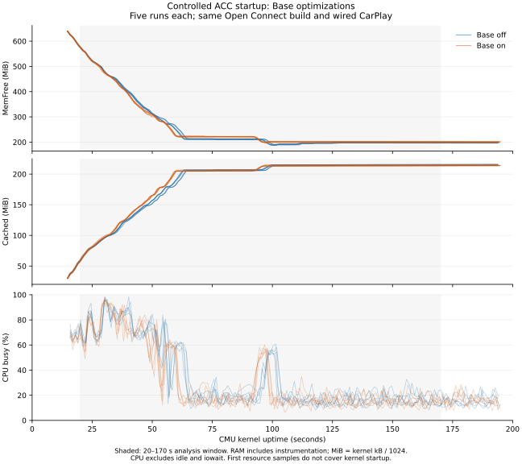

# Installed Base optimizations comparison

With Base optimizations on, this installed development build reached the
**visible wired CarPlay dashboard about 3.8 seconds earlier** than the same build
with Base off. Minimum `MemFree` in the matched startup window was **9.9 MiB
higher**; ending free RAM was **2.58 MiB higher**. These five-run blocks support
the optional native Warn filter, which defaults off. They compare two settings
within one installed build; usable input, audio, native wireless and vehicle
behavior remain separate qualification work.

## Five starts per condition

All ten primary attempts completed and passed the saved/applied setting, boot,
trace and clock checks. Both video blocks ended at the idle daytime wired
dashboard without startup input. No primary attempt failed or was excluded.

| Base optimizations | Median Home bounds (s) | Median dashboard bounds (s) | Median CPU busy | Median minimum MemFree (MiB) |
| --- | --- | --- | --- | --- |
| Off | 31.63–31.84 | 54.42–54.63 | 33.75% | 189.52 |
| On | 30.83–31.04 | 50.61–50.82 | 31.04% | 199.42 |

Timing bounds are medians of the individual frame intervals, rounded outwards.
CPU/RAM use actual sample endpoints inside kernel uptime 20–170 seconds. The
3.81-second dashboard difference is calculated from unrounded median interval
midpoints. The roughly 0.80-second Home difference is smaller and sensitive to
where its entrance animation completes: a one-frame shift in each condition
can move that difference by about 0.4 seconds. Sensor/display and relay latency
remain uncalibrated. Visible appearance is not input or audio readiness.

| Base optimizations / run | Home (s) | Dashboard (s) | CPU busy | Minimum MemFree (MiB) |
| --- | --- | --- | --- | --- |
| Off / 1 | 31.62–31.83 | 54.42–54.63 | 33.14% | 187.29 |
| Off / 2 | 31.63–31.84 | 54.22–54.43 | 33.87% | 187.23 |
| Off / 3 | 32.03–32.24 | 55.22–55.43 | 37.24% | 189.68 |
| Off / 4 | 31.63–31.84 | 54.22–54.43 | 33.59% | 189.86 |
| Off / 5 | 32.01–32.22 | 55.21–55.42 | 33.75% | 189.52 |
| On / 1 | 31.23–31.44 | 51.41–51.62 | 32.74% | 198.80 |
| On / 2 | 30.83–31.04 | 50.61–50.82 | 31.04% | 199.68 |
| On / 3 | 30.63–30.84 | 51.61–51.82 | 31.79% | 195.79 |
| On / 4 | 30.62–30.84 | 50.60–50.81 | 30.96% | 199.42 |
| On / 5 | 31.22–31.43 | 50.60–50.81 | 30.55% | 200.28 |

| Base optimizations | CPU busy range | Per-run minimum MemFree range (MiB) | Median ending MemFree (MiB) | Median ending Cached (MiB) |
| --- | --- | --- | --- | --- |
| Off | 33.14–37.24% | 187.23–189.86 | 198.68 | 214.18 |
| On | 30.55–32.74% | 195.79–200.28 | 201.27 | 213.64 |

Median minimum MemFree increased by 9.90 MiB, while the last-window value increased
by 2.58 MiB. This describes less temporary pressure rather than a fixed 9.9 MiB
allocation permanently recovered. Cached memory also differs and observer output
is included. The CPU median fell by 2.71 percentage points; these particular
ranges did not overlap, but sequential order, drift and one unit still limit
attribution and generalization.



| Device / Base optimizations | Median sectors read (range) | Median sectors written (range) |
| --- | --- | --- |
| `ffx01` / Off | 248,640 (247,368–250,192) | 240 (120–240) |
| `ffx01` / On | 246,600 (237,120–250,080) | 128 (128–240) |
| `mmcblk0` / Off | 63,821 (63,821–63,826) | 201 (199–206) |
| `mmcblk0` / On | 63,821 (63,821–63,826) | 203 (201–212) |

I/O does not establish a general reduction. Median `ffx01` reads/writes were lower
with Base on, with overlapping ranges; `mmcblk0` reads were unchanged and median
writes were slightly higher. Values are native kernel sector counters per device.
Do not sum parents and partitions. The CSV retains SD endpoints separately;
missing endpoints have no inferred full-window delta.

The 1,711 local samples begin at uptime **14.55–14.94 seconds** and end at
**193.80–194.87 seconds**. This installed candidate's early resource gap is later
than the roughly 11-second gap in the isolated stock-feature experiment. It is
explicitly unobserved, not zero. No whole-boot RAM peak, direct emitted-log volume
or per-logger PSS is inferred. Maintenance, mechanism and setup starts are
separate from the ten primary attempts.

## What is compared

Five Base-on starts followed by five Base-off starts use the same installed
**0.3.0-dev.7** bundle on exact **74.00.324A NA/cmu150_NA**. Both conditions have
Touchscreen While Driving **Allow**, Startup disclaimer **Skip**, UART/SSH **off**
and Pandora **on**. The first preset contents are the native Warn prefilter;
individual service selections stay fixed. Off leaves the RAM override absent.

The product comes from [CI 44917434811](https://github.com/aeharding/open-connect/actions/runs/44917434811),
source [`2bbc8ade`](https://github.com/aeharding/open-connect/tree/2bbc8ade53ea455bd923c0fd4ae487ee9e93e285).
USB ZIP SHA256 is `9f0c76aeca6e73b2086878b0a1047d036bb32deadcbdd638892d2a43c2ac7230`;
public manifest is `e403bdd466a0e8d15bbcc787fa02268aaae3972fb704f88cb45d7efc6bfa8fed`.
The installed instance and native mappings must match that payload; the private
instance manifest also includes the CMU's generated INSTANCE data.

The separate [isolated logging comparison](logging-comparison.md) used original
features/services and a temporary bench hook that supplied the logging setting.
These new trials use the installed product to supply it and retain the original
collector-only observer. Earlier controls are not pooled into this comparison.
Reversing the earlier block order does not eliminate drift or single-unit limits.

## Conditions and measurements

Each primary start follows 30 seconds of ACC-off, with the supply unchanged at
12.02 V. These are controlled ACC shutdowns, not full supply loss or overnight
vehicle starts. Each block follows a separate, unmeasured setup restart after
saving the desired choice. The same wired iPhone, Ethernet and reference FAT SD
remain connected; phone model and iOS are unrecorded. The dashboard is idle in its
daytime palette, with no route, audio or startup interaction.

UART and roughly 5-fps video start before ACC-off. The camera retains manual
exposure readback 105 and gain 32. Home means its completed entrance animation;
dashboard means the first complete visible wired dashboard, while maps/widgets
may continue loading. Adjacent decoded frames bound each event. Relay command,
per-boot kernel origin and video time remain distinct, with uncalibrated camera/
display and relay latency. Visibility does not establish usable input or audio.

The unchanged collector starts locally from stage 1, independently of SSH. It
records system counters for 180 seconds with a one-second minimum pause; retrieval
starts 225 seconds after ACC-on, followed by seven clock exchanges. No SSH or
UI input runs during measured startup. CPU/RAM/I/O summaries use actual sample
endpoints inside kernel uptime 20–170 seconds. The first sample does not cover
kernel startup, so no whole-boot RAM peak is inferred.

`MemFree`, `Cached`, `Buffers`, `Shmem` and `Slab` remain separate; this kernel
has no `MemAvailable`. CPU busy excludes idle and iowait. Instrumentation output
contributes to RAM. Parent and partition I/O counters must not be summed, and
missing endpoints are not zero. Direct emitted-log volume and per-logger PSS are
not measured. Keep all attempts, failures, spreads, regressions and frame
sensitivity when interpreting the result.

## Reproduce

Frozen capture, policy checks, annotation and analysis use
[`956637b`](https://github.com/aeharding/open-connect/tree/956637b3ade64392c8c15bcbe6da4ebd34cdc882).
Its [Base comparison method](https://github.com/aeharding/open-connect/blob/956637b3ade64392c8c15bcbe6da4ebd34cdc882/cmu/bench/BASE-COMPARISON.md)
includes setup and independent undo. The assertion flags below verify an already
applied preference; they never change it. Supply the installed instance manifest
hash, rather than the public USB hash.

```sh
python -m open_connect.startup_batch --live --host my-cmu \
  --condition open-connect --package INSTALLED_INSTANCE_MANIFEST_SHA \
  --pandora 1 --base 1 --bundle runs/base/base-on
python -m open_connect.startup_batch --live --host my-cmu \
  --condition open-connect --package INSTALLED_INSTANCE_MANIFEST_SHA \
  --pandora 1 --base 0 --bundle runs/base/base-off
python -m open_connect.startup_export runs/base runs/base-public --base-optimizations
python -m open_connect.startup_plot runs/base-public/startup-samples.csv \
  runs/base-public/startup-resources.svg
```

Use `startup_frames` to inspect adjacent video frames and `startup_annotate` to
save their bounds before export. Export reparses raw trace framing/digests,
checks saved JSON/CSV and policy records, recomputes all clock exchanges against
raw replies, and verifies saved adjacent PTS and annotation arithmetic. These
checks do not replace visual review or calibrate latency. The public sample CSV
reproduces the scientific chart independently with Matplotlib 3.10.9.

Collector SHA256 is
`04ce5017e08a4e62823135eb6a560cefbc51289edda256ff5f2b1946b3d5a109`.
The source passed 145 host tests with two explicit local skips and reproduced
the previous four logging CSVs byte for byte. OEM inputs, credentials, raw video/
UART, process-memory reads and personal map images stay private.

## Maintenance and restoration qualification

The actual CI bundle passed fresh installation, automatic restart, completion
and Open settings. Fresh defaults were Base off and Pandora on. Cancel preserved
the saved configuration. Enabling Base saved a pending restart choice without
changing the running boot's RAM policy. A normal same-version dev.7 → dev.7
reinstall preserved Base on and the authenticated original uninstall baseline.

One initial post-click verifier ran before the asynchronous preference save
finished. Its failure was retained; a fresh read confirmed the completed save
and no input was resent. This tooling timing failure is separate from a device
transaction failure and from primary startup attempts.

The new boot selected the installed native modules and produced the exact
22-byte Warn RAM setting while leaving the physical original Info configuration,
its inode/metadata and common library untouched. A separate full native read
found 77 initialized Warn contexts, three initialized Info contexts and three
uninitialized contexts; all remained enabled and the peak level retained Info.
This mechanism read is not a claim of an identical whole-system split in every
primary start. Each trial independently checks the initialized MMUI logger.

Normal Settings uninstall from Base on restored all 19 intake originals and
metadata. A fresh boot loaded the original native/frontend code, had no product
state, touch NVRAM, observer output or RAM logging override, and retained the
original read-only physical root and login inode with one link. All 80 initialized
logging contexts returned to Info, with three uninitialized contexts also at Info.
Restoring configuration bytes alone would not establish this loaded behavior.

After the five Base-on trials, Cancel on the Disable dialog preserved the on
choice. Confirming Disable saved Base off and kept Pandora on while the running
MMUI logger and RAM override remained Warn. A full read at that point found
78 initialized Warn contexts, three Info contexts and two uninitialized contexts.
The additional initialized Warn context differs from the earlier mechanism read;
it does not change the per-trial MMUI checks or establish a fixed global split.
The separate off-setup restart then returned the initialized MMUI logger to Info,
with the RAM override absent, Pandora running and both links up. Its camera view
returned to the same idle daytime dashboard before the first off trial.

A normal dev.6 → dev.7 update also preserved Pandora off from the six-field
configuration, introduced Base as off in the seven-field configuration, and
preserved the original uninstall baseline. Actual Pandora state was stopped,
with autorun disabled and no service-start event. The reference SD contents were
restored before timing setup; the installed runtime remains self-contained.

After both timing blocks, the independent bench controller restored the exact
original stage-1 inode and removed its hold. Normal Settings uninstall then
removed the product. A separate original ACC startup again matched all 19 intake
files and metadata, original native/frontend mappings and the read-only physical
root. Product state/runtime, touch NVRAM, observer output and the RAM logging
override were absent. All 81 initialized logging contexts were Info, with two
uninitialized contexts retaining Info defaults. The original login inode had one
link. The pre-existing inactive bench profile and independent owner SSH access
were retained as found; they are separate from product uninstall.

After the software uninstall restart the phone link was down, as in earlier
stock software-restart observations. The separate ACC cycle restored both links;
software-restart projection reconnection remains separate qualification work.
Physical input, motion, audio and first-car checks remain owner-deferred; these
software bench checks do not qualify a production vehicle release.


Download [1,711 samples](assets/performance/base/startup-samples.csv),
[10 run summaries](assets/performance/base/startup-runs.csv),
[20 timing intervals](assets/performance/base/startup-timings.csv) and
[200 per-device I/O records](assets/performance/base/startup-io.csv).
