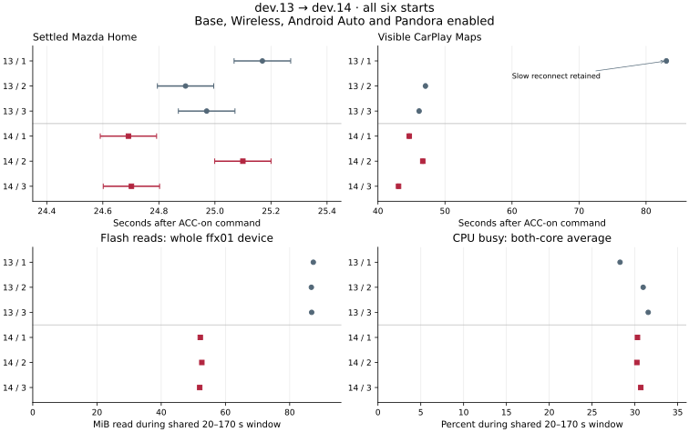

# Base startup tuning — dev.14

Three starts per version moved median visible Maps from **47.09 to 44.67 seconds**
after ACC-on, and settled Mazda Home from **24.97 to 24.70 seconds**. Median flash
reads in the shared resource window fell from **86.85 to 52.17 MiB**. CPU busy's
median was **0.67 percentage points lower**, with overlapping run ranges.

Open Connect's own allocated tmpfs increased by **12 KiB**. Most of the roughly
57 MiB higher free RAM was explained by a smaller file cache; this does not
establish a 57 MiB reduction in application memory. The no-overhead target in
[#9](https://github.com/aeharding/open-connect/issues/9) and long-parked CarPlay
work in [#8](https://github.com/aeharding/open-connect/issues/8) remain open.

## All timed starts

All six attempts completed video, UART and resource retrieval, with **1,036 sample
rows**. Acquisition order was all three dev.13 controls, upgrade/setup, then all
three dev.14 starts. The first control's slow reconnect remains in the table.
The smaller sample and blocked order limit causal and drift conclusions.

| Version / run | Home bounds (s) | Maps bounds (s) | CPU busy (%) | Min MemFree (MiB) | ffx01 reads (MiB) |
| --- | --- | --- | --- | --- | --- |
| dev13 / 1 | 25.068–25.270 | 82.927–83.129 | 28.27 | 217.87 | 87.36 |
| dev13 / 2 | 24.795–24.996 | 46.985–47.186 | 30.97 | 215.74 | 86.76 |
| dev13 / 3 | 24.870–25.072 | 46.042–46.244 | 31.56 | 215.79 | 86.85 |
| dev14 / 1 | 24.591–24.792 | 44.568–44.769 | 30.30 | 272.98 | 52.17 |
| dev14 / 2 | 24.999–25.200 | 46.585–46.787 | 30.23 | 272.69 | 52.65 |
| dev14 / 3 | 24.602–24.803 | 42.970–43.171 | 30.69 | 273.19 | 51.98 |

Home's median midpoint difference was **−0.268 s**, with differences of the
median frame endpoints **−0.470..−0.067 s**. Maps' corresponding difference was
**−2.417 s**, bounded by **−2.618..−2.216 s**. These are frame brackets, not
confidence intervals. Individual Maps midpoint ranges overlap: dev.13
**46.14–83.03 s**, dev.14 **43.07–46.69 s**. Relay and sensor latency are uncalibrated.

The first control started CarPlay control at native 63.811 s, recorded two
successful-connect events, and reached `SessionActiveCP` at 80.963 s. Other
control sessions were 45.085 and 43.994 s; dev.14 sessions were 42.365, 44.684 and
41.282 s. Native UART timestamps stay separate from camera/ACC command time.
They do not measure accepted input or audio readiness. Use UART events only
when both the Linux-banner and native boot-marker counts equal one; buffering
and dropped lines still apply.

One earlier preflight requested the initial Pandora-off fixture while Android
Auto was also off. The unchanged capture guard refused Android Auto off **before
any camera/UART/relay opened**. Both integrations were then enabled and retained
for every timed run. This refusal is the untimed row in
[attempts.csv](assets/performance/base-startup-tuning/attempts.csv); setup is not
silently relabeled as a matched trial.

## RAM, CPU and storage

The table below uses the median of each run's last sample inside **20–170 s**.
Each column is a metric's median, rather than one shared physical sample.

| Metric (MiB) | dev.13 | dev.14 | Difference |
| --- | --- | --- | --- |
| MemFree | 218.117 | 275.074 | +56.957 |
| Cached | 204.902 | 147.816 | -57.086 |
| AnonPages | 225.746 | 226.270 | +0.523 |
| Shmem | 5.570 | 4.125 | -1.445 |
| Slab | 18.738 | 18.758 | +0.020 |

Minimum MemFree's median rose **57.18 MiB**. Ending MemFree and Cached moved in
opposite directions by roughly 57 MiB. AnonPages and Slab were similar; Shmem
varied between runs. Keep these categories separate when assessing footprint.

Two postflight snapshots, at kernel uptime **281.59 s** and **278.17 s**, counted
regular-file allocations under `/tmp/open-connect` once per device/inode,
including hardlinked session files only once:

| Own RAM component (KiB) | dev.13 | dev.14 |
| --- | --- | --- |
| Unique allocated tmpfs files | 436 | 448 |
| Listener private / PSS | 72 / 84 | 72 / 84 |
| Ignition private / PSS | 132 / 153 | 132 / 153 |

The three extra 4 KiB allocations are `defer-gap2.sh`, the larger `firmware.sh`
and the inline-logging selected `index.html`. The common firmware helper is also
present with Base off. The diagnostic Base-off/Wireless-off snapshot is included
in [own-ram.csv](assets/performance/base-startup-tuning/own-ram.csv); it has no
matched dev.13 Base-off snapshot and is not a Base-off RAM-parity result.

On November 23, the owner [explicitly accepted this candidate's RAM cost](https://github.com/aeharding/open-connect/pull/128#issuecomment-7103096499):
+12 KiB allocated tmpfs, including +4 KiB with Base off. This approval applies to
dev.14; it does not waive the general no-unapproved-RAM rule or close #9.

The combined CPU median moved **30.97% → 30.30%**. The observed ranges were
**28.27–31.56%** and **30.23–30.69%**. CPU0's median moved **39.99% → 38.70%**;
CPU1 was nearly unchanged at **22.03% → 22.06%**. The later 60–170 s split is a
post-hoc diagnostic in the CSV, not another predeclared benchmark.

`ffx01` is the whole flash device; its partition rows overlap and must not be
summed with it. Its lower read volume is a **complete-preset observation**:
read-ahead, logging and service scheduling changed together, so these starts
do not isolate each component's contribution.

In 20–170 s, `ffx01p4` read **1,880 sectors (0.918 MiB) in every run**, but
completed read requests were **65/63/63** for dev.13 and **227/205/215** for
dev.14. The median rose **63 → 215 (3.4×)**, with smaller average requests.
Unchanged volume does not establish unchanged application latency; latency was
not measured here.

In the later 60–170 s interval, p4 read **56/56/56 sectors** for dev.13 and
**48/56/48** for dev.14. Writes ranged **16–72 sectors** and **16–80**, respectively.
The later window showed no large read-volume increase in this small settled
workload. It does not qualify arbitrary sequential I/O or every vehicle workload.

## Build and live checks

- Control: **0.3.0-dev.13**, [main 24d3931](https://github.com/aeharding/open-connect/tree/24d393145a6a3bd5c66003fb8ef730d30cffb7da).
- Candidate: **0.3.0-dev.14**, [1e4a26c](https://github.com/aeharding/open-connect/tree/1e4a26c4cbcee3f1383d4a418819716a5927a73f),
  exact [CI 45157300285](https://github.com/aeharding/open-connect/actions/runs/45157300285)
  USB ZIP SHA256 `9e20038e167d24cac542ba2fc31cf3f928ea16db21f167903a939c59e05c6913`.
  All 43 public members matched the installed package; `INSTANCE` was its sole
  private added member. [Source review](https://github.com/aeharding/open-connect/pull/128#issuecomment-7098236266)
  approved that revision; CI passed 322 tests with one skip.

The maintained dev.13→dev.14 upgrade retained choices and the original stock-five-field
baseline. Base-on read-ahead was 4 KiB, all 79 observed VBS/system threads allowed
both cores, and live Opera reported Warn logging with both Open Connect modules
loaded. The new gate released six services after about twelve seconds;
update, favorites, diagnostics, USB, navigation and JVM services were ready.
Mazda SM consumes/unlinks the ready flag after worker exit, as observed in UART.
Its absence afterwards is normal.

A fresh Base-off/Wireless-off kernel restored read-ahead to **128 KiB**, stock
VBS/system CPU masks, browser **Info** logging and the four original service
choices. The new gate/script was absent. Real Open Connect Settings opened over
15555; the updated Base dialog was captured and Cancel preserved the record.
The temporary timing hook was independently undone to the original inode.

Compatible dev.13 media independently removed dev.14 through its real Uninstall
button after the Base-off sanity check. The first selection followed an expired
five-minute media session and started no removal; its unchanged saved state and
underlying Mazda screen were reconciled before reopening the session. The
reopened selection completed removal and restart once.

The fresh stock kernel passed original OEM hashes/modes, original UIA/MMUI
mappings, stock Opera/SM startup, restored service states, absent touch NVRAM
override, read-only root, read-ahead 128 KiB and absence of installed Open Connect
state, runtime and root helper. The timing hook's original inode/mode was restored
before that restart, and the inactive measurement files were removed afterwards.
This is the manual SD bench route, not a new physical USB-insertion test.

The compatible dev.13 purge and actual OEM logger-constructor replays also
passed offline for both Base/disclaimer states. The selected logging override
is inline after the stock script URL, so logging has no new private persistent
asset to disappear during purge.

## Reproduce

Use the same **74.00.324A NA/cmu150_NA** unit, supply/peripherals and feature
preset: **Allow/Skip, Base=1, Wireless=1, Android Auto=1, Pandora=1, UART=0, SSH=0**.
A separate already-authenticated lab SSH connection performs retrieval. The
nearby iPhone stays USB-connected to the Mac with Wi-Fi/Bluetooth on and dark
foreground Maps. There is no route playing, hardware TAU or licensed navigation
card on this bench. B+ stays supplied; each ACC-off interval is thirty seconds.
This is an ACC-off/kernel-start comparison, not an overnight B+ cold boot or a
reproduction of Miatafy's published timings.

Use the existing [stage-1 observer installation and clock procedure](startup-comparison.md#source-pins-and-reproduction),
with frozen capture revision
[`95f1eae`](https://github.com/aeharding/open-connect/tree/95f1eae00007e59fe5700a2ef08fd8107aa15bde)
and analysis revision
[`802dfcf`](https://github.com/aeharding/open-connect/tree/802dfcf95057785019bc1607c365886bffe849b0).
Keep those checkouts separate from the release build. The collector runs 180 s
with a 190 s watchdog; camera/UART begin before ACC, video continues 210 s and
retrieval begins at 225 s. Never start primary logging after SSH connects.

With that capture checkout on `PYTHONPATH` and `OC_WORKSPACE` pointing to it:

~~~sh
python -m open_connect.startup_reference --live --host my-cmu \
  --ssh-config /path/to/trusted-ssh-config --condition open-connect \
  --package INSTALLED_PRIVATE_PACKAGE_DIGEST --base 1 --wireless 1 --pandora 1 \
  --bundle runs/my-cohort/trial-1 --label 'Base/Wireless/AA/Pandora on; dark Maps'
~~~

After each capture closes, use the same-boot `clock_reference` command from the
existing procedure, preserving its bounded exchanges. Three unchanged starts
per version are followed by separate setup/UI checks. Keep every failure or
miss with the attempt that produced it.

Home requires three icons at their final positions, gradient-registration
correlation above 0.95, sustained over three frames. Maps requires the sidebar
and roads around the central position marker, sustained in the next two frames.
Blank central tiles and one-frame partial maps fail. A sidebar/luma proxy only
locates candidate frames. Feed adjacent **video PTS values** to
`startup_annotate --projection maps`, then run `startup_analysis` and
`startup_wireless` from the frozen analysis checkout.

The first resource samples were at kernel uptime **9.83–10.90 s**;
CPU/RAM before those samples is unobserved. Use samples with start ≥20 s and
end ≤170 s; the CSV retains actual endpoints. CPU busy is `100 × (total_delta − idle_delta − iowait_delta) / total_delta`
using the first eight `/proc/stat` counters. RAM fields come from each sample's
`/proc/meminfo`; per-run minimum and last values are explicit. Storage differences
use the first and last in-window `/proc/diskstats` rows, with 512-byte sectors.
Analysis reparses the saved fetch output and verifies the trace, memory CSV,
clock exchanges and annotation arithmetic. Capture verifies the transmitted
BOOT_TRACE_SHA digest, preserving the [capture/export distinction](wireless-startup-speed.md#reproduce).

The first control's supplementary SM/selector capture used different labels
and lacks an embedded boot-ID receipt. Its rows are explicitly marked
`manual_capture_no_embedded_boot_receipt`; later supplements have same-boot
verification. This does not change that run's independently verified camera,
clock and resource trace. Do not silently upgrade the historical receipt.

Download [timings](assets/performance/base-startup-tuning/timings.csv),
[attempts](assets/performance/base-startup-tuning/attempts.csv),
[resource summaries](assets/performance/base-startup-tuning/summary.csv),
[all 1,036 samples](assets/performance/base-startup-tuning/samples.csv),
[CPU windows](assets/performance/base-startup-tuning/cpu-windows.csv),
[storage deltas](assets/performance/base-startup-tuning/io.csv),
[storage windows](assets/performance/base-startup-tuning/io-windows.csv),
[own-RAM snapshots](assets/performance/base-startup-tuning/own-ram.csv),
[selector phases](assets/performance/base-startup-tuning/selector-phases.csv),
[native services](assets/performance/base-startup-tuning/native-services.csv) and
[native wireless events](assets/performance/base-startup-tuning/native-wireless.csv).
Raw captures, phone locations, credentials and OEM files stay private.

These starts do not qualify physical touch/commander acceptance, CAN, reverse,
audio, an Android phone, licensed navigation or long-parked reliability. The
complete preset changed several mechanisms together; it is not a component
ablation or universal zero-feature-loss claim.
