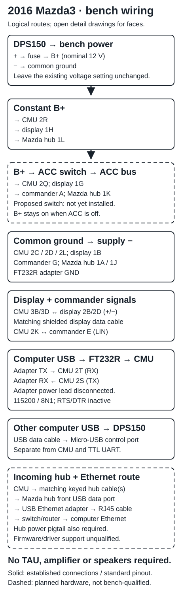

# Build a Mazda Connect test bench

This guide covers **2014–2016 Mazda3 / first-generation Mazda Connect**: CMU,
matching display, commander and Mazda media hub. Use mating pigtails and the
matching shielded data cables. A regulated 12 V supply, fused wiring, common ground
and a USB-to-TTL UART adapter complete a silent UI bench. **TAU, amplifier,
speakers, GPS antenna and a navigation SD card are optional.**

The development bench has working CMU/display, **FT232R UART** and **FNIRSI
DPS150 USB serial control**. The ACC switch is a proposed addition; the incoming
AliExpress CarPlay hub/harness and Ethernet adapter are not yet qualified.
Our software baseline remains **55.00.750B NA**. Physical connector compatibility
is not proof of firmware or network support.

## 1. Power, display and commander

Disconnect power before assembling a new harness. Use a fuse near supply positive,
sized for the wiring and load. **Leave the existing DPS150 voltage setting unchanged.**
The table describes the intended harness, including the proposed ACC branch.

Open or zoom the original, printable connector drawings:
**[CMU power + UART](assets/bench-wiring/cmu-power-uart.svg)** ·
**[Display + commander](assets/bench-wiring/display-commander.svg)** ·
**[Hub power + USB](assets/bench-wiring/usb.svg)**.

Each drawing labels **module/socket face** and **mating-plug face**, viewed into
the contacts with the indicated latch at the top. The plug face is mirrored;
the wire-entry view is not the plug face. Mazda's [viewing convention][views]
explains why its *harness-side* drawings have the same left-to-right order as
the module socket. Pin names below are Mazda terminal labels, not wire colors.

| Source | Destination | Purpose |
| --- | --- | --- |
| Fused supply **+** (B+) | CMU **2R**; display **1H**; stock hub **1L** | Constant supply into each module |
| Fused B+ → **ACC switch** → ACC bus | CMU **2Q**; display **1G**; commander **A**; stock hub **1K** | Switched supply into each module |
| Supply **−** / common ground | CMU **2C, 2D, 2L**; display **1B**; commander **G**; stock hub **1A, 1J**; UART **GND** | Common return/reference |
| CMU **2K** ↔ commander **E** | One LIN wire | Commander communication; neither UART nor CAN |
| CMU display connector **3B / 3D** ↔ display **2B / 2D** | Matching shielded display cable, + to + and − to − | Image to display; touch/status back to CMU |

Keep B+ present when ACC is switched off; switching the supply output removes
both and is a hard power cut. The display needs **both** its power plug and its
data cable. Commander **B** (TNS/lighting) and **H** (illumination return) can
remain isolated for an unlit bench; C, D and F are unused. Leave the CMU's CAN,
TAU/RS485 and unrelated AV connections unconnected for this silent setup.

Sources: Mazda3 [training manual][training], sections 09-33, 09-83, 09-89 and
09-93 (terminal functions); Mazda3 service drawings for [display power][display-power],
[display data][display-data], [commander LIN][commander] and [CMU ACC][acc].
The hub face is cross-checked against Mazda's [2016 MX-5 shared hub connector
0920-206A][hub-face], PDF page 2; it is **not an aftermarket internal pinout**.
Use the hub's matching 12-way pigtail intact on a standard retrofit.

## 2. UART and supply control are separate USB links

| Source | Destination |
| --- | --- |
| Computer USB | FT232R adapter USB socket |
| CMU **2S — TX output** | Adapter **RX / RXD input** |
| Adapter **TX / TXD output** | CMU **2T — RX input** |
| Adapter **GND** | Common supply/CMU ground |
| Computer's other USB connection | DPS150 **Micro-USB communication socket**, using a data cable |

Use **3.3 V TTL signals**, **115200 baud, 8N1**, no flow control, **RTS/DTR
inactive**. Leave the adapter's **VCC/5V/3V3 power lead disconnected**, and do
not connect RTS, CTS or DTR. FT232R names the chip; verify the adapter's actual
I/O voltage, not just its power-output label. TX and RX cross by function.
Mazda's service tables leave the console pins unnamed; their UART functions
come from the [CMU hardware research][hardware] and working bench communication.
The chip supports configurable I/O levels: [FTDI FT232R datasheet][ftdi].

The **[DPS150 connector drawing](assets/bench-wiring/dps150.svg)** separates its
Micro-USB control port, USB-C/DC power **inputs**, and +/− bench **outputs**.
This host link is already working; it does not route through the Mazda hub or
TTL adapter. See FNIRSI's [PC connection instructions][fnirsi-control] and
[power-input information][fnirsi-power].

## 3. Mazda hub and USB Ethernet

The **[USB drawing](assets/bench-wiring/usb.svg)** shows two alternatives:

| Hub | CMU → hub connection |
| --- | --- |
| Original 2014–2016 hub | Original keyed cable: CMU **4A → 2A** ground, **4B ↔ 2B** D+, **4C → 2C** USB power, **4D ↔ 2D** D−. Retain the 12-way power/AUX plug. |
| Common CarPlay retrofit hub | Supplied **gray/green → black** cable and **gray/blue → brown** cable, each into its matching keyed socket; retain the 12-way power/AUX plug. Isolate the superseded original USB cable at both ends. |

The stock mapping is from Mazda3 [B1252:87][usb-data] and [B1252:09][usb-power].
The retrofit route is Mazda's **C922 V6 605**, [connection diagram, Common-4][retrofit].
Those colors identify **cable-end housings**, not conductor order. The incoming
AliExpress kit is expected to follow this common layout; use its matching molded
keys and supplied cables. Do not transfer stock 4A–4D numbering to its second
link or splice USB conductors from a color guess. The separate power plug still
needs B+, ACC and ground; USB cables do not replace it.

For networking: **CMU → Mazda hub → front USB data port → USB Ethernet adapter
→ RJ45 patch cable → network switch/router → computer Ethernet**. An optional
computer-side USB Ethernet adapter belongs on the computer's USB bus. Neither
adapter is a USB cable between two hosts. Use assembled USB/RJ45 cables.

The ordered adapter still needs driver qualification. Mazda requires compatible
firmware **before** fitting the CarPlay hub; v55 is not a verified CarPlay-hub
configuration. Ethernet link, IP configuration and SSH service are separate
checks; UART works without them.

## 4. First serial connection

Install the host tools as described in [development setup](development.md).
Enumerate the UART adapter rather than copying another bench's device name:

~~~sh
python -m serial.tools.list_ports -v
# Replace UART_PORT with the enumerated FT232R port:
python -m serial.tools.miniterm --rts 0 --dtr 0 --eol CR UART_PORT 115200
~~~

Only one program owns UART. Exit miniterm with **Ctrl+]** before using
[CLI operations](cli.md). Readable boot logs confirm the receive path; a shell
also depends on firmware/access state. A black display with readable logs points
first to the display's power and data connections. For silent Entertainment tests,
use the [bench profile](cli.md), which does not require a physical TAU or speakers.

[views]: https://mazda3.neocities.org/esicont/srvc/html/id000000800400
[training]: https://www.scribd.com/document/796872875/New-Model-Mazda3-Bm
[display-power]: https://mazda3.neocities.org/esicont/srvc/html/id0902n7103400
[display-data]: https://mazda3.neocities.org/esicont/srvc/html/id0902n7103500
[commander]: https://mazda3.neocities.org/esicont/srvc/html/id0902n7103100
[acc]: https://mazda3.neocities.org/esicont/srvc/html/id0902n7106800
[hub-face]: https://www.mx5manual.com/assets/service_manuals/en_us/2016/MX5/pdf/0920_2b.pdf
[hardware]: https://github.com/silverchris/mazda-cmu-documentation/blob/gh-pages/hardware.md#connectors
[ftdi]: https://ftdichip.com/wp-content/uploads/2020/08/DS_FT232R.pdf
[usb-data]: https://mazda3.neocities.org/esicont/srvc/html/id0902n7105300
[usb-power]: https://mazda3.neocities.org/esicont/srvc/html/id0902n7105100
[retrofit]: https://mazdaparts.org/content/MAZDA3SCREENMIRRORC922V6605.pdf
[fnirsi-control]: https://www.fnirsi.com/pages/software-downloads
[fnirsi-power]: https://www.fnirsi.com/products/dps-150
