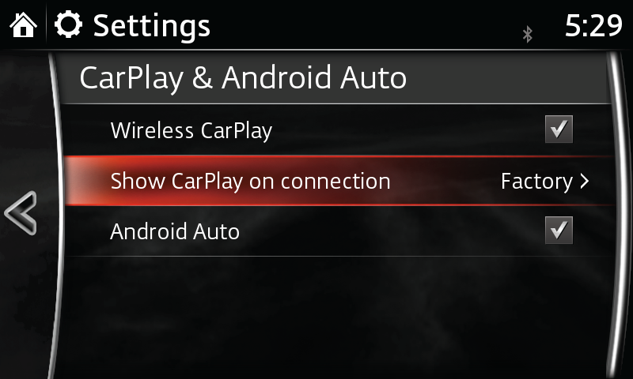

# Show CarPlay on connection

Open CarPlay when your iPhone connects, including after startup and reconnection.

<dl class="oc-spec">
  

    <dt>Menu</dt>
    <dd>Open Connect → CarPlay &amp; Android Auto</dd>
  

  

    <dt>Default</dt>
    <dd>Factory</dd>
  

  

    <dt>Impact</dt>
    <dd>Not measured separately</dd>
  

  

    <dt>Applies</dt>
    <dd>Next full startup</dd>
  

</dl>

<figure class="oc-screen">
  

  <figcaption>Show CarPlay on connection highlighted (dev.19), showing the Factory default.</figcaption>
</figure>

## Notes

CarPlay may replace your current screen when your phone connects. Active input, phone calls, voice control, Settings and maintenance dialogs take priority, and Mazda keeps screen and reverse-camera control.

Not measured separately in startup or memory benchmarks (see <a href="performance.md">Performance evidence</a>). Wireless bench checks worked from Mazda’s main screen and Navigation; one intermittent miss occurred with Startup optimizations on, and wired auto-selection, live call/Siri/reverse interactions and real-car driving remain unqualified on <strong>0.3.0-dev.24</strong> (<strong>74.00.324A NA</strong>).

Choices save automatically and apply on the <strong>next full Mazda Connect startup</strong>. Use <a href="apply-changes.md">Apply changes</a> to restart right away.

## Options

| Choice | List label | Behavior |
| --- | --- | --- |
| **Factory behavior** | Factory | Uses Mazda’s original screen-selection behavior. |
| **Automatically show** | Auto | Requests CarPlay when your iPhone connects. |

Select **Automatically show**, confirm **Enable**, then restart Mazda Connect (or wait for the next full startup). Select **Factory behavior** and restart to restore Mazda’s original behavior. Updates keep your choice.

This supports wired CarPlay and an already configured wireless connection. Use [Wireless CarPlay](wireless-carplay.md) to enable wireless availability.

You can return to Mazda Connect at any time. Open Connect makes at most one request per connection (expiring after 15 seconds) so it won’t repeatedly pull you back into CarPlay.

[Back to Settings](settings.md)
