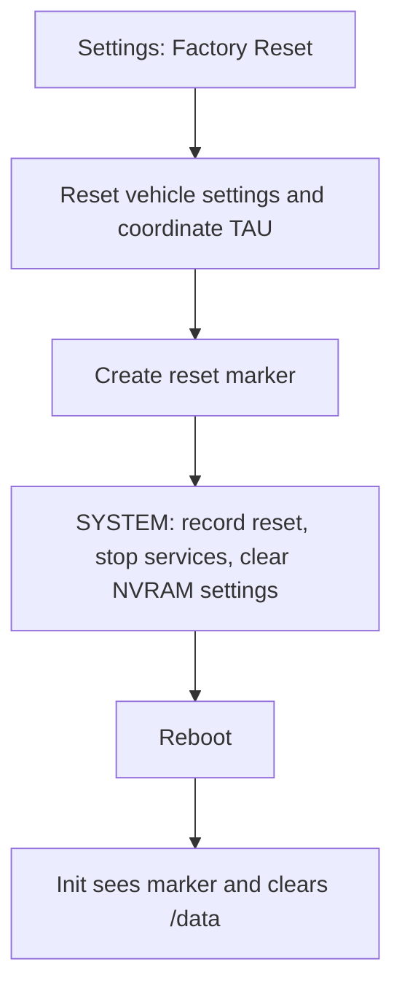

# What Mazda Factory Reset changes

**Factory Reset is a settings reset, not a firmware reinstall or an Open Connect
uninstall.** The inspected path clears user data and resets native settings.
It does not restore modified system files to their original bytes.

**Evidence:** offline analysis of North American **74.00.324A**. We have not
performed a complete Factory Reset on the supported firmware.

## The reset path

This shows the successful path. Vehicle-settings errors can stop it before the
marker is created. Calling the reset script directly would skip that coordination.

| Location | What the inspected code establishes |
| --- | --- |
| `/data` | Init checks `perform_factory_reset`, then runs deletion of `/data/*`. |
| NVRAM `nv-config` | The factory-reset branch clears and commits this block. |
| `/data_persist` | Separate from `/data`; SYSTEM stores a factory-reset counter here. This is **not** proof that every file survives every service's reset handling. |
| System files | No original-file restoration appears in this path. A surviving hook could lose the settings or files it expects. |

In v74, SYSTEM increments `/data_persist/factoryResetNum.txt` before requesting
the reboot. It is a useful reset-detection lead, **not proof that the reset
completed** or that the counter survives an interrupted write.

## Open Connect's proposed behavior

Keep the installation, clear its preferences and start with optional features
disabled. Keep **Uninstall** as the explicit action that restores pre-install
files. This is a proposal, not implemented behavior.

The bootstrap must tolerate missing state without loading optional features.
A retained installation must not silently recreate a previously enabled
selection after Mazda clears its settings.

**Next check:** trace remaining service-specific deletions, then exercise the
real Settings reset with known disposable state and independent recovery.
The bench lacks a TAU, so a partial reset must not be reported as the full
vehicle flow. Track this in [#56](https://github.com/aeharding/open-connect/issues/56).

## Source anchors

The [74.00.324A package](wireless-carplay.md#firmware-source) contains:

- `libjciuiasyssettings.so`: `UIA_SYSSETTINGS_SetAllToFactoryDefaults`
  delegates to the Settings reset group.
- `svcjciblmsettings.so`: `BLM_Settings_FactoryResetTAU` at `0xdcbcc`
  checks vehicle-reset status, creates the marker and requests SYSTEM reset.
- `svcjciblmsystem.so`: `factoryReset` at `0x9ed80`, reset-counter writer
  at `0x86928`, and `SYSTEM_SMCM_ResetBoardThread` at `0x1288f4`.
- `init_cmu`: `cb_jci_check_factory_reset` at `0xa438`.

Addresses are analysis references for this exact package, not patch instructions.
Private source hashes and slices: `runs/firmware74-research/boundary-result.json`.
