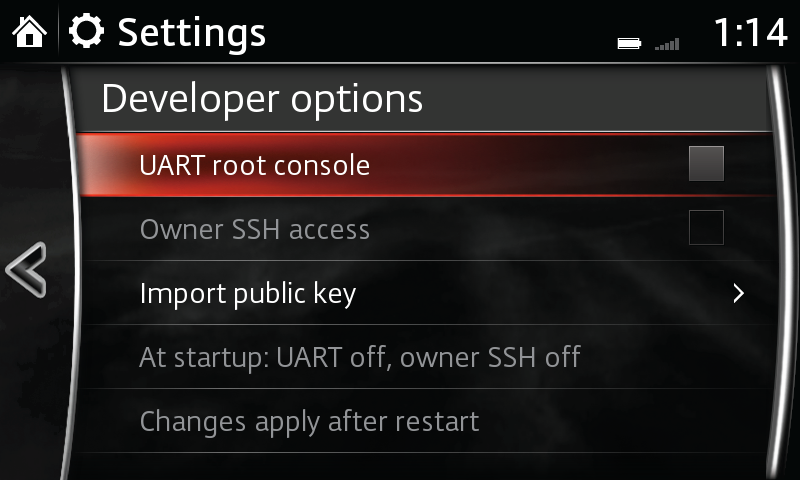
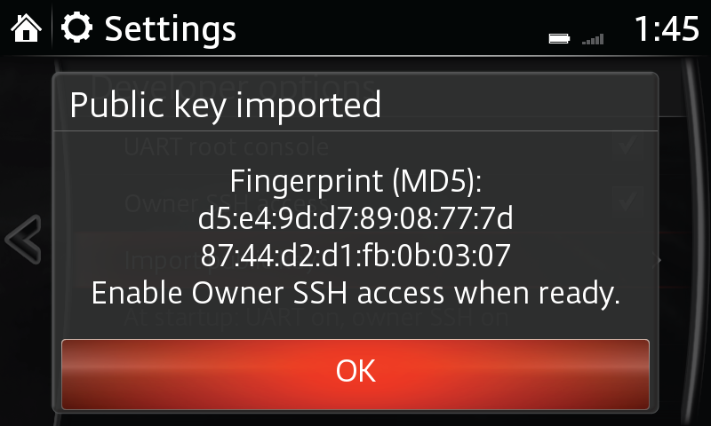

# Developer options

Implemented in the **74.00.324A NA** development candidate. It is not available
in the historical v55 download. See [Quick start](usb-installer.md) for
qualification and availability; a qualified v74 download is not published yet.

Open **Mazda Settings → System → Open Connect → Developer options**.
Both owner-access options start **off**. Checkboxes show your saved choices;
the **At startup** row shows the choices applied at startup. Changes take effect
after a full Mazda Connect restart, including disabling access.

<figure class="oc-screen">
  <div class="oc-screen-frame"></div>
  <figcaption>Fresh installations leave both access options off.</figcaption>
</figure>

## UART root console

**UART root console** provides passwordless root access over the serial connection.
Confirm **Enable**, then restart.
Use 115200 baud, 8 data bits, no parity, 1 stop bit and no flow control.

<figure class="oc-screen">
  <div class="oc-screen-frame"></div>
  <figcaption>Confirm Enable, then restart Mazda Connect.</figcaption>
</figure>

Turning it off restores the original authenticated login behavior. It does not
change passwords or turn off diagnostic output. The checkbox does not set a
password.

## Owner SSH access

Import your own public key, enable **Owner SSH access**, then restart. This uses
Mazda's existing SSH server on port **36000** and preserves its existing key
authorization. Turning it off removes the Open Connect key's authorization after
restart; any access configured before installing Open Connect is preserved.

SSH also needs a working network connection to the CMU. Enabling this option
does not configure Wi-Fi. Use the CMU's address on your connected network and
the account name **cmu**.

### Import a public key

The supported firmware accepts ECDSA keys and RSA keys of at least 2048 bits.
Its old SSH server does not support Ed25519. ECDSA avoids the legacy RSA
signature settings that some modern SSH clients require.

For example, create a dedicated key on your computer:

```sh
ssh-keygen -t ecdsa -b 256 -f ~/.ssh/open-connect
```

Keep `~/.ssh/open-connect` on your computer. Copy only
`~/.ssh/open-connect.pub` to the root of a FAT32 USB drive, naming the copy
**open-connect.pub**. Insert the drive, choose **Import public key**, then
confirm **Import**. The confirmation displays the imported key's MD5 fingerprint.
Compare all 16 pairs, across both lines, with the public key on your computer:

<figure class="oc-screen">
  <div class="oc-screen-frame"></div>
  <figcaption>Verify the fingerprint against the key on your computer.</figcaption>
</figure>

```sh
ssh-keygen -E md5 -l -f ~/.ssh/open-connect.pub
```

Import replaces the previously imported Open Connect key. It leaves Mazda's
keys intact and keeps the SSH checkbox's current selection. Use one drive with
one public key; key options, private keys and files containing multiple keys
are refused. After enabling access and restarting, connect with:

```sh
ssh -p 36000 -i ~/.ssh/open-connect cmu@CMU_ADDRESS
```

## Uninstall and recovery

Normal [Uninstall](uninstall.md) restores the saved login and SSH configuration
and removes imported keys with the rest of Open Connect. It refuses conflicting
later edits. USB maintenance remains available independently of developer access.
Neither option is required for normal installation or removal.
