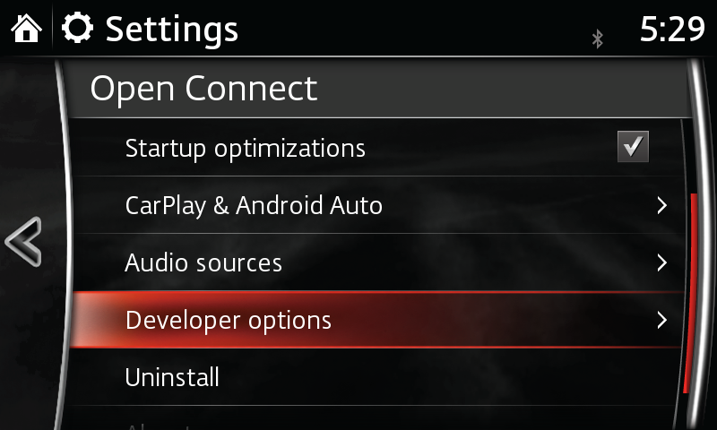
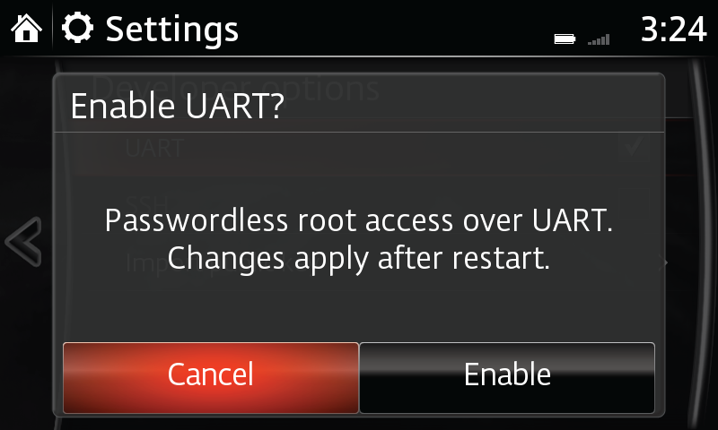

# Developer options

Use direct SSH or UART access to the head unit for your own purposes. Neither is needed for normal installation, settings or removal.

<dl class="oc-spec">
  <div>
    <dt>Menu</dt>
    <dd><span class="oc-nav-path" data-walkthrough="developer-options">Open Connect</span></dd>
  </div>
  <div>
    <dt>Default</dt>
    <dd><span class="oc-default oc-default--off">UART/SSH Off</span></dd>
  </div>
  <div>
    <dt>Impact</dt>
    <dd>Enabled: unmeasured</dd>
  </div>
  <div>
    <dt>Applies</dt>
    <dd>Next full startup</dd>
  </div>
</dl>

<figure class="oc-screen">
  <div class="oc-screen-frame"></div>
  <figcaption>Developer options highlighted (dev.19).</figcaption>
</figure>

## Notes

<p>Both UART and SSH are <span class="oc-default oc-default--off">Off</span> by default, with no Open Connect public key imported. Turning SSH on can start an SSH daemon; neither toggle has an isolated startup or memory benchmark (see <a href="performance.md">Performance evidence</a>).</p>

<p>UART enables a passwordless root serial shell; SSH authorizes your imported public key. Choices save automatically and apply on the <strong>next full Mazda Connect startup</strong> (use <a href="apply-changes.md">Apply changes</a> to restart right away). <strong>0.3.0-dev.27</strong> is a development prerelease for <strong>74.00.324A NA</strong>; real-car qualification remains pending.</p>

Restore any changes you make to head-unit storage before installing, upgrading or uninstalling Open Connect. Leaving storage modified can cause maintenance to stop rather than overwrite unexpected files. If you cannot return it cleanly to stock, reinstall Mazda firmware **74.00.324 NA N** first.

## UART

Requires physical access to the back of the infotainment unit (a wired serial connection to the rear harness connector) — intended for developers and troubleshooting, not normal use.

Enables **passwordless root shell access** over the CMU’s physical serial port (`115200` baud, `8N1`, no flow control). Turning it off restores Mazda’s original authenticated serial login without changing passwords or suppressing diagnostic output.

Connect a **3.3 V TTL USB-to-UART adapter** to the CMU’s blue connector 2:

- **2S (CMU TX) → adapter RX**
- **2T (CMU RX) → adapter TX**
- **2C, 2D, or 2L (CMU GND) → adapter GND**
- Leave the adapter’s VCC and handshake lines disconnected.

See [Wire a bench — pin maps](bench-setup.md#pin-maps) and [UART cables](bench-setup.md#cables) for full diagrams.

<figure class="oc-screen">
  <div class="oc-screen-frame"></div>
  <figcaption>Enabling UART explicitly confirms passwordless root serial access.</figcaption>
</figure>

## SSH

Authorizes your imported public key on Mazda’s built-in SSH server (port **36000**, account `cmu`) while leaving any pre-existing SSH keys untouched. Turning SSH off removes Open Connect’s key authorization on the next full restart.

SSH requires a network path to the CMU — enabling it does not configure Wi-Fi. Plug a supported **USB-to-Ethernet adapter** into one of the car’s USB ports on the same network as your computer (see [network cables](bench-setup.md#cables)). When **SSH** is enabled, Open Connect also performs a bounded background DHCP retry on `eth1` if Mazda’s initial boot DHCP attempt finishes before your USB-Ethernet link is ready (preserving Mazda’s fallback `192.168.42.1` address if no DHCP server responds).

### Import a public key

Mazda’s SSH server supports **ECDSA** and **RSA (2048-bit or larger)** keys — it does not support Ed25519. ECDSA avoids legacy RSA signature options on modern SSH clients:

```sh
ssh-keygen -t ecdsa -b 256 -f ~/.ssh/open-connect
```

1. Keep the private key (`~/.ssh/open-connect`) on your computer.
2. Copy **only** `~/.ssh/open-connect.pub` to the root of a single FAT32 USB drive and rename it to **`open-connect.pub`**.
3. Insert only that USB drive, select **Import public key**, and confirm **Import**.
4. Verify all 16 MD5 fingerprint pairs shown on screen against your computer:

```sh
ssh-keygen -E md5 -l -f ~/.ssh/open-connect.pub
```

<figure class="oc-screen">
  <div class="oc-screen-frame"></div>
  <figcaption>Compare the complete MD5 fingerprint with your local public key before connecting.</figcaption>
</figure>

After enabling **SSH** and restarting, connect with:

```sh
ssh -p 36000 -i ~/.ssh/open-connect cmu@CMU_ADDRESS
```

Importing a new key replaces only the previously imported Open Connect key; private keys, key options, and multi-key files are rejected.

## Uninstall and recovery

Normal [Uninstall](uninstall.md) restores your saved login and SSH configuration and removes imported keys along with the rest of Open Connect. USB maintenance always stays independent of developer access.

[Back to Settings](settings.md)
