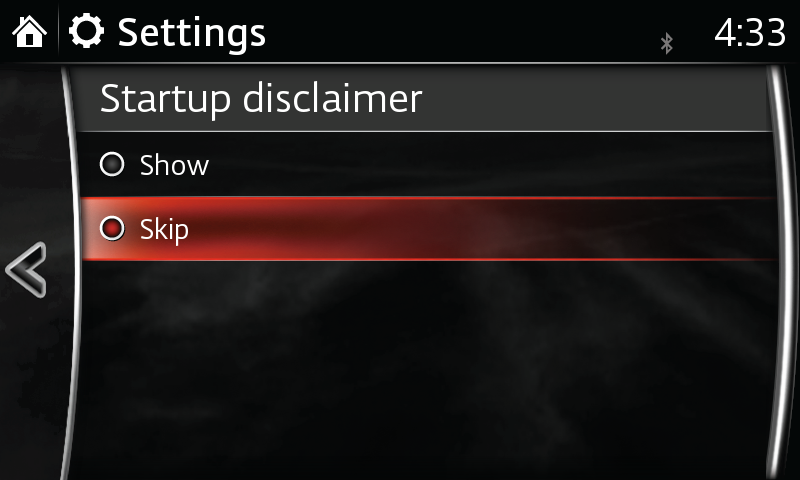

# Startup disclaimer

  <strong>Menu:</strong> Mazda Settings → System → Open Connect → Startup disclaimer
  <strong>Default:</strong> Skip
  <strong>Takes effect:</strong> Next full restart

## Why it exists

Every time Mazda Connect boots, it stops on a legal disclaimer screen until you tap **Agree** or wait out the timeout.

**Startup disclaimer** skips that warning cleanly inside Mazda’s own startup flow — preserving your normal resume screen (Home, audio, display-off, or Fuel Economy Monitor) and keeping Mazda’s frontend initialization and cleanup intact.

## Choices

| Choice | What it does |
| --- | --- |
| **Skip** · *default* | Skips the startup warning and goes straight to your normal screen. A brief fade or black frame may still appear during boot. |
| **Show** | Keeps Mazda’s original startup warning screen. |

<figure class="oc-screen">
  

  <figcaption>Skip bypasses the legal screen automatically on every boot.</figcaption>
</figure>

> **Qualification note:** Targets exact `74.00.324A NA`. Bench startup, resume routes, and stock restoration are verified; real-car validation is still ahead. See [Quick start](usb-installer.md) for current release status.

[Back to Settings →](settings.md) · [Install Open Connect →](usb-installer.md)
