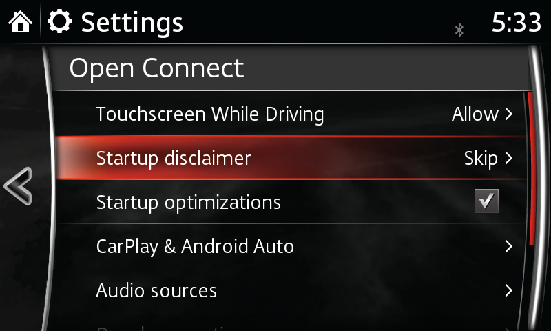

# Startup disclaimer

Skip Mazda’s startup warning and continue to your usual screen.

**Mazda Settings → System → Open Connect → Startup disclaimer**

<figure class="oc-screen">
  

  <figcaption>Startup disclaimer highlighted (dev.19).</figcaption>
</figure>

- **Default**: Skip.
- **Startup & RAM impact**: **Neutral** — no isolated startup or RAM measurement is established.
- **Trade-offs & boot implications**: The startup warning is skipped; the screen may briefly go black. Mazda’s normal resume behavior remains, including audio, display-off and Fuel Economy Monitor.
- **Applies**: Saved automatically; takes effect on the **next full Mazda Connect startup**. See [restart guidance](settings.md#apply-changes).
- **Evidence & limits**: Startup and restoration have bench checks. [Performance evidence](performance.md) does not isolate this setting. Dev.19 UI bench captures on **74.00.324A NA**; real-car qualification and matched dev.19 benchmarks remain pending. No public download yet.

## Options

| Choice | Behavior |
| --- | --- |
| **Skip** | Bypasses the startup warning. |
| **Show** | Displays Mazda’s original warning. |

Select **Show** to bring the warning back after the next full startup.

[Back to Settings](settings.md)
