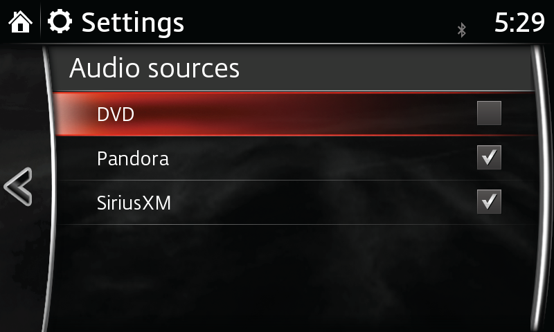

# DVD

Control in-dash DVD video support.

**Mazda Settings → System → Open Connect → Audio sources → DVD**

<figure class="oc-screen">
  

  <figcaption>DVD highlighted (dev.19).</figcaption>
</figure>

- **Default**: Off.
- **Startup & RAM impact**: **Neutral** — no isolated startup or free-RAM gain is established.
- **Trade-offs & boot implications**: Turning it off hides DVD from Mazda’s **Sources** list and stops DVD video support. Audio CDs and CarPlay still work.
- **Applies**: Saved automatically; takes effect on the **next full Mazda Connect startup**. See [restart guidance](settings.md#apply-changes).
- **Evidence & limits**: [Performance evidence](performance.md) has no isolated DVD comparison. Equipped DVD playback remains unqualified. Dev.19 UI bench captures on **74.00.324A NA**; real-car qualification and matched dev.19 benchmarks remain pending. No public download yet.

## Change the setting

Leave **DVD** off if you do not use in-dash DVD video. Turn it on and confirm **Enable** to restore support after a full restart.

Enabled sources retain Mazda’s hardware, connection and availability requirements. This choice is independent of [Startup optimizations](startup-optimizations.md).

[Back to Settings](settings.md)
