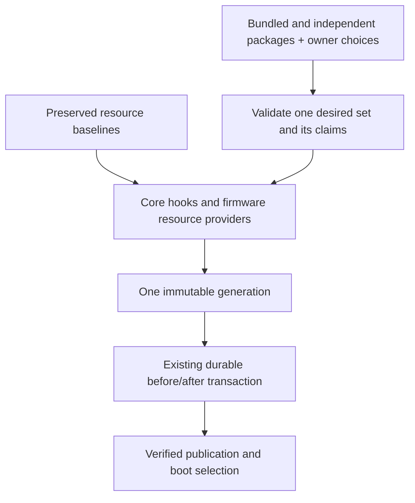

# Restoration and plugin architecture

**Research proposal for 74.00.324A NA; no plugin API is implemented.** The
current installer has a useful restoration foundation, but its built-in features
share specialized code and cannot yet be installed as independent plugins.
A marketplace would require a package contract, compatibility and trust model
in addition to a loader.

The proposed direction is **one core-owned integration point per hook, with
registrations owned by plugins**, plus typed operations for configuration and
persistent state. Keep the existing transaction and preserved originals. This
proposal does not change the [delivery order](https://github.com/aeharding/open-connect/blob/main/PLAN.md)
or authorize a framework implementation.

## What restoration means today

Uninstall returns affected resources to their **pre-install state**, not factory
defaults. A saved absent touchscreen key differs from an explicit value. Existing
SSH authorization must survive. “Factory Default” currently selects that saved
touchscreen value; it need not be the value on a newly manufactured CMU.

The backend already provides a serialized writer, immutable inputs and snapshots,
one durable before/after record, stale-request checks and recovery that preserves
unknown later edits. Access configuration is regenerated from the saved baseline.
The normal UI uninstall trial independently matched 19 intake hashes and metadata,
the original login inode, stock native mappings and frontend startup, with physical
root read-only. This is bounded single-unit evidence, not proof of every power-loss
boundary. See [the actual CI identities and limits](reverse-engineering.md#developer-access-and-login-script-lifetime-on-v74).

| Operation | Current meaning |
| --- | --- |
| Preference off | Select saved original behavior while retaining Open Connect and its settings. Imported access keys may remain available for re-enabling. |
| Failed-start fallback | Omit the optional disclaimer route and restore the saved touch value. The early display consumer observes that value on the following boot. Access is not revoked by this fallback. |
| Reinstall | Keep the original baseline and preferences, validate current targets and dependencies, then publish a verified package. |
| Uninstall | Restore owned targets, verify and flush restoration, then purge product state and remove its record last. Restart retires loaded code. |

The maintainability limit is coupling: snapshot fields, API values, target checks,
boot paths and UI code know individual feature names. There is no independently
removable package unit. Every new feature should not need another special branch
through each layer. The transaction and resource-lifetime design (originating in
[transaction.sh](https://github.com/aeharding/open-connect/blob/84471d2/cmu/installer/transaction.sh)
and [access.sh](https://github.com/aeharding/open-connect/blob/84471d2/cmu/installer/access.sh),
now implemented in native C under `cmu/installer/core/oc-txn.c` and `oc-access.c`)
is worth retaining while reducing that coupling.

## Hooks instead of independent wrappers

Each firmware adapter would install its hook once. The core owns the original
Mazda call, required cleanup and a table of selected registrations. Removing A
builds the table from the surviving registrations; B never holds A's callback as
its restoration handle. Initially, a changed table takes effect after restart.

A host experiment using the current Settings `replace()` helper illustrates the
problem with independent wrappers. Registering A then B called `B, A, Mazda`.
Undoing A left that chain intact because B owned the current callback. Undoing B
then exposed A again. The helper protects another writer, but does not provide
arbitrary-order plugin removal. This is a synthetic host result, not a CMU trial.
[Current helper and cleanup](https://github.com/aeharding/open-connect/blob/84471d2/cmu/installer/settings.js#L17-L23)

A hook needs explicit semantics, rather than a universal priority number:

| Hook type | Proposed combination rule |
| --- | --- |
| Named collection, such as Settings entries | Combine distinct stable IDs; reject conflicting duplicate IDs. The core preserves Mazda's callbacks and positional assumptions. |
| Observation | Notify multiple subscribers without granting a veto over Mazda's call. In-process code still shares its host's latency and crash risks. |
| Decision or replacement | Accept one behavior-changing owner unless a specific, tested combiner exists. Ordering two competing replacements does not make them compatible. |
| State consumed elsewhere or earlier | Use a typed resource provider with the correct timing, verification and undo. A late JavaScript hook cannot undo an earlier NVRAM or service-policy change. |

This has useful prior art. [Harmony](https://harmony.pardeike.net/v3/articles/basics.html#unpatching)
removes owned registrations and rebuilds from the original method and remaining
patches. Its managed runtime is not available on the CMU. [Tapable](https://github.com/webpack/tapable#hook-types)
distinguishes notification, first-result and transformation hooks. [Linux ftrace](https://docs.kernel.org/5.18/trace/ftrace-uses.html)
defines callback retirement and restricts instruction-pointer-changing owners.
These are design precedents, not libraries we propose installing on Mazda.

## Shared files and conflicts

A resource provider is the sole physical writer. Plugins declare contributions
to canonical resources or named slots; the provider defines combination rules,
read dependencies, metadata, validation and lifetime. It can publish a complete
file while assigning ownership at a smaller granularity. [Debian's shared-configuration policy](https://www.debian.org/doc/debian-policy/ch-files.html#sharing-configuration-files)
uses one owner and a shared modifier. [Kubernetes field ownership](https://kubernetes.io/docs/reference/using-api/server-side-apply/#merge-strategy)
shows why keyed collections and indivisible resources need different rules.

Capture a resource's valid as-found bytes, absence, metadata and required identity
at its first acquisition. A later plugin sharing that resource reuses its existing
baseline. A newly acquired resource gets its own recorded provenance. Upgrades
must carry those baselines forward.

Remove A by generating **baseline + surviving contributions**, not by restoring
A's backup over B. Preserve untouched bytes and comments where the provider
promises a lossless edit. Reject ambiguous input. For example, the core frontend
route and disclaimer native route alter different entries in both service-manager
profiles. One provider can generate each profile with both contributions, then
omit only the disclaimer route on removal. Preserve the actual board decision.

Disjoint text or byte ranges are insufficient evidence of compatibility. A second
host experiment merged two individually valid JSON changes without a Git conflict,
yet produced a route pointing at a renamed service. Validate the resulting
consumer relationships. Native edits can also share layout, ABI or scratch-space
dependencies. Keep opaque binaries and behavior replacements exclusive until a
provider qualifies a finer-grained contract. Filesystem overlays alone hide a
lower file rather than combining its fields.

## External mods and removal authority

Cooperating plugins can use this contract. Arbitrary root scripts can change
undeclared files or external state, so they cannot receive a universal undo
guarantee. A checksum establishes content integrity, not publisher trust or
confinement of native code, renderer JavaScript or root shell scripts.

The current uninstall requires the complete dependency list to match. This can
block restoration after an external edit to a file Open Connect only reads.
Separate evidence needed to **activate** a feature from evidence needed to
**release its owned changes**. This is a proposed improvement, not a current
exception to the installer's guards.

| Observation | Proposed treatment |
| --- | --- |
| A removed plugin's activation-only dependency changed | Allow removal only if restoration inputs, owned targets and surviving configuration verify. Leave the changed dependency untouched. Qualify this per provider. |
| Firmware or an input needed for restoration changed | Refuse; retain originals and a compatible recovery path. Never replay old offsets or bytes into another firmware. |
| A managed target has an external edit | Initially refuse the requested transition before writes. Report the resource and preserve the edit. Any future semantic import needs separate ownership and recovery tests. |
| An OEM source used for a private shadow changed | Refuse stale activation too: a private copy can hide the owner's edit without overwriting the source. |

Recheck publication preconditions under the lock. The record does not make
multiple files plus NVRAM atomically visible to arbitrary running consumers.
Select complete generations before consumption or require restart. A third state
found during recovery remains preserved, including evidence of any targets already
changed. Automatic merging of unmanaged edits is a separate promise.

## Lifetime, upgrades and recovery

Keep one authoritative record pointing to the baseline, committed generation and
precise before/after generations while prepared. Immutable manifests may describe
package versions, options and claims without becoming competing operation records.
Distinguish requested, committed and startup-selected state from independently
observed behavior.

A migration must preserve selections and existing baselines, validate the entire
surviving set, and keep the old reader and inputs until retirement. Finish a pending
old transaction with its recorded semantics before migrating. Removal must work
from verified local evidence even if the original plugin distribution disappears.
Do not require a downloaded uninstaller. Removing a provider with active dependents
needs an explicit combined plan; arbitrary removal order applies to independent
plugins, not missing prerequisites.

Loaded native mappings, callback tables, open login scripts and authorized-key
references have lifetimes beyond a pathname replacement. Retain required holds
and generations until their readers retire. The original login needs its
same-filesystem hardlink even for a read-only remount. Claim restored running
behavior only after restart and independent checks. Keep the existing finite boot
budget; a ready screen must not erase protection against later faults. The current
fallback's treatment of developer access must remain explicit.

The 44.434-second prepared maintenance recovery does not establish that a larger
plugin set fits the current 25-second startup wrapper. Measure both boot and
180/185-second service/client paths, RAM and storage as part of any migration.

## Bounded Services groundwork

The dev.10 Services slice replaces positional active preferences with named keys,
a static packaged service catalog and one final SM composer. Android Auto and
Pandora choices reach the backend and Settings through that catalog; composing
both off and then restoring Android Auto yields the same profile as a clean
Pandora-only selection. Missing or conflicting claims refuse before preparation.
These reduce feature-specific branches while preserving the existing transaction,
originals and independent Uninstall.

This is one product package. It does not admit or independently remove external
packages, define publisher trust, or satisfy the independent-package acceptance
below. Keep those requirements open under
[#117](https://github.com/aeharding/open-connect/issues/117).

## Dogfooding before marketplace work

Use **built-in plugins** once our separately packaged features use the same
admission, options, conflicts, removal and recovery contract as an independent
package. Renaming today's feature directories alone would not achieve that.
[VS Code's bundled JSON manifest](https://github.com/microsoft/vscode/blob/main/extensions/json/package.json)
uses a [public contribution point](https://code.visualstudio.com/api/references/contribution-points#contributes.languages),
a concrete precedent for testing the same extension surface internally.

| Existing feature | Contribution through the proposed contract | Mechanics retained in reviewed providers |
| --- | --- | --- |
| Touchscreen | Radio entry and a typed claim on the display restriction setting | Exact display compatibility, absent/enable/disable state, commit/readback and early-reader timing |
| Disclaimer | Radio entry and paired native continuation/renderer contributions | Exact native layout, both service profiles, mandatory Mazda cleanup and boot-long loaded lifetime |
| Developer access | Default-off controls, public-key import and selected access claims | Login inode hold, metadata, SSH parser/config validation and preserved existing authorization |

A bounded first slice would add one core Settings registration point and one
resource provider, then convert our features with UI/uninstall parity. A separate
offline package must add a new named entry without its ID being compiled into the
core or renderer. Repackage one of our own definitions independently and exercise
the same lifecycle. A private list of hard-coded built-ins fails that proof.

Before calling that slice complete, require:

- **Composition:** independent A/B contributions installed in either order yield
  identical outputs and behavior. `AB → B` equals clean B-only, and vice versa.
- **Conflict refusal:** duplicate keys, competing decisions, semantic dependencies
  and layout-dependent binary edits fail before publication with useful reasons.
- **Removal and lifetime:** no removed wrapper reappears; surviving callbacks and
  Mazda's continuation run correctly after the selected restart boundary.
- **External edits:** preserve unknown targets and distinguish retired activation
  dependencies from necessary restoration inputs. Exercise edits after prepare.
- **Upgrade and interruption:** retain B and owner options across A's schema change;
  recover each publication/purge boundary without blind UI retries. Lost package
  distribution must not prevent removal.
- **Last removal:** restore acquired resources to their saved values, including
  absence and existing authorization. Whole-product Uninstall additionally removes
  the host, state, keys and holds and verifies stock loaded code and read-only root.

Package admission, executable capabilities, publisher trust and distribution remain
product decisions. Bounded declarations over supported hooks are a proposed first
scope; a public native/JavaScript ABI needs a separately specified trust and
lifetime contract. No catalog or marketplace implementation is proposed for the
current release. Private research and both host examples are recorded under
`runs/plugin-architecture-20261120/research.md`; OEM inputs remain private.
