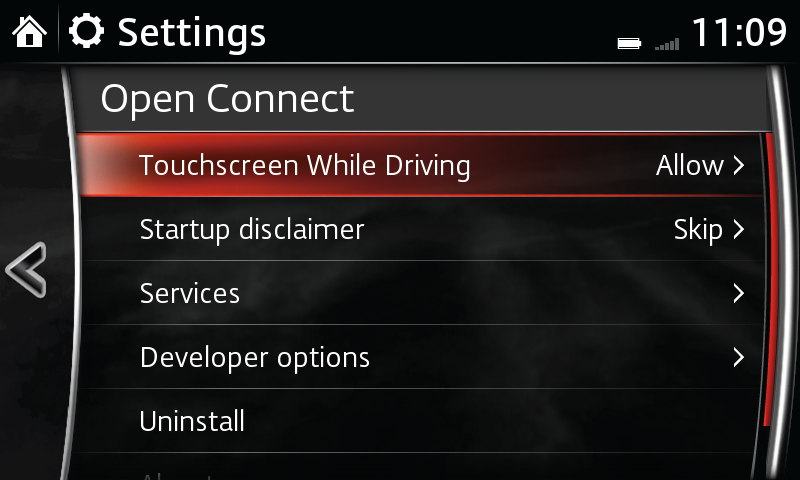

# Features

Every Open Connect feature is optional and lives inside **Mazda Settings → System → Open Connect**. Nothing replaces Mazda’s interface or physical commander controls — pick only the improvements you want and leave the rest at factory behavior.

<figure class="oc-screen">
  

  <figcaption>All features are configured natively inside Mazda Settings → System → Open Connect.</figcaption>
</figure>

## Everyday driving & connectivity

  <a class="oc-feature-card" href="../touchscreen/">
    

      Touchscreen While Driving
      Default: Allow
    

    
Removes Mazda’s low-speed touchscreen lockout so passengers can still use touch controls while moving.

  </a>

  <a class="oc-feature-card" href="../disclaimer/">
    

      Startup disclaimer
      Default: Skip
    

    
Skips the mandatory startup legal notice and lands straight on your normal screen.

  </a>

  <a class="oc-feature-card" href="../wireless-carplay/">
    

      Wireless CarPlay
      Default: Off
    

    
Unlocks Mazda’s native wireless CarPlay setup without spoofing vehicle or GPS identity.

  </a>

  <a class="oc-feature-card" href="../services/">
    

      Services &amp; optimizations
      Base: Off
    

    
Trim verbose logging, dead regional services, and unused integrations to reduce startup contention and memory use.

  </a>

## Advanced & maintenance

  <a class="oc-feature-card" href="../developer-options/">
    

      Developer options
      Default: Off
    

    
Enable passwordless UART serial access or key-based SSH over a USB-to-Ethernet adapter for bench work and diagnostics.

  </a>

  <a class="oc-feature-card" href="../uninstall/">
    

      Uninstall
      Built in
    

    
Restore your saved pre-install configuration and remove Open Connect completely from Settings or USB.

  </a>

