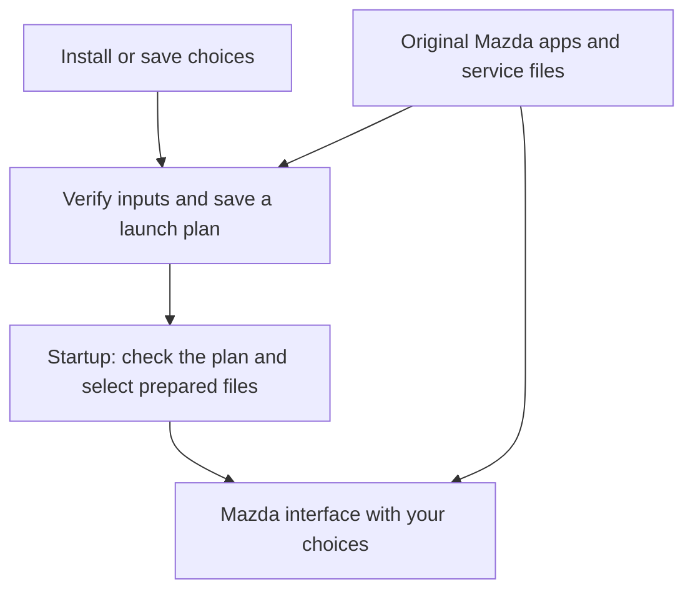
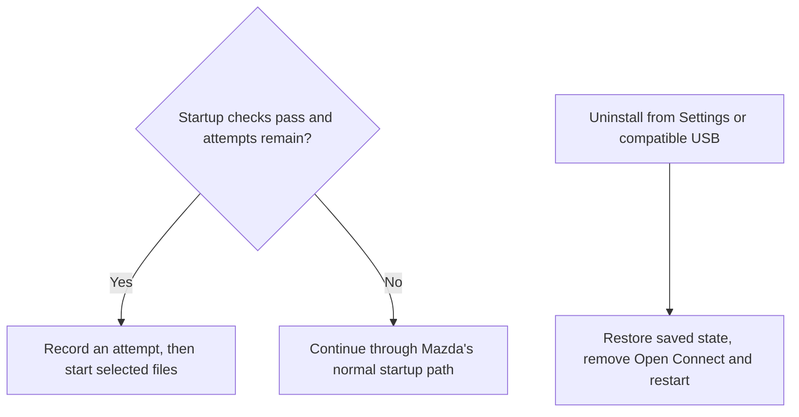
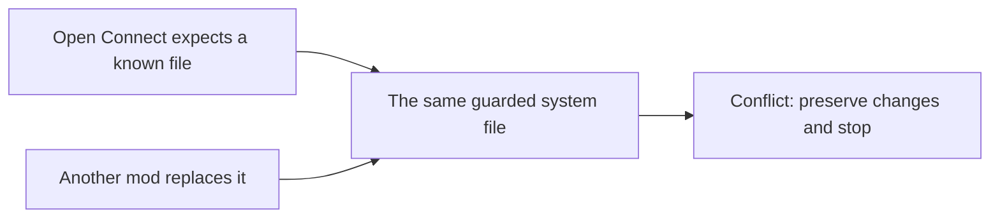

# How Open Connect works

Open Connect keeps Mazda's interface and saves your choices. At startup, it
selects prepared files, keeping only the necessary temporary copies in RAM.

## Original files, selected copies

The Mazda app and service originals stay on storage. Open Connect also adds a
helper and modifies the startup entry, plus any requested touchscreen or access
settings. Their pre-install state is recorded for [Uninstall](uninstall.md).
System storage returns to read-only after owned file changes are saved.

## A bounded startup fallback

A three-attempt allowance limits repeated restarts without an ignition renewal.
A sustained ignition-off period followed by a full system start renews it. Normal use
isn't limited to three starts.

Fallback leaves Open Connect installed. Uninstall restores the files and settings
Open Connect changed to their saved pre-install state, including removing its
added files. It preserves unrelated Mazda preferences; it isn't a factory reset.

## Prepare ahead of startup

Installation and Settings saves perform full verification and prepare the launch
files. Normal startup uses a small compiled selector: it checks the saved plan
and file details, and verifies selected bytes. Some prepared files are used
directly from Open Connect's private storage; the rest are copied to RAM. Changed
inputs take a full-check or fallback path. The selector can work alongside
Mazda's existing startup preparation, and must finish before the selected apps
start.

The recorded selector span was **0.56 seconds in one dev.9 bench start**. Timing
varies, and approximately zero added delay versus stock remains a target. See
[the timings, RAM and qualification limits](startup-overhead.md#native-selector-pilot-dev9).

## Shared files need shared rules

Direct edits to guarded files can block installation, updates or removal.
Open Connect preserves unknown changes instead of overwriting them. See
[existing modifications](installer-development.md#existing-modifications).

The [plugin architecture proposal](extension-architecture.md) would give built-in
features and third-party additions one way to compose changes and check overlaps
before activation. That system is being researched; a plugin marketplace isn't
available yet. Follow [#117](https://github.com/aeharding/open-connect/issues/117).

Ready to use it? Start with [Quick start](usb-installer.md), then
[Settings](settings.md).
