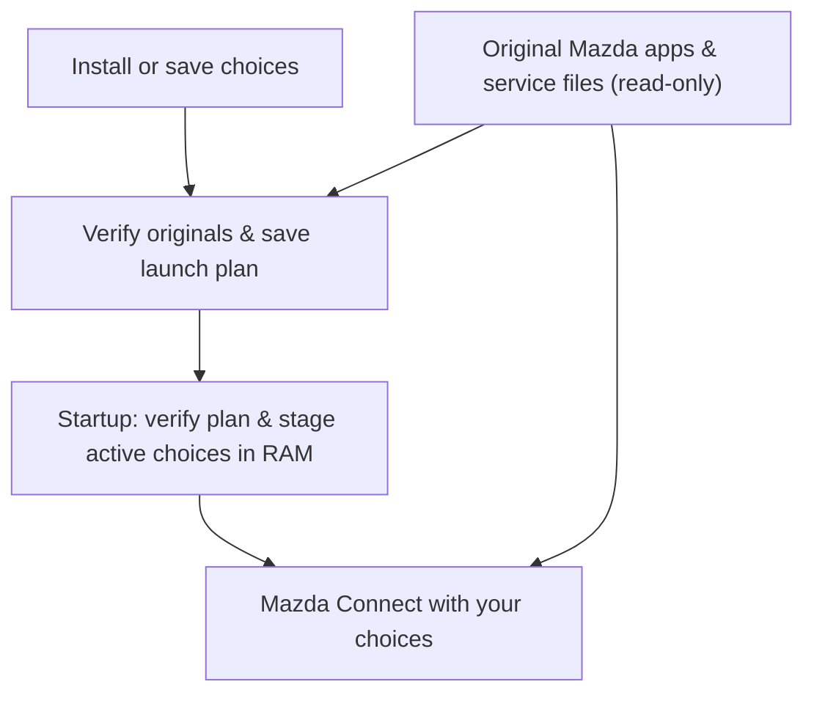
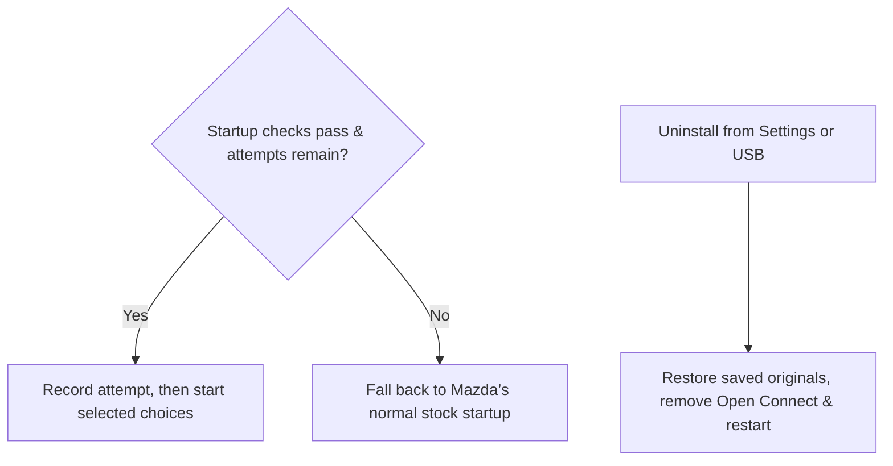
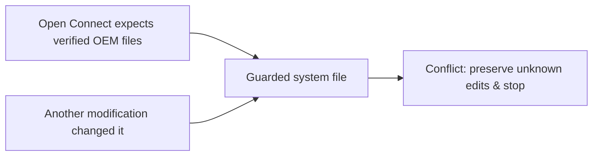

# How Open Connect works

Open Connect keeps Mazda’s original interface and system files intact. At startup, a small native selector checks your saved preferences and stages only the temporary files needed for your active choices in RAM.

## Original files stay untouched

Mazda’s stock app, voice, and service binaries remain intact on storage. Open Connect records the exact pre-install state of the few entry points it touches (startup hook, touchscreen NVRAM, and optional access config), then immediately returns system storage to **read-only**.

## Automatic startup safety fallback

A bounded **three-attempt** counter protects against boot loops:

- Every normal start that follows a sustained ignition-off shutdown renews the allowance automatically, so everyday driving is never limited to three starts.
- If repeated unexpected restarts exhaust the allowance, Open Connect steps aside and boots Mazda Connect completely stock — without erasing your settings.
- When you choose [Uninstall](uninstall.md), Open Connect restores every recorded pre-install file and setting, then deletes its own packages, backups, and state. Unrelated Mazda settings and pairings are left alone (it is as-found restoration, not a factory reset).

## Prepared ahead of time

Heavy verification and file composition happen when you install or save a setting — **not** on every boot. On a normal start, a small compiled native selector validates the sealed launch plan and stages only what your active settings require alongside Mazda’s own boot sequence.

Tracking and removing startup/memory overhead is an ongoing benchmark goal — see [Performance](performance.md) for current timings, RAM accounting, and open limits.

## Conflict protection with other mods

If another modification already edited a system file Open Connect relies on, installation, updates, and uninstall stop safely rather than overwriting unknown changes. See [existing modifications](installer-development.md#existing-modifications) and the [extension architecture research](extension-architecture.md) for how future modular composition is being explored ([#117](https://github.com/aeharding/open-connect/issues/117)).

Ready to try it? Head to [Quick start](usb-installer.md) or browse [Settings](settings.md).
