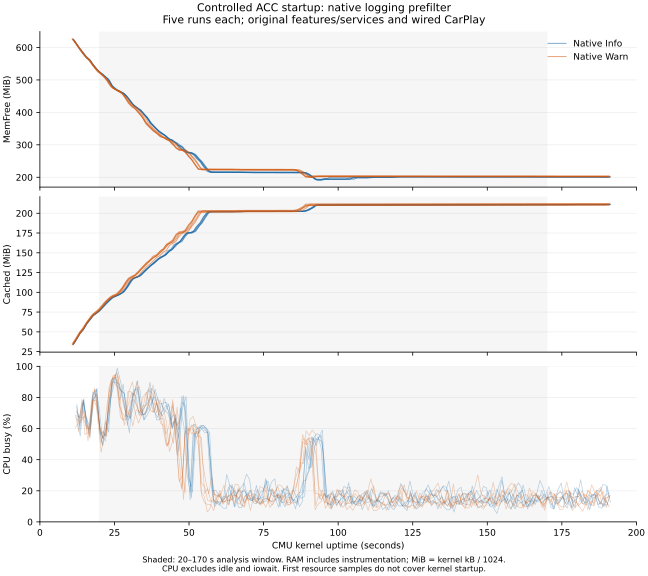

# Native logging comparison

The native Warn prefilter reached the **visible wired CarPlay dashboard about
3.2 seconds earlier** than the Info control on this bench. Minimum `MemFree` in
the matched startup window was about **8.7 MiB higher**; ending free RAM was only
about **1.4 MiB higher**. These five-run blocks support qualifying this narrow
change for the proposed Base optimizations setting. They do not measure an
installed optimization bundle, usable input, audio or native wireless CarPlay.

## Five starts per condition

All ten primary attempts completed, passed saved/applied policy and boot/trace
checks, and returned to the wired dashboard without startup input. No primary
attempt was excluded. Both conditions used original features and service choices.

| Native logging | Median Home bounds (s) | Median dashboard bounds (s) | Median CPU busy | Median minimum MemFree (MiB) |
| --- | --- | --- | --- | --- |
| Info | 25.59–25.80 | 47.78–47.99 | 29.60% | 191.99 |
| Warn | 25.05–25.26 | 44.60–44.82 | 27.06% | 200.69 |

These are medians of individual measurements, rounded outwards for timing bounds.
CPU/RAM use actual sample endpoints inside kernel uptime 20–170 seconds. Minimum
MemFree is not MemAvailable or a fixed allocation saved. The dashboard intervals
have roughly 0.2-second frame spacing; their median difference is about 3.18 seconds.
The nominal Home difference is about 0.54 seconds and is sensitive to where the
entrance animation ends within a frame. A one-frame shift in each condition can
move that difference by roughly 0.4 seconds. Visual Home/dashboard appearance does
not establish usable controls or audio readiness.

| Native logging / run | Home (s) | Dashboard (s) | CPU busy | Minimum MemFree (MiB) |
| --- | --- | --- | --- | --- |
| Info / 1 | 25.59–25.80 | 47.78–47.99 | 29.45% | 192.27 |
| Info / 2 | 25.40–25.61 | 47.39–47.60 | 29.43% | 191.91 |
| Info / 3 | 26.07–26.28 | 46.84–47.05 | 30.20% | 193.90 |
| Info / 4 | 25.59–25.80 | 47.98–48.19 | 30.22% | 191.99 |
| Info / 5 | 25.40–25.61 | 47.78–47.99 | 29.60% | 191.51 |
| Warn / 1 | 25.19–25.41 | 44.97–45.18 | 27.06% | 199.66 |
| Warn / 2 | 24.99–25.20 | 43.76–43.97 | 26.08% | 202.35 |
| Warn / 3 | 25.05–25.26 | 44.60–44.82 | 29.35% | 199.57 |
| Warn / 4 | 25.00–25.21 | 44.15–44.37 | 26.92% | 200.69 |
| Warn / 5 | 25.59–25.80 | 45.17–45.38 | 29.87% | 201.33 |

| Native logging | CPU busy range | Per-run minimum MemFree range (MiB) | Median ending MemFree (MiB) | Median ending Cached (MiB) |
| --- | --- | --- | --- | --- |
| Info | 29.43–30.22% | 191.51–193.90 | 201.07 | 210.92 |
| Warn | 26.08–29.87% | 199.57–202.35 | 202.46 | 210.57 |

Median minimum MemFree increased by 8.70 MiB; the median last-window value increased
by 1.39 MiB. The larger minimum difference describes reduced temporary pressure,
not 8.7 MiB permanently recovered. Cached memory also differs and observer output
is included. CPU median fell by about 2.54 percentage points; its ranges overlap,
so this is an observation rather than a general CPU-saving guarantee. Sequential
block order and one unit still limit attribution.



| Device / Native logging | Median sectors read (range) | Median sectors written (range) |
| --- | --- | --- |
| `ffx01` / Info | 204,104 (198,432–204,320) | 120 (120–232) |
| `ffx01` / Warn | 198,216 (193,824–203,784) | 120 (120–120) |
| `mmcblk0` / Info | 63,816 (63,814–63,818) | 200 (197–200) |
| `mmcblk0` / Warn | 63,819 (63,815–63,819) | 203 (181–207) |


I/O does not establish a general reduction: median writes on `ffx01` were
unchanged, and those on `mmcblk0` were slightly higher with Warn. Values are the
kernel's sector counters per device; do not add partitions to their parent.
The CSV retains SD endpoints separately. Direct emitted-log volume and per-logger
PSS were not measured, so the experiment does not assign the memory difference
to one buffer or process.

The 1,721 local samples begin at uptime 10.83–11.35 seconds and end at 190.00–191.25 s.
Earlier resource pressure remains unobserved. Separate warm-file and native getter
probes were mechanism checks, not primary timing attempts or excluded starts.

## What changes

This experiment tests a narrow native logging filter on exact **74.00.324A NA /
cmu150_NA**, with Open Connect absent and original service selections retained.
The unchanged temporary stage-1 observer supplies Mazda's global RAM setting
before starting the same finite resource collector. Both conditions use the same
hook; only its declared data choice changes from Info to Warn.

The physical `/config/common/log/settings.txt` stays at its original Info value.
The temporary `/tmp/common/log/settings.txt` contains exactly one line,
`COMMON_LOG_LEVEL=Info` or `COMMON_LOG_LEVEL=Warn`, followed by LF. No service is
stopped, relaunched or patched live. Each block starts after a separate unmeasured
setup restart; capture asserts the already-applied choice rather than changing it.

A separate mechanism check found 74 initialized native logging contexts at Warn,
seven earlier contexts still at Info and two uninitialized contexts. The peak
level remains Info. At the final Warn block-end read the split was 73 Warn,
eight initialized Info and two uninitialized; `L_settings` was the additional
Info context. The Info block-end read found all 81 initialized contexts at Info,
plus two uninitialized contexts. These full reads are block-end observations;
every primary start separately checks the initialized MMUI logger before and
after, rather than claiming an identical whole-system split in every boot.
This is a filter for those later contexts, not a switch that
turns off every diagnostic source or disables the logging service.

The warm-file check is a useful counterexample: adding the RAM file after startup
left all 83 existing contexts at Info. A fresh read-only native client reported
Info → Warn → Info → Info as the RAM override was added, changed and removed.
Changing configuration bytes alone does not establish that running services use
the new level. The primary pre/postflight checks read the actual initialized MMUI
logger state as well as the exact saved and RAM configuration bytes.

## Conditions and measurement

The declared order is five new Info starts followed by five new Warn starts.
Earlier stock controls and the unmeasured mechanism boot are excluded from this
comparison and retain their original identities. Sequential block order, drift
and one bench limit causal attribution.

Each start follows 30 seconds of ACC-off; the unchanged supply stays at 12.02 V.
This is controlled ACC shutdown/start, not a full supply-loss or overnight-car
experiment. The same wired iPhone, Ethernet and FAT SD remain connected, including
the same reference installer contents. Phone model and iOS were not recorded.
All original features and services, including Pandora, stay selected. No route,
audio or startup interaction is used. The idle CarPlay map uses its daytime
palette in both blocks; the earlier theme transition occurred during setup.

UART and video begin before ACC-off. The same identified camera records roughly
5 fps at manual exposure readback 105 and gain 32. Home is the completed entrance
animation with all five icons spaced out. Dashboard is the first complete visible
wired CarPlay dashboard, allowing its map and widgets to keep loading. Adjacent
decoded frames bound each event. ACC-on command and per-boot kernel origins remain
distinct; camera/display and relay latency are uncalibrated. These visual events
do not establish usable input, audio readiness or wireless CarPlay performance.

Collection starts locally from stage 1 and records system RAM, CPU, VM, disk and
network counters for 180 seconds, with a one-second minimum pause. SSH retrieves
the completed trace after 225 seconds and then measures that boot's clock offset.
No SSH or UI input runs during measured startup. Actual sample endpoints retain
the early unobserved interval; no whole-boot RAM peak is inferred.

CPU busy excludes idle and iowait. Summary CPU, RAM and per-device I/O use actual
sample endpoints inside kernel uptime 20–170 seconds. `MemFree`, `Cached`,
`Buffers`, `Shmem` and `Slab` remain separate counters; this kernel has no
`MemAvailable`. Observer output contributes to RAM and is not subtracted as
though its full overhead were known. Parent devices and partitions must not be
summed; an endpoint missing because a device appeared later has no inferred
full-window delta. The system collector does not directly measure emitted log
volume or each logger's PSS.

## Reproduce

Capture, policy assertions and annotation use immutable experiment source
[`173a839`](https://github.com/aeharding/open-connect/tree/173a839d3a0f225b1d32fb2ba34c74ffe3f172c2).
Read-only trace analysis, timing cross-checks and numeric export use
[`d15ecc8`](https://github.com/aeharding/open-connect/tree/d15ecc8dcf23a41c42c6659767b7804a7aec7497).
That later analysis revision does not relabel the captures or their manifests.
The capture revision's [setup and undo method](https://github.com/aeharding/open-connect/blob/173a839d3a0f225b1d32fb2ba34c74ffe3f172c2/cmu/bench/LOGGING-PREFILTER.md)
describes the temporary bench profile. This is playground instrumentation, not a
supported Base optimizations feature or an owner installation package.

```sh
python -m open_connect.startup_batch --live --host my-cmu \
  --condition stock --log-level Info --bundle runs/logging/logging-info
python -m open_connect.startup_batch --live --host my-cmu \
  --condition stock --log-level Warn --bundle runs/logging/logging-warn
python -m open_connect.startup_export runs/logging runs/logging-public --logging
python -m open_connect.startup_plot runs/logging-public/startup-samples.csv \
  runs/logging-public/startup-resources.svg
```

The assertion flag never selects the policy. Save the desired choice, complete
the separate setup restart and verify it before each block. Use `startup_frames`
to review adjacent video frames and `startup_annotate` to retain their bounds
before exporting. Run export from the later analysis checkout. It reparses raw
framing and saved traces, matches all seven clock exchanges to raw replies,
recalculates the clock intersection, checks annotation definitions/adjacent saved
ffprobe PTS and timing arithmetic, and rechecks both policy records. These
consistency checks do not replace visual milestone review or calibrate camera
latency. The public sample CSV alone reproduces the chart with Matplotlib 3.10.9.

Collector SHA256 is
`04ce5017e08a4e62823135eb6a560cefbc51289edda256ff5f2b1946b3d5a109`, unchanged
between conditions and earlier comparisons. The same new analysis reproduced the
four published Pandora CSVs and SVG byte for byte. OEM inputs, credentials, raw
video/UART captures, process-memory reads and personal map images remain private.


## Restoration

The independent controller restored the exact original stage-1 inode and the
previous data-profile hook/manifest. It removed the mode choice and preserved
backups only until their restoration was verified. A separate original ACC start
then restored loaded behavior: all 81 initialized native contexts were Info again,
with two uninitialized contexts also retaining Info defaults. The RAM override
and observer output were absent; the physical Info file, its inode/metadata and
read-only root matched the original.

Independent checks also matched all 19 intake originals and metadata, original
native/frontend mappings, the original login inode with one link, absent product
state/runtime and absent touch NVRAM. Wired CarPlay returned to the idle daytime
dashboard. The temporary restore helper was removed by its exact digest after
that proof; the pre-existing inactive bench profile and independent owner SSH
access remained as found. No logging change remains active. This is experiment
undo, not qualification of an installed Base optimizations option or a vehicle.

Private supporting records are `closure-stock.json`, `restored-native.json` and
`cleanup-profile-extra.out` under `runs/logging-prefilter-20261121/`. They are
provenance, not public downloads. The frozen capture source passed 142 host tests
and the later analysis passed 144, each with two explicit local skips. Host checks
do not establish physical input, audio, motion lockout or matching-car behavior.

Download [1,721 samples](assets/performance/logging/startup-samples.csv),
[10 run summaries](assets/performance/logging/startup-runs.csv),
[20 timing intervals](assets/performance/logging/startup-timings.csv) and
[200 per-device I/O records](assets/performance/logging/startup-io.csv).
