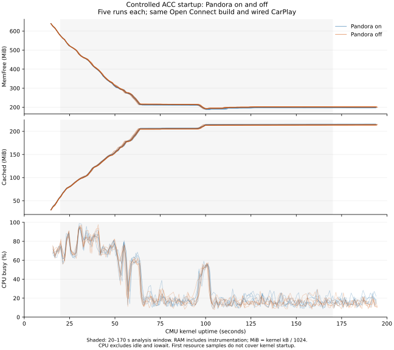

# Pandora startup and RAM comparison

Disabling Mazda's built-in Pandora integration produced about **3.2 MiB more
minimum free RAM** in the measured startup window on this bench. It did **not
resolve a faster wired CarPlay startup**. The optional Services control defaults
to on; these results support choosing whether to load an unused integration,
without a general speedup promise.

## Five starts per condition

All ten primary attempts completed, passed native service-state and per-boot
clock checks, and returned to the wired dashboard without startup input. The
same Open Connect build ran in both conditions. No primary attempt was excluded.

| Pandora | Median Home bounds (s) | Median dashboard bounds (s) | Median CPU busy | Median minimum MemFree (MiB) |
| --- | --- | --- | --- | --- |
| On | 31.62–31.83 | 54.44–54.65 | 34.15% | 189.92 |
| Off | 31.41–31.62 | 54.42–54.63 | 33.40% | 193.14 |

These are medians of each run's actual measurements. CPU/RAM use endpoints
inside uptime 20–170 s; minimum MemFree is computed over that same window.
MemFree is not MemAvailable. The dashboard median difference is about **0.02 s**,
far below the roughly 0.2-second camera spacing. The nominal Home difference is
about one frame and is sensitive to manual animation annotation: one enabled
run has a remaining one-frame ambiguity. Moving that bound one frame earlier
changes the enabled median Home interval to about 31.43–31.64 s. Neither visual
milestone demonstrates a useful startup gain here.

| Pandora / run | Home (s) | Dashboard (s) | CPU busy | Minimum MemFree (MiB) |
| --- | --- | --- | --- | --- |
| On / 1 | 31.62–31.83 | 54.82–55.03 | 32.87% | 187.32 |
| On / 2 | 31.24–31.45 | 54.44–54.65 | 34.15% | 189.91 |
| On / 3 | 31.43–31.64 | 54.42–54.63 | 32.95% | 190.56 |
| On / 4 | 31.64–31.85 | 54.84–55.05 | 34.42% | 189.92 |
| On / 5 | 31.63–31.84 | 54.42–54.63 | 34.48% | 190.45 |
| Off / 1 | 31.23–31.44 | 54.82–55.03 | 33.40% | 193.61 |
| Off / 2 | 31.41–31.62 | 54.60–54.81 | 32.84% | 193.30 |
| Off / 3 | 31.82–32.03 | 53.81–54.02 | 34.09% | 190.67 |
| Off / 4 | 31.21–31.43 | 54.41–54.62 | 33.78% | 192.72 |
| Off / 5 | 32.03–32.24 | 54.42–54.63 | 32.61% | 193.14 |

| Pandora | CPU busy range | Per-run minimum MemFree range (MiB) | Median ending MemFree (MiB) | Median ending Cached (MiB) |
| --- | --- | --- | --- | --- |
| On | 32.87–34.48% | 187.32–190.56 | 199.16 | 214.18 |
| Off | 32.61–34.09% | 190.67–193.61 | 202.15 | 213.41 |

Median minimum MemFree increased by about 3.23 MiB, with about 2.99 MiB more
free at the last matched-window sample. Cached memory also differs; these are
observed system counters, not a subtraction of Pandora's RSS or a universal
amount of memory recovered. CPU's median fell by about 0.75 percentage points,
but its run ranges overlap. Block order, drift and one bench limit attribution;
this does not establish a useful CPU improvement.



| Device / Pandora | Median sectors read (range) | Median sectors written (range) |
| --- | --- | --- |
| `ffx01` / On | 247,416 (235,904–249,728) | 240 (232–240) |
| `ffx01` / Off | 245,936 (245,760–248,248) | 240 (128–240) |
| `mmcblk0` / On | 63,823 (63,821–63,824) | 197 (196–205) |
| `mmcblk0` / Off | 63,821 (63,821–63,824) | 207 (205–207) |


I/O is reported per device in the kernel's sector counters, over the same
actual endpoints. It does not demonstrate a general reduction: median writes
on `ffx01` were unchanged, while `mmcblk0` writes were slightly higher with
Pandora off. The CSV also retains partitions and the SD's appeared endpoints;
those rows must not be summed into the parent devices.

The local traces begin at uptime 14.60–14.83 s and end at 193.74–194.81 s, with
1698 samples altogether. Earlier resource pressure remains unobserved.
A separate settled follow-up with Pandora off observed all 10 injected focus
changes, starting at uptime 320.42 s. This checks software navigation and does
not measure physical input latency, audio, motion lockout or an early-session
responsiveness improvement.

## Conditions and limits

These are ten new starts on the same **74.00.324A NA/cmu150_NA** bench and
Open Connect build: five with Pandora enabled, then five disabled. They do not
reuse or relabel the earlier stock controls. Each start follows 30 seconds of
ACC-off; the supply remains at 12.02 V and is never switched during this batch.
This is a controlled ACC shutdown/start, not a long-parked car or full supply-loss
experiment. Sequential block order and drift limit causal attribution.

Allow/Skip remain selected, product UART/SSH are off, and the same wired phone,
Ethernet and FAT SD stay connected. The exact 35-file reference installer and
five other retained SD folders are unchanged during both blocks. Each recording
starts on the idle CarPlay dashboard with map/Not Playing, without route or audio.
The phone model and iOS version were not recorded, limiting reproduction on other
phones. This does not reproduce Miatafy's wireless or usable-input milestones.

The normal Services checkbox, Disable/Enable confirmations, cancellation and
restart persistence were exercised separately. The enabled block was selected
through that UI. Between blocks, the same verified backend setting request
selected off without changing the foreground application; an unmeasured setup
restart applied it before the first disabled trial. No service was stopped or
restarted live during the primary trials. Pre/postflight checks require the saved
and applied choice to agree, verify native service autorun/state/PID and confirm
one Pandora start when enabled and none when disabled.

The identified camera records 1280×720 at roughly 5 fps, with manual exposure
readback 105 and gain 32. UART and video begin before ACC-off. Home is the
completed entrance animation with all five icons spaced out. Dashboard is the
first fully visible wired CarPlay dashboard; its map and widgets may still load.
Adjacent decoded frames bound each event. The tables use the host ACC-on command
as origin and round outwards; downloadable timings also retain per-boot kernel
bounds. Camera/display and relay latency remain uncalibrated. These visual
milestones establish neither usable physical input nor audio readiness.

The unchanged local stage-1 observer collects system RAM/CPU/VM/disk/network
counters for 180 seconds with a one-second minimum pause. SSH only retrieves the
completed trace after 225 seconds, then measures the boot's clock offset. No SSH
or UI input runs during measured startup. Actual sample spacing and the early
unobserved interval are retained in the data; there is no whole-boot RAM peak claim.
CPU busy excludes idle and iowait. CPU and separate-device I/O use actual sample
endpoints inside uptime 20–170 seconds. Minimum RAM in the summary uses that same
window. `MemFree`, `Cached`, `Buffers`, `Shmem` and `Slab` are distinct kernel
counters; `MemAvailable` is absent on this kernel. Parent-device and partition I/O
must not be added together. SD entries that appear after the first endpoint have
no inferred full-window delta. The observer's RAM output contributes to measured
memory and is not subtracted as though all overhead were known.

## Reproduce and inspect

The measured build is **0.3.0-dev.6**, source
[`c98c9ce4`](https://github.com/aeharding/open-connect/tree/c98c9ce4f048255805813a9485eedff8bbdd9816),
[CI 44893957634](https://github.com/aeharding/open-connect/actions/runs/44893957634).
USB ZIP SHA256 `02a50685b55f1a52e51178e0fcaa27b4ea898cf0c0554936edfce1e4e6fd7381`;
public manifest `ff3032883f80a7e8aa7fc8fcc74ce75f1e346ec4248082b7f7f170132675817d`.
All runtime members and actual loaded native mappings were checked against it.

Capture, annotation, independent raw-trace analysis, numeric export and plotting
use immutable experiment source
[`c00bcb0`](https://github.com/aeharding/open-connect/tree/c00bcb0c8dac2c8c98ea89caaa642b91b52d12d3).
Follow its [setup, commands and undo](https://github.com/aeharding/open-connect/blob/c00bcb0c8dac2c8c98ea89caaa642b91b52d12d3/cmu/bench/SERVICES-COMPARISON.md).
The `--pandora` argument asserts the already-applied condition; it does not change
settings. Supply the actual installed instance's manifest ID, not the public
manifest digest. Keep `pandora-on/` and `pandora-off/`, each with five trials and
per-boot clock directories. Review adjacent video frames with `startup_frames`
and record bounds with `startup_annotate` before exporting:

```sh
python -m open_connect.startup_export runs/service-comparison \
  runs/service-public --services
python -m open_connect.startup_plot runs/service-public/startup-samples.csv \
  runs/service-public/startup-resources.svg
```

The exporter reparses raw framing, matches saved JSON/CSV and boot/clock identity,
and independently rechecks native service conditions. The plot can be recreated
from the public numeric sample CSV alone, using Matplotlib 3.10.9; no private
capture or CMU is needed. Collector SHA256 is
`04ce5017e08a4e62823135eb6a560cefbc51289edda256ff5f2b1946b3d5a109`, identical
in both blocks and the earlier comparisons. Numeric exports contain reviewed
fields only. OEM files, credentials, raw captures and personal map images remain
private. Earlier warm stop/launch probes and operator navigation refusals are
separate setup evidence, not excluded primary starts or timing trials.


## Maintenance and restoration qualification

The measured c98 build passed normal SD installation, automatic restart,
completion/Open settings, checkbox cancellation, both setting directions and
restart application. The physical service-manager originals stayed unchanged;
selected RAM profiles differed only in the verified feature routes and Pandora's
single autorun choice. The SD path is a manual bench launch; the separately
recorded USB-insertion evidence retains its original source identity.

The later compatibility and unavailable-status UI fixes use source
[`4e5178a`](https://github.com/aeharding/open-connect/tree/4e5178a3ba4d258f5929e1023d739b3950e376a9),
[CI 44899611680](https://github.com/aeharding/open-connect/actions/runs/44899611680),
version **0.3.0-dev.6**. USB ZIP SHA256
`9d380dbe5b8443e0e603e6fc7066f28a27577a447d49aea2390f25f2321eea7b`;
public manifest `914b2ac2e361b5f2ca01493702a46ad6c3909c9b615be3418df58e2c90d475ad`.
Its normal Install/update showed From dev.6 / To dev.6, restarted, completed and
opened Settings. Pandora off, Allow/Skip, product UART/SSH off and the original
backup base survived. The checkbox remained unchecked; native SM reported no
Pandora process or start. Every installed runtime member and actual native
mapping matched this CI package. Timing data retain their measured c98 identity;
the later artifact has separate maintenance qualification.

Normal Settings Uninstall then removed persistent product files and state.
After its restart, independent checks matched all 19 intake hashes and metadata,
original native/frontend mappings, absent touch NVRAM and read-only physical
root. The original login inode and original stage-1 inode were restored with
one link each, and the local observer's output was absent. Stock Pandora ran
again. The bench's independent owner SSH/recovery configuration remains separate.

Both primary and independent exact-4e offline runs passed **141 tests with two
explicit local skips** (private OEM fixture and unavailable BusyBox ash).
Additional independent access-bearing probes exercised immediate-base snapshot
reading, interrupted removal at preparation and restoration boundaries, original
login inode retention and refusal of unknown later edits. These host checks and
the completed software bench flow leave physical input, audio, motion lockout and
matching-car operation unqualified. No qualified v74 release is claimed.

Download [1,698 samples](assets/performance/pandora/startup-samples.csv),
[10 run summaries](assets/performance/pandora/startup-runs.csv),
[20 visual timing intervals](assets/performance/pandora/startup-timings.csv) and
[200 separate-device I/O records](assets/performance/pandora/startup-io.csv).
The summary and figure are derived from those files. The Services control is
explained in the [owner guide](services.md).
