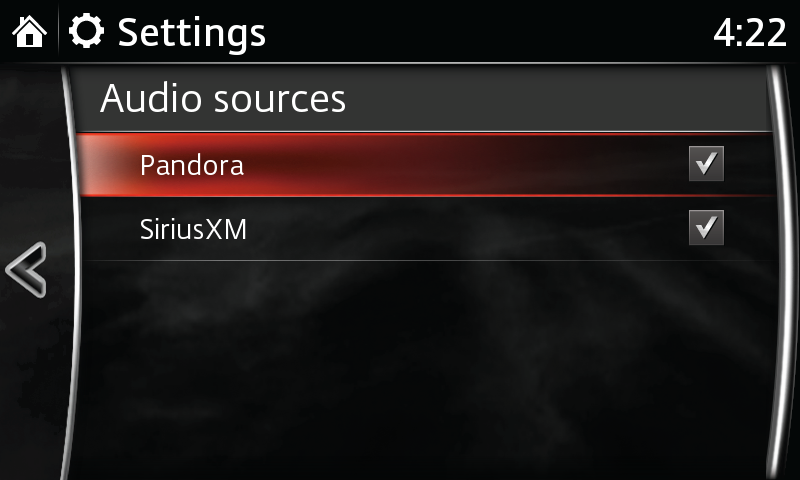

# Pandora

Control Mazda’s built-in Pandora integration.

<dl class="oc-spec">
  <dt>Location</dt>
  <dd>Open Connect → Audio sources</dd>
  <dt>Default</dt>
  <dd>On.</dd>
  <dt>Startup &amp; RAM</dt>
  <dd><strong>Neutral</strong> for startup in the dev.6 comparison: the wired-dashboard timing difference was below camera resolution. Turning it off left about <strong>3.2 MiB more minimum MemFree</strong>.</dd>
  <dt>Trade-offs &amp; boot</dt>
  <dd>Turning it off hides Mazda’s Pandora integration from <strong>Sources</strong>. Pandora through CarPlay or Bluetooth, and audio CDs, still work.</dd>
  <dt>Applies</dt>
  <dd>Saved automatically; takes effect on the <strong>next full Mazda Connect startup</strong>. See <a href="settings.md#apply-changes">restart guidance</a>.</dd>
  <dt>Evidence</dt>
  <dd><a href="performance.md">Performance evidence</a> links the <a href="pandora-comparison.md">dev.6 comparison</a>: five starts per choice on one bench. MemFree is free RAM, not memory available to apps; these are not dev.19 results. Dev.19 UI bench captures on <strong>74.00.324A NA</strong>; real-car qualification and matched dev.19 benchmarks remain pending. <strong>0.3.0-dev.19</strong> is a development prerelease.</dd>
</dl>

<figure class="oc-screen">
  

  <figcaption>Pandora highlighted (dev.19).</figcaption>
</figure>

## Change the setting

Turn **Pandora** off and confirm **Disable** to remove Mazda’s integration after a full restart. Turn it on and confirm **Enable** to restore its usual availability.

Enabled sources retain Mazda’s hardware, connection and availability requirements. This choice is independent of [Startup optimizations](startup-optimizations.md).

[Back to Settings](settings.md)
