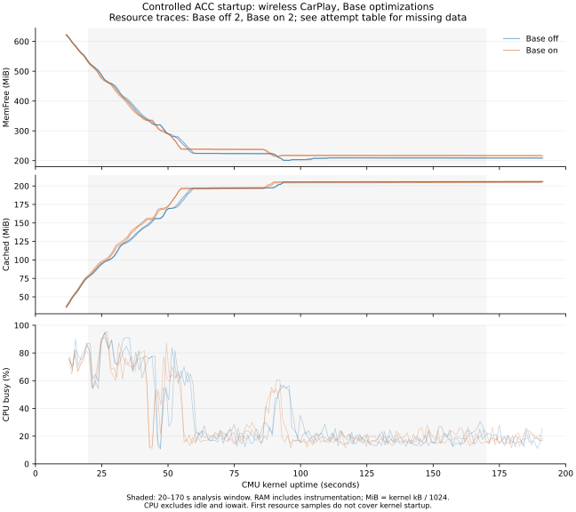

# Complete Services preset on dev.10

This comparison changes the installed **Base optimizations** setting on one
dev.10 bundle: native Warn filtering plus the four DAB, TV and Stitcher service
leaves. Android Auto, Pandora and Wireless CarPlay stay enabled. Voice startup
retains its original five-second delay.

In two starts per setting, Base on had **14.21 MiB higher median minimum
MemFree** and **8.31 MiB higher ending free RAM**. The median visible dashboard
was about **3.2 seconds earlier**. These are observations from one small,
blocked comparison; the night/day map change and acquisition order prevent
attributing the timing or CPU difference solely to Base.

| Setting / acquisition order | Home (ACC s) | Dashboard (ACC s) | CPU busy | Minimum / ending MemFree (MiB) | Selector span (s) |
| --- | --- | --- | --- | --- | --- |
| Off 1 | 26.60–26.81 | 51.81–52.02 | 33.51% | 200.97 / 208.57 | 0.60 |
| Off 2 | 26.79–27.01 | 53.01–53.22 | 32.82% | 201.17 / 208.86 | 0.61 |
| On 1 | 25.99–26.20 | 48.78–48.99 | 31.17% | 215.90 / 217.67 | 0.55 |
| On 2 | 26.00–26.22 | 49.60–49.81 | 30.41% | 214.66 / 216.38 | 0.62 |

All four matched attempts returned to the dashboard without input and retained
complete camera, UART and resource observations, with one kernel boot each.
The two earlier foreground misses below are also retained: six primary attempts
in total, with no missing traces or excluded failures. No physical-input or audio
readiness claim follows from a visible dashboard.

[Matched attempt denominator](assets/performance/services-comparison/startup-attempts.csv) ·
[Video timing bounds](assets/performance/services-comparison/startup-timings.csv) ·
[Resource-window summaries](assets/performance/services-comparison/startup-runs.csv) ·
[Full resource samples](assets/performance/services-comparison/startup-samples.csv) ·
[I/O deltas](assets/performance/services-comparison/startup-io.csv) ·
[Native UART events](assets/performance/services-comparison/wireless-events.csv) ·
[Selector phases](assets/performance/services-comparison/selector-phases.csv).



## Conditions and observations

The bench ran exact **74.00.324A NA/cmu150_NA**, with the paired iPhone on the Mac,
Ethernet and a non-navigation FAT SD on the CMU, and the supply setting unchanged.
ACC was off for 30 seconds with B+ retained. These are full ACC restarts, not
overnight parked-car starts or complete supply-loss tests. Touchscreen Allow,
disclaimer Skip, both individual services and wireless enablement stayed fixed;
product UART/SSH access stayed off. Phone model and iOS version were not recorded.

Home means the entrance animation has finished and all five carousel icons have
their final spacing. Its label can appear later. CarPlay means the dashboard's
sidebar, destination cards and media widget are visible; map tiles may still be
loading. This records visible projection, not accepted input or working audio.
Adjacent camera frames bound each observation, relative to the host ACC-on
command. Sensor and relay latency remain unqualified. Table bounds are rounded
outwards to hundredths; the numeric export retains the original precision.

Primary starts were passive: no injected input or SSH polling. Camera and
receive-only UART recording began before ACC-off. The existing local stage-1
observer started the finite resource collector, with SSH retrieval at ACC+225 s.
The collector pauses at least one second between bounded samples. RAM before
its first sample is unobserved: the matched traces begin at kernel uptime
11.49–11.81 s and end at 190.82–191.48 s (171–173 samples per start).
A fresh same-boot clock bridge after
retrieval maps video observations to kernel time without treating UART delivery
as a clock. Native UART milestones retain their separate logging time base.

CPU busy excludes idle and I/O-wait ticks, using samples wholly inside kernel
uptime 20–170 s. Minimum MemFree covers the observed trace; ending MemFree is its
last sample. The sample CSV retains the full trace and other memory counters;
the run and
I/O CSVs summarize the contained 20–170 s window, whose minimum/last values can
differ from the full-trace table.
Linux reports these memory fields in kB (KiB); divide by 1024 for MiB.
MemFree is not MemAvailable or a measurement of process PSS.

## Preliminary foreground observations

Two earlier Base-off attempts reconnected wirelessly but kept Mazda's main screen
in front for the recording. The native interface had been left foreground after
Settings screenshots. Their complete resource, UART and video observations are
retained separately, without inventing a visible-CarPlay time or mixing their
foreground workload into the matched comparison.

Returning through Mazda's normal long-Home action presented the CarPlay dashboard.
Before the Base-on block it initially opened the app grid; a separate settled
virtual-commander Left pair returned the dashboard. These setup actions were
outside primary timing. All four matched starts returned to the dashboard
without input. Always showing CarPlay on connection is a separate
[requested option](https://github.com/aeharding/open-connect/issues/107).

| Attempt | Home (ACC s) | Visible dashboard | CPU busy | Minimum / ending MemFree (MiB) |
| --- | --- | --- | --- | --- |
| Preliminary off 1 | 27.21–27.42 | Not observed by ACC+210 s | 27.86% | 200.86 / 208.58 |
| Preliminary off 2 | 26.80–27.01 | Not observed by ACC+210 s | 27.70% | 199.91 / 207.61 |

[Preliminary numeric observations](assets/performance/services-comparison/preliminary-runs.csv).
Wireless session activity is not a visible-dashboard observation.

## Maintenance and restoration

The measured candidate also passed Services saves/restarts and
[independent maintenance Uninstall](installer-development.md#qualification).
A fresh extraction of the exact CI bundle was manually launched from SD;
Uninstall restored the preserved stock-five baseline, original loaded code and
all checked service members. The bench was left on verified stock for the next
startup-parity comparison. This does not establish physical USB insertion,
Android-phone/audio behavior or a real-car release.

## Sources and reproduction

The installed product was
[`0b5a4af7`](https://github.com/aeharding/open-connect/tree/0b5a4af74cdf8ab15014b3d6de63671fc4808666),
from [CI 45016577830](https://github.com/aeharding/open-connect/actions/runs/45016577830).
USB ZIP SHA256:
`1ed49e3351057bab999e1593cf8f412a620e60948150d4fd2a444bdc49fb9fe5`.
Its 40-member public manifest is
`fde4ebfd66d79406fc46bf08a39b7ac61d60d098a86f979a57fd7b0ef6376b79`.
The private installed instance has an additional unit-specific identity; derive
its hash from that unit rather than substituting the USB manifest hash.

Capture used
[`95f1eae0`](https://github.com/aeharding/open-connect/tree/95f1eae00007e59fe5700a2ef08fd8107aa15bde),
which adds OC2 and fixed individual-service guards to the prior wireless capture.
Collection, UART, camera timing and the local collector are unchanged. Analysis
used [`802dfcf9`](https://github.com/aeharding/open-connect/tree/802dfcf95057785019bc1607c365886bffe849b0):
explicit projection definitions, configurable attempt count and Home-only
observations when projection never appears. Its host suite ran 184 tests (182 passed, two skipped),
and all five previously published wireless CSVs regenerate byte for byte with
the historical default options. Earlier evidence retains its original revisions.

Use the [observer setup and wireless method](wireless-comparison.md#build-and-reproducible-sources).
Save Base off, complete a separate setup restart, then **return to the connected
CarPlay dashboard before starting the block**. Verify it visually; a wireless
association or SessionActive alone does not establish foreground projection.
At the capture revision, with an already authenticated trusted SSH alias:

```sh
installed_instance=$(ssh my-cmu "cut -d '|' -f 4 /tmp/mnt/data_persist/open-connect/record")
trial_root=runs/services/wireless-base-off
for trial in 1 2; do
  python -m open_connect.startup_reference --live --host my-cmu \
    --condition open-connect --package "$installed_instance" \
    --pandora 1 --base 0 --wireless 1 --bundle "$trial_root/trial-$trial"
  boot_uuid=$(python -c 'import json,sys; print(json.load(open(sys.argv[1]))["boot_id"])' \
    "$trial_root/trial-$trial/trace.json")
  python -m open_connect.clock_reference --live --host my-cmu \
    --expect-boot "$boot_uuid" --bundle "$trial_root/clock-$trial"
  ssh my-cmu sh -s -- "$boot_uuid" > "$trial_root/phase-$trial.out" <<'CMU_PHASE'
test "$(cat /proc/sys/kernel/random/boot_id)" = "$1" && cat /tmp/open-connect/startup-times
CMU_PHASE
done
```

Then save Base on, complete one unmeasured setup restart, return to the dashboard,
and repeat with `--base 1` and `wireless-base-on`. The flags assert saved/applied
state; they do not change it. Retain every attempt and reconcile failures before
resuming at the next scheduled number.

At the analysis revision, review adjacent frames with `startup_frames`, then use
`startup_annotate` with the four actual Home/dashboard PTS bounds for that video.
Use `--no-projection` and only the Home pair for an observed projection miss;
never substitute zero. The matched export is:

```sh
python -m open_connect.startup_export runs/services runs/services-public --wireless --runs 2
python -m open_connect.startup_plot runs/services-public/startup-samples.csv \
  runs/services-public/startup-resources.svg
python -m open_connect.startup_wireless \
  runs/services/wireless-base-off/trial-{1,2} \
  runs/services/wireless-base-on/trial-{1,2} > runs/services-public/wireless-events.csv
```

All primary attempts, including the two preliminary foreground misses, remain
in the published denominator. Native UART event times must be discarded if
`kernel_boot_banners > 1` in the attempt CSV, even when the event CSV has only
one syslog boot marker. Buffering and dropped messages limit UART evidence.

The native selector spans come from the separately guarded `startup-times` reads
after capture, not a new startup probe. They use `/proc/uptime`, separately from
ACC timing. A measurable selector span remains; these data do not establish
stock parity. Two starts per setting, one unit and blocked acquisition order
limit attribution and repeatability. The map changed from night to day rendering
around local dawn between the blocks, adding a foreground-workload confound.
Physical input, audio, Android-phone, long-parked behavior and real-car qualification remain open.
