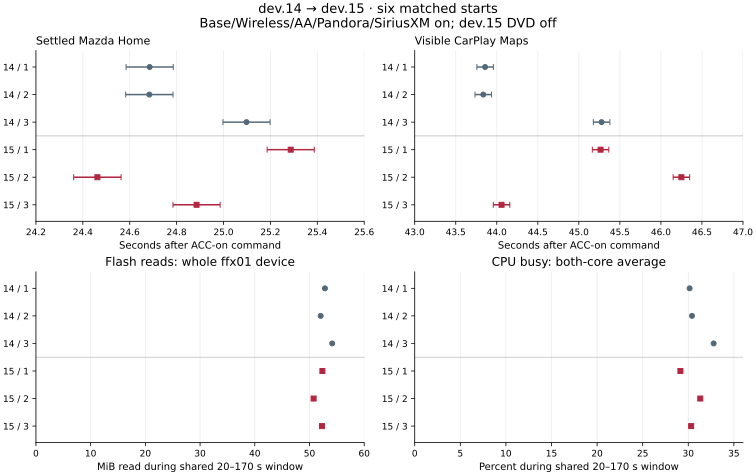

# Expanded Services — dev.15

The dev.15 candidate adds **SiriusXM (default on)** and **DVD (default off)**,
stops Aha/offboard work with Base enabled, and hides disabled Audio Sources
using the applied selection. The [Services guide](services.md) explains the controls.

Three matched starts per version showed **4 KiB less own allocated tmpfs** and
lower aggregate anonymous pages. They did **not** show a startup speedup:
median visible Maps moved **43.86→45.26 s**, and settled Home **24.68→24.89 s**.
CPU was nearly unchanged. The owner [accepted this candidate's timing tradeoff](https://github.com/aeharding/open-connect/pull/129#issuecomment-7108804856);
[#9](https://github.com/aeharding/open-connect/issues/9) remains open.

## Configuration and attempts

Both versions used **Allow/Skip, Base=1, Wireless=1, Android Auto=1, Pandora=1,
SiriusXM on, UART=0 and SSH=0**. The existing lab SSH connection is separate from
the product setting. Dev.14 ran stock DVD/Aha; dev.15 used its new DVD-off default
and Base Aha/offboard policy. Pandora on kept the shared IRS helper running.
This is a **complete-preset comparison**, not an isolated DVD or Aha result.

Acquisition order was three dev.14 controls, upgrade/setup, one wrong-workload
attempt, then three matched dev.15 starts. All **seven** attempts completed
video, UART and resource retrieval: **1,212 sample rows**, including **1,038** in
the six matched starts. The extra attempt stays in every applicable CSV with
`included_in_matched=False` and matched run `0`.

The operator returned through Mazda's CarPlay-audio event, which opened Apple
Music, then began that extra capture before inspecting the image. The capture
finished unchanged; it is an operator fixture deviation, not a CMU failure.
Mazda's Navigation event restored light Maps, visibly checked before the next
start. No route was playing; camera position, exposure and peripheral wiring
stayed fixed. The extra attempt has Home/resource observations but no qualified
Maps observation.

| Version / matched run | Home bounds (s) | Maps bounds (s) | CPU busy (%) | Min MemFree (MiB) | ffx01 reads (MiB) |
| --- | --- | --- | --- | --- | --- |
| dev14 / 1 | 24.584–24.785 | 43.757–43.958 | 30.15 | 270.88 | 52.82 |
| dev14 / 2 | 24.583–24.785 | 43.735–43.937 | 30.41 | 270.20 | 52.04 |
| dev14 / 3 | 24.998–25.199 | 45.177–45.378 | 32.78 | 271.50 | 54.15 |
| dev15 / extra (excluded) | 24.791–24.992 | Unqualified workload | 24.31 | 278.86 | 51.44 |
| dev15 / 1 | 25.186–25.387 | 45.164–45.365 | 29.14 | 279.15 | 52.36 |
| dev15 / 2 | 24.361–24.563 | 46.149–46.350 | 31.32 | 277.70 | 50.75 |
| dev15 / 3 | 24.785–24.986 | 43.958–44.159 | 30.31 | 280.04 | 52.28 |

Home's median midpoint difference was **+0.200 s**, with differences of median
frame endpoints **−0.001..+0.401 s**. Maps' difference was **+1.407 s**, bounded by
**+1.206..+1.608 s**. These are frame brackets, not confidence intervals. Individual
Maps midpoint ranges overlap: **43.835–45.277 s** and **44.059–46.250 s**.
The blocked order and three runs per version limit attribution and drift claims.
Neither stock parity nor a universal no-overhead result is established.

## Native milestones and CPU

The native Service Manager `stage_1` starts were **8.466/8.425/8.575 s** for dev.14
and **8.460/8.457/8.544 s** for dev.15. Their medians differ by **−0.006 s**.
MMUI STARTED medians were **20.649→20.707 s**. All six selector joins waited
**0.00 s** at the recorded hundredth-second resolution. Selector spans and both
durable flush barriers remain in the phase CSV.

| First native event, then median (s) | dev.14 | dev.15 |
| --- | --- | --- |
| DHCP server start | 35.461/35.488/35.511 → **35.488** | 34.766/35.316/34.915 → **34.915** |
| CarPlay control start | 36.085/36.947/37.111 → **36.947** | 36.448/36.153/35.970 → **36.153** |
| Wi-Fi association | 39.346/39.555/40.802 → **39.555** | 39.876/39.175/39.296 → **39.296** |
| Control connected | 40.597/40.924/42.152 → **40.924** | 41.518/40.773/40.600 → **40.773** |
| MMUI SessionActiveCP | 41.273/41.815/42.813 → **41.815** | 42.734/43.826/41.399 → **42.734** |

These are each attempt's first matching UART event, followed by the cohort
median. Repeated events remain in the CSV; DHCP emits two startup lines per
attempt and is not pooled as six independent boots. UART clock times are
separate from camera/ACC times. Discard them unless both Linux-banner and
native boot-marker counts equal one; all seven captures passed that check.
Buffering and dropped lines still apply.

Several CMU connection milestones were earlier while SessionActive and Maps
were later. That locates the changed median in the connection/session tail;
it does **not** prove phone-only causation. No input or audio-readiness claim is
inferred from Home, service readiness or SessionActive.

Combined CPU busy medians were **30.409→30.315% (−0.094 percentage points)**,
with ranges **30.147–32.784%** and **29.140–31.315%**. The ranges overlap.
The later 60–170 s CPU split is a post-hoc diagnostic, not a separate declared
benchmark. Whole-device flash-read medians were **52.824→52.281 MiB** in the
shared 20–170 s window. Partition rows overlap the whole device; do not add them.

## Named memory metrics and own RAM

Each value below is the median of the per-run last sample inside 20–170 s;
columns are separate metric medians, not one shared physical sample.

| Last-sample metric (MiB) | dev.14 | dev.15 | Difference |
| --- | --- | --- | --- |
| MemFree | 272.875 | 281.312 | +8.438 |
| Cached | 149.289 | 145.918 | -3.371 |
| AnonPages | 226.285 | 222.551 | -3.734 |
| Shmem | 5.594 | 4.062 | -1.531 |
| Slab | 18.703 | 18.496 | -0.207 |
| Buffers | 1.797 | 1.805 | +0.008 |

Median minimum MemFree rose **8.266 MiB**. Cached, Shmem, AnonPages and Slab all
moved; report them separately. AnonPages is a system aggregate, not per-process
private/PSS attribution. Higher MemFree alone is not proof of an equivalent
application-memory saving.

| Own RAM component (KiB) | dev.14 | dev.15 |
| --- | --- | --- |
| Unique allocated tmpfs files | 448 | 444 |
| Listener private / PSS | 72 / 83 | 72 / 83 |
| Ignition private / PSS | 132 / 153 | 132 / 153 |

Own-file allocations count each device/inode once under `/tmp/open-connect`,
including hardlinked session members only once. Matched snapshots were taken
at kernel uptime **235.68–236.47 s**, after the timing/resource capture.
Dev.15's selected page was **3,899 B / 4 KiB allocated**, versus dev.14's
**4,228 B / 8 KiB**; this explains the **−4 KiB** allocation difference.
Helper private pages/PSS stayed unchanged in all matched snapshots.

The separate Base-off/Wireless-off snapshot had **404 KiB** allocated files,
listener **76/87 KiB private/PSS**, and ignition **132/154 KiB**. Those components
match the earlier dev.14 off-state snapshot. This is a single diagnostic, not a
matched Base-off timing or total-memory comparison. No new RAM increase or
broad RAM waiver is claimed.

## Build, controls and restoration

- Control: **0.3.0-dev.14**, [1e4a26c](https://github.com/aeharding/open-connect/tree/1e4a26c4cbcee3f1383d4a418819716a5927a73f),
  exact [CI 45157300285](https://github.com/aeharding/open-connect/actions/runs/45157300285) bundle.
- Candidate: **0.3.0-dev.15**, [7e81225](https://github.com/aeharding/open-connect/tree/7e8122571d241fc3b58d0356687f0932bdacd5d0),
  exact [CI 45207857419](https://github.com/aeharding/open-connect/actions/runs/45207857419).
  ZIP SHA256 `4d5a8d054ea6bdfc190f728709c96dbbd6a8e8ecdb901983b0f6bd0a340478a4`;
  all **42 public members** matched the installed package, with only `INSTANCE`
  added privately. [Source approval](https://github.com/aeharding/open-connect/pull/129#issuecomment-7105970834)
  covers that revision. Local checks ran 326 tests with 40 environment skips;
  skips are not hardware passes.

The dev.14→dev.15 upgrade retained existing choices and the original stock-five
baseline, adding DVD off and SiriusXM on. Real Settings showed all five Services
rows; native Entertainment showed no disabled white/grey ghost source rows.
The [direct guide screenshot](services.md#base-optimizations) records that list.
Applied visibility resisted late Mazda Visible messages; the OEM master source
array and USB_A index 12 stayed intact. Pending saves did not change applied rows.

The earlier same-runtime local candidate exercised SiriusXM off/on: off omitted
all five definitions and returned native NotFound for demand launch/save; on
retained the original two automatic and three demand services. With Base on and
Wireless off, the three Aha edges pointed to `stage_ir`. Pandora off stopped the
otherwise-unused IRS helper; Pandora on retained it. Native CD/Android Auto and
SiriusXM automatic services remained available. No equipped tuner, disc, Android
phone, CAN, reverse, audio or vehicle save/resume was qualified.

Exact-CI screening confirmed Warn logging, VBS/system thread masks `0-1`, the
12.065 s gap2 gate and retained auxiliary services. A fresh Base-off/Wireless-off
kernel restored 128 KiB read-ahead, stock masks, Info logging and no delay gate,
while retaining the four individual choices. The temporary timing hook was
independently restored to its original inode, then its eight files were removed
after an original-script startup.

Actual old dev.14 media refused the earlier dev.15 downgrade before prepare,
leaving record/NVRAM unchanged. It then independently removed that candidate
through Uninstall and its ordinary automatic restart. Final exact-CI dev.15
removal also used dev.14's real Uninstall button and returned to verified stock:
pinned OEM hashes/modes, original UIA/MMUI mappings and SM/Opera paths, restored
services, the saved access policy and originally absent touchscreen NVRAM key,
root read only, read-ahead 128 KiB and no
Open Connect state/helper/runtime or measurement hook. This is the manual SD
bench route, distinct from the earlier qualified USB-insertion path.

**Post-purge reload limit:** the final check temporarily held exactly one automatic
restart transmission, then reloaded the selected page after persistent state was
gone. A fresh JS context loaded Mazda's original System script, connected MMUI,
kept DVD hidden and preserved USB_A index 12. It remained in IntroAnimation at
8 s; later Opera disappeared and the CMU rebooted before the planned explicit
restart was sent. The preceding cause was not captured. Stock Websockets has a
fatal-close restart branch, but it is not an established explanation for this
attempt. Fully usable mid-uninstall page reload remains unqualified. The new
stock kernel passed restoration checks without a second removal/restart request.
The offline exact-OEM replays passed both disclaimer states; they do not replace
this live boundary. Raw failures are retained privately.

Two earlier untimed setup transport interruptions were kept separate: one SSH
refusal during local Services screening and one lost Ethernet connection after
fresh dev.14 installation. Each recovered on one ACC cycle; neither interrupted
a matched capture. Their causes were not established. A later helper mistakenly
compared the installed private manifest with the public-media digest and refused
before saving; unchanged state was checked, then the correct private binding was
used. No uncertain install, uninstall or restart request was blindly resent.

## Reproduce

Use the same **74.00.324A NA/cmu150_NA** unit and preset, fixed camera/exposure,
light foreground Maps, nearby iPhone USB-connected to the Mac with Wi-Fi/Bluetooth
on, and the same Ethernet/SD fixture. There is no route, hardware TAU or licensed
navigation card. B+ stays supplied and ACC is off thirty seconds per start.
These are ACC/kernel starts, not overnight cold boots or a reproduction of
Miatafy's published milestones.

Use the [stage-1 observer and clock procedure](startup-comparison.md#source-pins-and-reproduction).
The target observer remains frozen at
[`95f1eae`](https://github.com/aeharding/open-connect/tree/95f1eae00007e59fe5700a2ef08fd8107aa15bde).
The actual capture revision
[`0630ba3`](https://github.com/aeharding/open-connect/tree/0630ba30602d09e0ba9d64f89bd2af5e541e46a3)
only extends the exact Services fixture guard for dev.15's DVD/SiriusXM choices.
Keep that checkout on `PYTHONPATH` and set `OC_WORKSPACE` to it:

~~~sh
python -m open_connect.startup_reference --live --host my-cmu \
  --ssh-config /path/to/trusted-ssh-config --condition open-connect \
  --package INSTALLED_PRIVATE_PACKAGE_DIGEST --base 1 --wireless 1 --pandora 1 \
  --bundle runs/my-cohort/trial-1 --label 'dev15 B1 W1 AA1 P1 DVD0 SXM1 light Maps'
~~~

The sampler runs locally for 180 s, with a 190 s watchdog; UART/camera start before
ACC, video continues 210 s and retrieval starts at 225 s. Logging does not wait
for SSH. The seven first samples were at **9.28–10.16 s** kernel
uptime; earlier resource use is unobserved.

After capture closes, collect the bounded same-boot `clock_reference` exchanges
and the two read-only postflight probes retained in analysis revision
[`0b548e7`](https://github.com/aeharding/open-connect/tree/0b548e7a334cd0d7d041cdfe0004cf6487279893):

~~~sh
python -m open_connect.clock_reference --live --host my-cmu \
  --ssh-config /path/to/trusted-ssh-config --expect-boot BOOT_ID \
  --bundle runs/my-cohort/clock-1
ssh my-cmu 'timeout -t 50 sh -s -- BOOT_ID 1 PRIVATE_PACKAGE_DIGEST' \
  < cmu/bench/wave-b-services-postflight.sh > runs/my-cohort/extra-1.out
ssh my-cmu 'timeout -t 45 sh -s -- BOOT_ID PRIVATE_PACKAGE_DIGEST' \
  < cmu/bench/wave-b-ram-postflight.sh > runs/my-cohort/ram-1.out
~~~

Use the analysis checkout for frame review and export. Home requires zero integer
pixel displacement of all three icon regions against settled frame 300, **mean**
gradient correlation above 0.95 and three consecutive qualifying frames. The
published `startup_home_registration` helper uses this camera's three fixed
regions and a ±16 px search; adjust regions for another camera. It reads extracted
`home-review-*.png` frames, with the last image as the settled reference. It does
not measure physical input acceptance or wait for the center icon's red fade.
Maps requires sidebar and roads/labels around the central marker, sustained in
the next two frames. Blank central tiles fail; luma/sidebar proxies only locate
candidate frames.

Feed adjacent video PTS to `startup_annotate --projection maps`. The wrong-workload
attempt instead uses `--no-projection` and its retained
`workload-qualification.json` sets `qualified_for_matched_comparison` false.
Export with the same analysis checkout on `PYTHONPATH`:

~~~sh
python -m open_connect.startup_wave_b PRIVATE_CAPTURE_ROOT OUTPUT_CSV_DIR
python -m open_connect.startup_wave_b_plot OUTPUT_CSV_DIR comparison.svg
~~~

The export validates saved fetch/trace, memory CSV, condition guards, clocks and
annotation arithmetic. Capture checks the transmitted BOOT_TRACE_SHA digest;
export reparses the saved trace. The [capture/export distinction](wireless-startup-speed.md#reproduce)
still applies. Select samples with start ≥20 s and end ≤170 s. CPU busy is
`100 × (total_delta − idle_delta − iowait_delta) / total_delta` using the first
eight `/proc/stat` counters; RAM retains each named `/proc/meminfo` field. Storage
uses first/last in-window `/proc/diskstats` differences and 512-byte sectors.
Always filter `included_in_matched=True` for cohort statistics; keep unmatched
rows and missing milestones in the attempt record. The new exporter/probes are
retained for this dataset; old evidence and manifests are unchanged.

Download [attempts](assets/performance/services-expansion/attempts.csv),
[timings](assets/performance/services-expansion/timings.csv),
[resource summaries](assets/performance/services-expansion/summary.csv),
[all 1,212 samples](assets/performance/services-expansion/samples.csv),
[CPU windows](assets/performance/services-expansion/cpu-windows.csv),
[storage deltas](assets/performance/services-expansion/io.csv),
[storage windows](assets/performance/services-expansion/io-windows.csv),
[own RAM](assets/performance/services-expansion/own-ram.csv),
[selector phases](assets/performance/services-expansion/selector-phases.csv),
[native services](assets/performance/services-expansion/native-services.csv),
[service states](assets/performance/services-expansion/service-states.csv) and
[native wireless events](assets/performance/services-expansion/native-wireless.csv).
Raw captures, locations, credentials and OEM files remain private.
