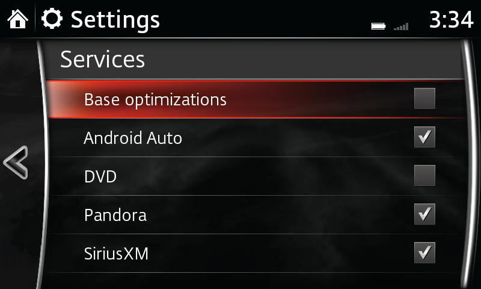
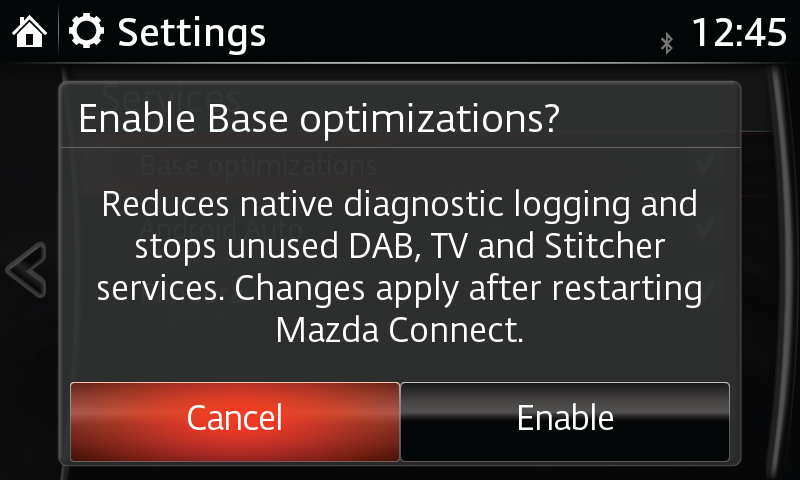
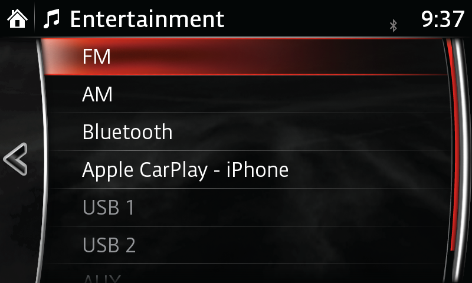
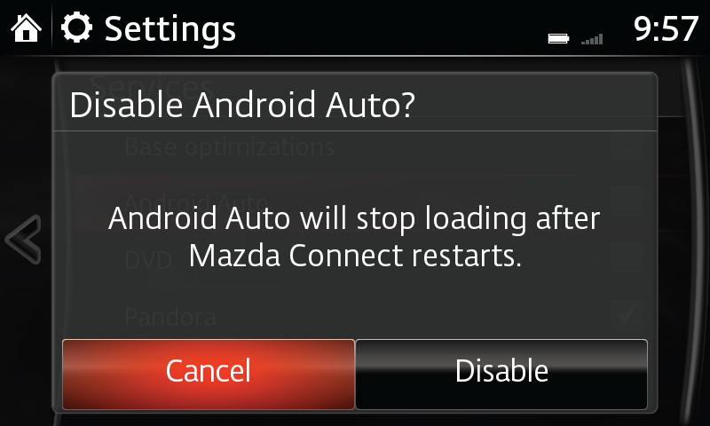

# Services & Base optimizations

  <strong>Menu:</strong> Mazda Settings → System → Open Connect → Services
  <strong>Defaults:</strong> Base Off · DVD Off · Android Auto, Pandora, SiriusXM On
  <strong>Takes effect:</strong> Next full restart

## Why this page exists

First-generation Mazda Connect runs on modest dual-core hardware with slow flash storage, yet starts dozens of background services on every boot — including regional and discontinued services that North American cars never use (DAB digital radio, digital TV, Stitcher, Aha) and verbose diagnostic logging.

The **Services** page lets you turn on **Base optimizations** to cut that unnecessary startup work, and individually turn off built-in integrations you don’t use.

<figure class="oc-screen">
  

  <figcaption>Defaults: Base optimizations and DVD start off; Android Auto, Pandora, and SiriusXM start on.</figcaption>
</figure>

| Setting | Default | What it changes |
| --- | --- | --- |
| **Base optimizations** | **Off** | Reduces verbose logging, stops dead/non-NA services (DAB, TV, Stitcher, Aha), trims flash read-ahead, unloads native UI/voice modules for disabled services, and prioritizes CarPlay startup when Wireless CarPlay is on. |
| **Android Auto** | **On** | Loads Mazda’s built-in Android Auto integration. Turn off if you only use CarPlay or stock Mazda audio. |
| **DVD** | **Off** | Loads Mazda’s DVD video playback integration. CD audio continues to work normally with DVD off. |
| **Pandora** | **On** | Loads Mazda’s built-in Pandora app integration. Turn off if you don’t use Mazda’s native Pandora client. |
| **SiriusXM** | **On** | Loads Mazda’s satellite-radio and data integrations. Leave on if you use SiriusXM. |

---

## Base optimizations

Turn on **Base optimizations** if you want a leaner startup with more free RAM and less background disk activity. Here is everything it changes together:

- **Stops discontinued & non-NA services:** Leaves **DAB** (European digital radio), **TV**, **Stitcher** (discontinued), and **Aha** (discontinued) unstarted. Shared streaming helpers stop automatically once every integration using them is off.
- **Cuts verbose logging:** Switches Mazda’s native and browser logs from noisy `Info` output to `Warn` (warnings and errors are still logged).
- **Lightens boot contention:** Lowers unnecessary flash read-ahead and allows two busy Mazda services to use both CPU cores instead of competing on one.
- **Skips unused UI & voice modules:** Avoids loading native MMUI and voice-recognition plugins for integrations you have turned off, and hides disabled radio, DVD, and streaming rows from Mazda’s Entertainment **Sources** list.
- **Prioritizes projection when Wireless CarPlay is also on:** Adjusts wireless startup scheduling, delays six non-essential background fuel/maintenance/driver-data services by 12 seconds after CarPlay/network readiness, and delays Mazda Navigation startup by about 20 seconds so CarPlay gets flash and CPU first. *(Navigation still starts automatically even if no phone connects — early compass/map screens simply appear ~20 seconds later.)*

<figure class="oc-screen">
  

  <figcaption>Enabling Base optimizations summarizes its startup and Navigation-delay changes before saving.</figcaption>
</figure>

<figure class="oc-screen">
  

  <figcaption>With Base on and Android Auto, DVD, Pandora, and SiriusXM off, disabled audio sources are cleanly hidden from Mazda’s Sources menu.</figcaption>
</figure>

Turning **Base optimizations** back off restores Mazda’s original logging, startup scheduling, and service loading after the next full start without changing your individual Android Auto, DVD, Pandora, or SiriusXM toggles.

---

## Individual integrations

Each integration below is independent of **Base optimizations** and of the others.

### Android Auto
Turn off if you never connect an Android phone for Android Auto. CarPlay, Bluetooth audio, and USB music keep working normally.

<figure class="oc-screen">
  

  <figcaption>Each toggle confirms before saving; Cancel keeps your existing choice.</figcaption>
</figure>

### DVD
Starts **off** by default because North American vehicles rarely use in-dash DVD video playback. **Audio CDs keep working normally** with DVD off. Turn on only if your vehicle has a DVD player you actively use.

### Pandora
Turn off if you don’t use Mazda’s built-in Pandora app (streaming Pandora over CarPlay or Bluetooth doesn’t use this service).

<figure class="oc-screen">
  

  <figcaption>Disabling Pandora frees its background service on the next full startup.</figcaption>
</figure>

### SiriusXM
Starts **on** by default. Leave it enabled if you use SiriusXM satellite radio or SiriusXM Traffic/Travel Link data. Turning it off hides SiriusXM from Entertainment **Sources** and **Applications**.

> **Qualification limits:** Bench checks verify startup, Settings persistence, audio-source hiding, and clean stock uninstall. Physical-input/audio, Android-phone, and equipped satellite-tuner vehicle checks remain pending (the bench has no SiriusXM tuner). Keep SiriusXM enabled for everyday driving until tuner checks are complete.

## Measured evidence

See the full per-run benchmarks, memory accounting, and caveats in [Performance](performance.md), including [Sparse native loading](sparse-native-loading.md), [Expanded Services](services-expansion.md), [Base startup tuning](base-startup-tuning.md), and [Wireless startup speed](wireless-startup-speed.md).

[Back to Settings →](settings.md)
