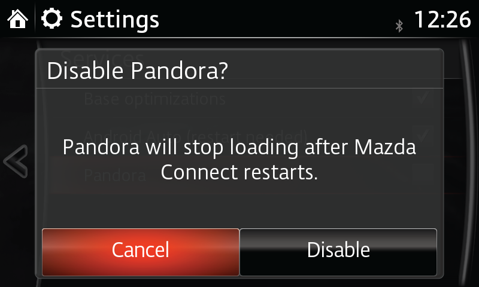

# Services

The **Services** page is under **Mazda Settings → System → Open Connect**.
It controls the optional **Base optimizations** preset and Mazda's built-in
**Pandora** integration. Your selections save automatically and apply after a
full Mazda Connect restart.

| Choice | Fresh-install default | Effect |
| --- | --- | --- |
| Base optimizations | **Off** | Reduce normal native diagnostic logging to Warn |
| Pandora | **On** | Load Mazda's built-in Pandora integration |

## Base optimizations

Check **Base optimizations** and confirm **Enable** to apply the preset at the
next full restart. Its first contents are the measured native Warn logging
filter. Native warnings/errors remain available; early services and other
logging sources retain their separate behavior. Service selections stay as you
chose them.

Clear it and confirm **Disable** to return to the original native logging policy
after the next full restart. Updating preserves your choice. Uninstall restores
the pre-install startup configuration; its restart clears the temporary filter.

The [isolated logging comparison](logging-comparison.md) found earlier visible
wired CarPlay and a smaller temporary free-RAM dip. That experiment used original
features/services. The complete installed preset needs its own qualification;
those numbers are not an installed-bundle or vehicle guarantee.

## Pandora

<figure class="oc-screen">
  

  <figcaption>Pandora starts by default.</figcaption>
</figure>

Clear the checkbox to stop that integration from loading. The confirmation
explains that changes apply after restarting Mazda Connect. Switching ignition
off and immediately on may resume the existing session; let it shut down fully.
Updating preserves the selection. Uninstall restores the pre-install startup
configuration.

Checking it again and confirming **Enable** restores the integration after the
next full restart. The checkbox shows your saved choice; the current session
keeps its existing services until that restart.

<figure class="oc-screen">
  

  <figcaption>Confirm Disable to save the choice.</figcaption>
</figure>

Other service choices remain under investigation.
The [five-start comparison](pandora-comparison.md) found modestly higher free
RAM with Pandora off, without a resolved wired CarPlay startup gain.

The Pandora control has bench checks for startup, software Settings,
update and restoration; see the [qualification record](pandora-comparison.md#maintenance-and-restoration-qualification).
Physical-input/audio and first-car checks remain pending.
