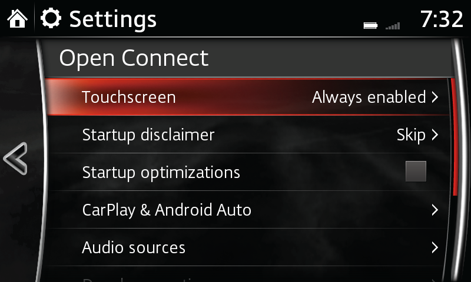

# Settings

Change your preferences in Mazda’s own menus. Choices save automatically; use [Apply changes](apply-changes.md) to restart Mazda Connect when you’re ready.

<dl class="oc-spec">
  

    <dt>Menu</dt>
    <dd>Settings → System → Open Connect</dd>
  

  

    <dt>Default</dt>
    <dd>—</dd>
  

  

    <dt>Impact</dt>
    <dd>Varies by setting</dd>
  

  

    <dt>Applies</dt>
    <dd>Per setting</dd>
  

</dl>

<figure class="oc-screen">
  

  <figcaption>Open Connect settings with Touchscreen set to Always enabled (pre-dev.24 CI build; same UI).</figcaption>
</figure>

## Notes

Fresh installations use the defaults below; updates keep your saved choices.

Choices save automatically. Use <a href="apply-changes.md">Apply changes</a> to restart Mazda Connect and activate them, or let them take effect on the next full startup.

<strong>0.3.0-dev.24</strong> is a development prerelease for North American version <strong>74.00.324A</strong>. Bench checks cover installation, Settings, Apply changes and Uninstall; real-car qualification remains pending.

## Choose a setting

Open Connect sits just above **About** in Mazda’s System menu:

1. [**Touchscreen**](touchscreen.md): Always enabled by default; choose **Factory behavior** or **Always disabled**.
2. [**Startup disclaimer**](disclaimer.md): Skip by default; **Show** restores Mazda’s warning.
3. [**Startup optimizations**](startup-optimizations.md): Off by default (includes turning off Mazda’s unused North American [DVD](dvd.md) service).
4. **CarPlay & Android Auto**:
    - [Wireless CarPlay](wireless-carplay.md): Off, unless factory enabled.
    - [Show CarPlay on connection](carplay-on-connection.md): Factory behavior by default (**Factory** in the list); choose **Automatically show** (**Auto**).
    - [Android Auto](android-auto.md): On by default.
5. **Audio sources**:
    - [Pandora](pandora.md): On by default.
    - [SiriusXM](siriusxm.md): On by default.
6. [**Developer options**](developer-options.md): UART Off; SSH Off; no public key imported.
7. [**Apply changes**](apply-changes.md): restart to activate saved choices; disabled when nothing is pending.
8. [**Uninstall**](uninstall.md)
9. [**About**](about.md)

## Impact at a glance

Cold-boot bench measurements below compare **v0.3.0-dev.20** against Stock (**Stock Show** vs installed **Skip**; primary **Startup optimizations** cohorts are `n=3`, isolated individual toggles are a separate `n=1` sweep). Do not add differences across rows; combined presets need their own measurements.

| Setting / configuration | Main screen vs Stock | Available RAM proxy vs Stock | Boot CPU vs Stock | Trade-off / notes |
| --- | --- | --- | --- | --- |
| Open Connect defaults (`Base=0`, Skip, `n=3`) | ~4.3 s earlier (vs Stock Show) | +0.6 MiB | +0.7 pp | Uses 396 KiB own allocated tmpfs vs none on Stock; does not establish zero overhead. |
| [Touchscreen](touchscreen.md) | Not measured separately | Not measured separately | Not measured separately | **Always disabled** adds +4 KiB tmpfs and +8 KiB `devices` PSS vs matched boot (+28 KiB vs post-install boot); physical panels remain unqualified. |
| [Startup disclaimer Skip](disclaimer.md) | Included in defaults above | Not isolated | Not isolated | Restoring **Show** returns Mazda’s warning. |
| [Startup optimizations on](startup-optimizations.md) (`n=3`) | ~7.7 s earlier (~3.4 s beyond defaults) | +21.2 MiB (−17.8 MiB AnonPages) | −4.8 pp | Stops unused services (500 KiB own allocated tmpfs); ~20 s Navigation delay only with Open Connect Wireless override on. |
| [Wireless CarPlay on](wireless-carplay.md) (`n=1`) | ~5.1 s earlier (~0.8 s vs defaults) | ~0 MiB (+0.1 observed) | +2.2 pp (+3.4 pp settled) | Connected iPhone; compatible hardware and pairing required. |
| [Show CarPlay on connection](carplay-on-connection.md) | Not measured separately | Not measured separately | Not measured separately | CarPlay may replace your current screen on connection. |
| [Android Auto off](android-auto.md) (`n=1`) | ~4.7 s earlier (~0.4 s vs defaults) | +4.6 MiB | +0.9 pp | Built-in Android Auto becomes unavailable. |
| [Pandora off](pandora.md) (`n=1`) | ~3.9 s earlier (0.4 s later vs defaults) | +1.9 MiB | +2.4 pp | Hides Mazda’s Pandora; CarPlay and Bluetooth audio still work. |
| [SiriusXM off](siriusxm.md) (`n=1`) | ~5.5 s earlier (~1.2 s vs defaults) | +7.4 MiB | −0.6 pp | Satellite radio and SiriusXM data become unavailable. |
| Max-off combined preset (`n=1`) | **29.0 s** (~10.9 s earlier vs Stock 39.9 s) | **+36.7 MiB** | **−4.3 pp** | Startup optimizations on; Android Auto, Pandora, SiriusXM and Wireless off. |
| [Developer options](developer-options.md) | Not measured separately | Not measured separately | Not measured separately | Direct access; enabled SSH can start a daemon. |

“Available RAM proxy” is `MemFree + Buffers + Cached + SReclaimable − Shmem` (Linux 3.0.35 has no kernel `MemAvailable`; this proxy is not guaranteed allocatable RAM). Small `n=1` timing or CPU differences can reflect run variation or background phone/Navigation activity. See [Performance evidence](performance.md) for full methodology, raw cohorts, CPU percentage points (`pp`) and trial limits.

## Apply changes

Select [**Apply changes**](apply-changes.md) above **Uninstall**, then confirm **Restart**. Keep the car on until Mazda Connect restarts. You don’t need a USB drive or computer.

**restart needed** means a choice is saved but not active yet. You can change several settings before applying them together. Saved choices also take effect on the next full startup; a quick ignition off/on may resume the same session.
