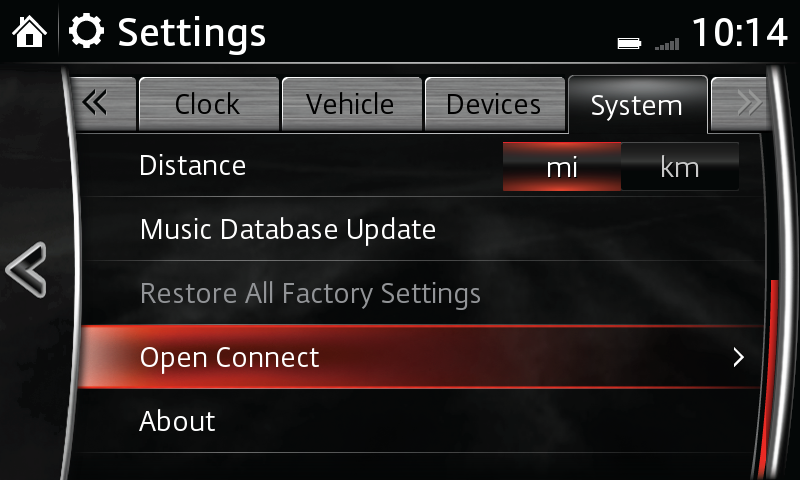

# Settings

Change your preferences in Mazda’s own menus. Choices save automatically.

Open **Mazda Settings → System → Open Connect**, just above **About**.

<figure class="oc-screen">
  

  <figcaption>Scroll down in the System tab to find Open Connect.</figcaption>
</figure>

<figure class="oc-screen">
  

  <figcaption>Current choices appear beside the settings. Scroll down for Uninstall and About.</figcaption>
</figure>

## Choose a setting

- [**Touchscreen While Driving**](touchscreen.md): choose **Allow** or **Factory Default**.
- [**Startup disclaimer**](disclaimer.md): choose **Skip** or **Show**.
- [**Wireless CarPlay**](wireless-carplay.md): enable a wireless iPhone connection on compatible hardware.
- [**Services**](services.md): turn off unused integrations or enable **Base optimizations**.
- [**Developer options**](developer-options.md): leave off unless you need development access.
- [**Uninstall**](uninstall.md): remove Open Connect and restore your saved configuration.
- [**About**](about.md): see your installed Open Connect version.

Updates keep your choices.

## Apply changes

Changes take effect on the **next full Mazda Connect startup**. Turn the ignition off and let the system shut down completely before starting again. A quick off/on may resume the same session.

**restart needed** means a choice is saved but not active yet. If a save cannot be confirmed, reopen Open Connect and check the choice before trying again.

The guide describes **0.3.0-dev.17**, still in testing on North American version **74.00.324**. Real-car checks remain; no public download is available yet.
