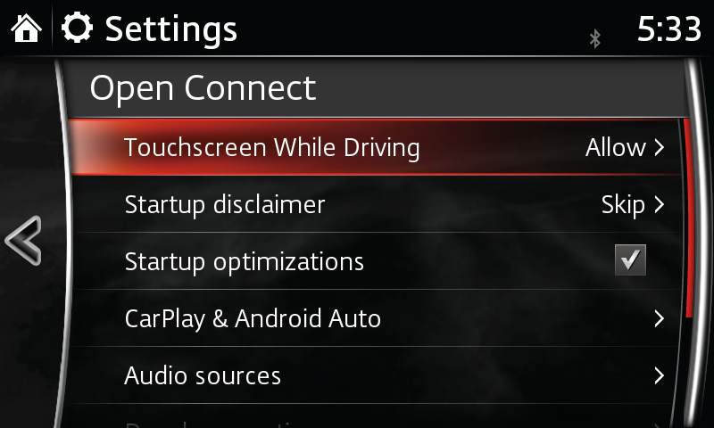

# Settings

Change your preferences in Mazda’s own menus. Choices save automatically.

Open **Mazda Settings → System → Open Connect**, just above **About**.

<figure class="oc-screen">
  

  <figcaption>Open Connect settings (0.3.0-dev.19).</figcaption>
</figure>

- **Default**: Fresh installations use the choices listed below; updates keep your choices.
- **Startup & RAM impact**: **Neutral** for browsing Settings. Individual settings have different measured effects; see [Impact at a glance](#impact-at-a-glance).
- **Trade-offs & boot implications**: Each setting page explains the affected features and any startup delay.
- **Applies**: Choices save automatically and take effect on the **next full Mazda Connect startup**; [Uninstall](uninstall.md) restarts automatically and [About](about.md) is read-only.
- **Evidence & limits**: [Performance evidence](performance.md) records earlier measured configurations. The dev.19 menu has bench captures and Settings Uninstall verification; real-car qualification and matched dev.19 benchmarks remain ahead. No public download is available.

## Choose a setting

The list follows this order:

1. [**Touchscreen While Driving**](touchscreen.md): Allow by default; **Factory Default** restores the saved pre-install setting.
2. [**Startup disclaimer**](disclaimer.md): Skip by default; **Show** restores the warning.
3. [**Startup optimizations**](startup-optimizations.md): Off by default.
4. **CarPlay & Android Auto**:
    - [Wireless CarPlay](wireless-carplay.md): Off, unless factory enabled.
    - [Show CarPlay on connection](carplay-on-connection.md): Factory behavior by default (**Factory** in the list); choose **Automatically show** for **Auto**.
    - [Android Auto](android-auto.md): On by default.
5. **Audio sources**:
    - [DVD](dvd.md): Off by default.
    - [Pandora](pandora.md): On by default.
    - [SiriusXM](siriusxm.md): On by default.
6. [**Developer options**](developer-options.md): UART Off; SSH Off; no public key imported.
7. [**Uninstall**](uninstall.md)
8. [**About**](about.md)

## Impact at a glance

These comparisons describe enabling Startup optimizations or disabling an unused integration. Other rows describe choosing the feature. **Neutral** means no measured startup gain is established. **Faster** and **Slightly faster** are reserved for measured gains; they do not promise faster startup than stock.

| Setting | Startup speed | Free RAM (bench) | Trade-off |
| --- | --- | --- | --- |
| [Touchscreen While Driving](touchscreen.md) | Neutral | Not measured separately | Touch stays available while moving. |
| [Startup disclaimer](disclaimer.md) | Neutral | Not measured separately | The startup warning is skipped. |
| [Startup optimizations](startup-optimizations.md) | Faster in earlier wired tests | +9.9 MiB minimum MemFree; +2.58 MiB ending, dev.7 | Aha, Stitcher, DAB and TV stop; Mazda Navigation starts about 20 s later with Wireless CarPlay on. |
| [Wireless CarPlay](wireless-carplay.md) | Neutral | No isolated gain established | Requires compatible hardware and phone pairing. |
| [Show CarPlay on connection](carplay-on-connection.md) | Neutral | No matched PSS measurement | CarPlay may replace your current screen on connection. |
| [Android Auto off](android-auto.md) | Neutral | Not measured separately | Built-in Android Auto becomes unavailable. |
| [DVD off](dvd.md) | Neutral | Not measured separately | DVD video disappears from Sources; CDs still work. |
| [Pandora off](pandora.md) | Neutral | +3.2 MiB minimum MemFree, dev.6 | Mazda’s Pandora integration disappears from Sources; CarPlay apps still work. |
| [SiriusXM off](siriusxm.md) | Neutral | Not measured separately | Satellite radio and SiriusXM data become unavailable. |
| [Developer options](developer-options.md) | Neutral | Not measured separately | Gives direct access to the head unit; changes you make can affect maintenance. |

The [Performance evidence](performance.md) records the configurations and limits. Startup optimizations was called **Base optimizations** in those tests: dev.7’s wired dashboard was about 3.8 s earlier with it on. Pandora’s timing difference was below camera resolution. These are earlier bench results, not dev.19 measurements; do not add their RAM figures together. Free RAM here means **MemFree**, not memory available to apps. Later presets changed both behavior and memory costs; matched dev.19 results remain ahead.

## Apply changes

Changes take effect on the **next full Mazda Connect startup**. Turn the ignition off and let the system shut down completely before starting again. A quick off/on may resume the same session.

**restart needed** means a choice is saved but not active yet. If a save cannot be confirmed, reopen Open Connect and check the choice before trying again.

The guide describes **0.3.0-dev.19**, still in testing on North American version **74.00.324**. Real-car checks remain; no public download is available yet.
