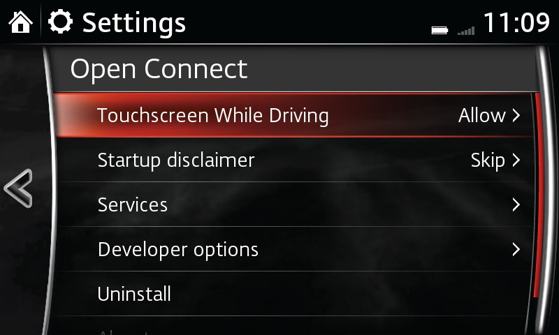

# Settings

Open **Mazda Settings → System → Open Connect**.

Fresh installations select **Allow** for the touchscreen and **Skip** for the
startup disclaimer. Updating keeps your choices.

Select a preference, then select the choice you want. **Your choice saves
automatically** and takes effect at the next full Mazda Connect restart.
Use Back to return to the list.

After changing a preference, switch the ignition off and let Mazda Connect shut
down completely before starting again. A quick off/on may resume the old session.

<figure class="oc-screen">
  

  <figcaption>Your current choices appear beside each preference.</figcaption>
</figure>

## Touchscreen While Driving

| Choice | What it does |
| --- | --- |
| **Factory Default** | Uses Mazda's normal touchscreen restriction. |
| **Allow** | Removes the display's speed-based touchscreen restriction. |

<figure class="oc-screen">
  

</figure>

Physical touch while moving and CarPlay behavior are still being qualified for
the development prerelease.

## Startup disclaimer

| Choice | What it does |
| --- | --- |
| **Show** | Keeps Mazda's startup warning. |
| **Skip** | Skips the warning and continues the normal startup. |

<figure class="oc-screen">
  

</figure>

A brief fade or black screen may still appear during startup.

**About** shows the installed Open Connect version.
To remove both features, choose [**Uninstall**](uninstall.md).

If a change cannot be confirmed, return to Open Connect and check the selected
choice before trying again.
