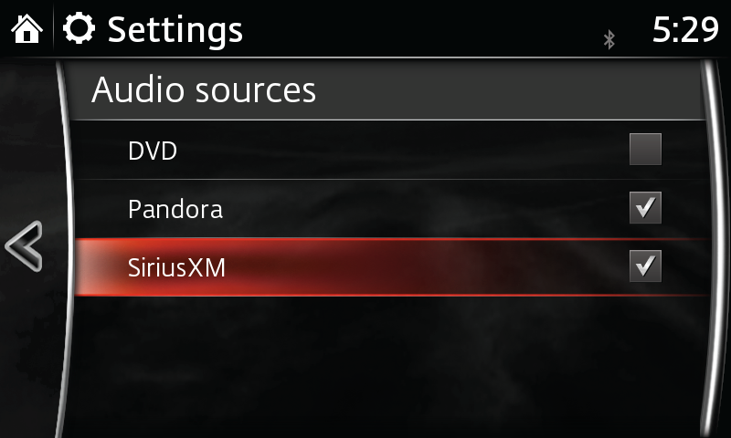

# SiriusXM

Control satellite radio and SiriusXM data services.

<dl class="oc-spec">
  

    <dt>Menu</dt>
    <dd>Open Connect → Audio sources</dd>
  

  

    <dt>Default</dt>
    <dd>On</dd>
  

  

    <dt>Impact (off vs stock)</dt>
    <dd>+7.4 MiB avail proxy</dd>
  

  

    <dt>Applies</dt>
    <dd>Next full startup</dd>
  

</dl>

<figure class="oc-screen">
  

  <figcaption>SiriusXM highlighted in Audio sources.</figcaption>
</figure>

## Notes

<strong>Bench results (dev.20, n=1 cold boot with SiriusXM off):</strong> <strong>+7.4 MiB available RAM proxy</strong> versus Stock (+6.8 MiB vs Open Connect defaults), main screen at 34.4 s (~1.2 s earlier than defaults) and −0.6 pp boot CPU vs Stock (small timing/CPU differences may be run variation). See <a href="performance.md#stage-2b-isolated-toggle-sweep-n1">Performance evidence</a> for memory definitions and single-trial limits.

Turning it off hides SiriusXM from <strong>Sources</strong> and stops both satellite radio and SiriusXM data. CarPlay and audio CDs still work.

Choices save automatically and apply on the <strong>next full Mazda Connect startup</strong>. Use <a href="apply-changes.md">Apply changes</a> to restart right away. The bench has no satellite tuner, so live radio/data playback and real-car driving remain unqualified on <strong>0.3.0-dev.24</strong> (<strong>74.00.324A NA</strong>).

## Change the setting

Leave **SiriusXM** on if you use satellite radio or its data services. To stop both, turn it off and confirm **Disable**; turn it back on and confirm **Enable** to restore support after a full restart.

Enabled sources keep Mazda’s normal hardware and connection requirements. This choice is independent of [Startup optimizations](startup-optimizations.md).

[Back to Settings](settings.md)
