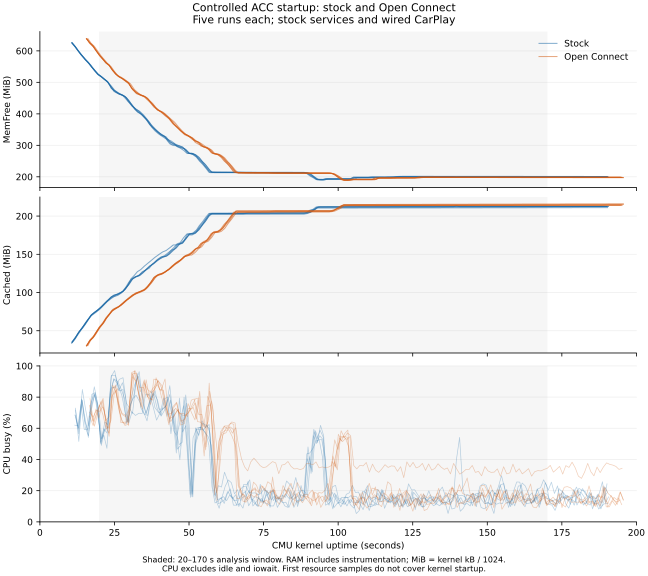

# First stock / Open Connect startup comparison

The **0.3.0-dev.4 development candidate was slower on this bench**. Across five
accepted starts per condition, the median wired CarPlay dashboard milestone
changed from about **48.3 to 56.7 seconds after the ACC-on command**. Median
system CPU busy increased from **30.0% to 33.6%** over the common analysis
window. Minimum free RAM changed by about 1.7 MiB. These results identify added
work to investigate; they do not establish its cause or a qualified release.

## Conditions and coverage

Measured November 21, 2026, on one **74.00.324A NA / cmu150_NA** bench. Stock
means Open Connect uninstalled, with normal Mazda services and the declared
bench instrumentation. The candidate enables **Touchscreen While Driving:
Allow / Startup disclaimer: Skip**, with product UART and SSH off. No service,
logging or wireless changes were made. Existing bench owner-key SSH is separate.

Both blocks use the same connected wired iPhone, Ethernet adapter and FAT32 SD,
the same installer contents on SD, and a 30-second ACC-off interval. Supply power
stays on. This is **controlled ACC shutdown**, not supply loss, overnight parking
or wireless CarPlay. Phone model/iOS were not recorded, limiting cross-bench
reproduction. There is no audio playback or navigation route; CarPlay ends on
the dashboard with its map and Not Playing. The phone remains connected.

Five stock starts precede five accepted candidate starts. This avoids repeated
installations but leaves order/drift as a confound; the rows below are numbered
within blocks, not paired crossover trials. Before each block, the camera
confirms CarPlay is foregrounded. Every accepted start returns automatically to
CarPlay, with no UI input or SSH during the startup observation window.

The same finite stage-1 observer records system counters locally in RAM for
180 seconds, with a minimum one-second pause. First samples occur at kernel
uptime **10.65–10.84 s stock** and **15.59–16.09 s candidate**. The earlier gaps
remain unobserved; this is not whole-boot peak-memory evidence. Trace output is
about 0.8 MiB per run and remains included in RAM usage. Stock traces were
retrieved at 195 seconds; the accepted candidate traces at 225 seconds, after
completion. The collector itself is unchanged. See [observer qualification](performance.md#startup-observer-coverage-november-21-2026).

Camera and receive-only UART start before ACC-off and cover through 120 seconds
after ACC-on. Video requests 5 fps; actual frame spacing is about 0.201 s.
AVFoundation PTS share the qualified host clock domain. Seven post-capture SSH
exchanges bound each boot's kernel/host clock with 24.3–29.5 ms interval widths.
Relay actuation and sensor/display latency are uncalibrated. Published intervals
retain frame uncertainty rather than claiming exact physical power-on times.

## Individual timings and RAM

Home means the carousel has finished its entrance animation, with all five
icons spaced out. CarPlay means the dashboard is fully visible; its map may
still be loading. Neither proves first usable touch, audio or projection input.
Timings below are adjacent-frame bounds in seconds after the host ACC-on
command, rounded outwards to hundredths. Kernel-relative bounds are in the
[timing CSV](assets/performance/startup-comparison/startup-timings.csv).

CPU and RAM use samples starting at or after kernel uptime 20 s and ending at
or before 170 s; actual endpoints are retained per run. CPU busy excludes idle
and iowait, calculated from aggregate counter deltas across those endpoints.
RAM here is **minimum MemFree**, converted from kernel kB by dividing by 1024;
it is not MemAvailable, which this kernel does not provide.

| Condition / run | Home (s) | CarPlay dashboard (s) | CPU busy | Minimum MemFree (MiB) |
| --- | --- | --- | --- | --- |
| Stock 1 | 25.38–25.59 | 48.38–48.59 | 30.01% | 190.43 |
| Stock 2 | 25.19–25.40 | 48.59–48.80 | 29.06% | 190.58 |
| Stock 3 | 25.40–25.61 | 47.39–47.60 | 29.09% | 190.91 |
| Stock 4 | 25.60–25.81 | 48.19–48.40 | 31.20% | 189.75 |
| Stock 5 | 25.59–25.80 | 46.78–46.99 | 30.68% | 191.87 |
| Open Connect 1 | 33.24–33.45 | 56.83–57.05 | 33.60% | 188.42 |
| Open Connect 2 | 32.83–33.04 | 56.23–56.44 | 34.47% | 190.30 |
| Open Connect 3 | 33.04–33.25 | 57.04–57.25 | **46.86%** | 188.92 |
| Open Connect 4 | 32.88–33.09 | 56.63–56.85 | 33.52% | 189.87 |
| Open Connect 5 | 33.03–33.24 | 56.02–56.24 | 33.31% | 188.70 |

Median frame-bound intervals are **25.40–25.61 s / 33.03–33.24 s for Home** and
**48.19–48.40 s / 56.63–56.85 s for CarPlay**, stock/candidate respectively.
CPU ranges are 29.06–31.20% and 33.31–46.86%. The high-CPU third candidate run
is retained; no cause is established. Median minimum MemFree is
190.58 / 188.92 MiB. At the final common-window sample, median MemFree is
199.62 / 198.01 MiB and median Cached is 212.38 / 214.16 MiB. These counters
do not demonstrate useful RAM savings or prove memory exhaustion.

The [per-device I/O CSV](assets/performance/startup-comparison/startup-io.csv)
uses those same endpoints. For whole device `ffx01`, median read-sector deltas
are 199,960 stock / 249,192 candidate; write-sector deltas are 232 / 232.
For `mmcblk0`, they are 63,819 / 63,821 reads and 199 / 205 writes.
Do not add whole devices to their partitions. SD devices missing at one endpoint
have blank deltas, not zero. Fixed elapsed windows contain different startup
phases here, so these values cannot attribute extra I/O to one component.

## Settled input workload

After each condition's block, one separate recording tests five injected
Right/Left pairs on the idle CarPlay dashboard, at kernel uptime above 300 s.
Two initial Left reports establish the dock selection; ten timed reports follow
at roughly two-second spacing. Each report is press/sync/release/sync through
the verified Virtual Keyboard. A 60-second system trace includes all inputs;
SSH sampling here observes an already-running workload.

All **10/10 focus changes per condition** are visible. The fixed map-border
region clearly separates focused and unfocused frames. The camera frame
spacing, input-write duration and clock bounds leave every timestamp-derived
response interval spanning zero. Sensor/display latency is uncalibrated, so
these are not physical latency bounds and do not resolve small differences.
This verifies the injected operation, not physical touchscreen/commander input.
There is one workload recording per condition, not five independent response
trials or a menu frame-time benchmark.

The two 59-sample traces have CPU busy 14.31% stock / 16.33% candidate;
minimum MemFree is 204,200 / 200,584 kernel kB. They include SSH and camera/input
instrumentation and were recorded at different settled uptimes; the small
workload does not isolate product overhead. See the [20 input intervals](assets/performance/startup-comparison/input-response.csv)
and [workload counters](assets/performance/startup-comparison/input-workload.csv).

## Attempts, restoration and limits

There were **13 startup attempts: five stock and eight candidate**. Three
candidate attempts are excluded from the primary comparison and preserved:

- One initial trace ended at uptime 195.98 s, after retrieval had started. The
  original incomplete result and a later, valid same-boot retrieval remain;
  premature SSH overlaps its final collection second.
- A subsequent complete recording started on Mazda Home rather than CarPlay.
  The first excluded attempt also had this foreground mismatch.
- The following attempt was cancelled after discovering the mismatch. Owned
  camera, UART and relay resources closed; the CMU was left with ACC on.

An acknowledged foreground-selection RPC had not established the requested
scene. Explicit Mazda CarPlay selection plus visual confirmation corrected the
fixture before the five accepted candidate starts. These observer/setup failures
are not evidence of three CMU boot failures; they are not relabeled as successes.

After collection, normal Settings **Uninstall** and its automatic restart
restored all 19 intake hashes and metadata, absent touch NVRAM, original native
mappings and the stock frontend. The independent bench observer restore returned
the original stage-1 inode and read-only root; its output directory is absent
on the subsequent original startup. Separate bench owner SSH remains available.

Miatafy's [published touch, Wi-Fi and wireless-session milestones](performance.md#miatafy-comparison)
remain **not comparable** with these visual Home/wired-dashboard events. We did
not run ScreenTune, measure its log triggers, or reproduce its wireless timings.
The result here is an initial Open Connect regression signal on one bench,
before changing services or logging. Repeat with comparable instrumentation
after investigating startup cost; avoid attributing the entire difference to
one feature from this blocked comparison alone.

## Source pins and reproduction

Candidate [CI 44874819096](https://github.com/aeharding/open-connect/actions/runs/44874819096)
builds source `3713f240e21f2e7ac40e24c3f4a2083d08994849`, version 0.3.0-dev.4.
The USB ZIP SHA256 is `96e7174c97c0b3f3bc915f8b99dd63942e67f9877b3014c12cd765b4b398aa64`;
public manifest `caca0596c53b678cc587226a362bce48f04652a65dcd359331ef45415dddd48f`.
Every installed member matched. Its private INSTANCE changes the installed
manifest ID; verify it rather than passing the public digest as `--package`.

Actual collection sources are [`58ba042`](https://github.com/aeharding/open-connect/tree/58ba042375ceafbef0d6a15f3ce3ef7890f0eca6)
for stock and [`4a7e4cf`](https://github.com/aeharding/open-connect/tree/4a7e4cf26e40633955ef7de968fd976dbbbd5874)
for accepted candidate runs. Collector SHA256 is
`04ce5017e08a4e62823135eb6a560cefbc51289edda256ff5f2b1946b3d5a109` in both.
The [immutable experiment instructions](https://github.com/aeharding/open-connect/blob/4e72b3a655f9024ed01439bfd504532f6772ee6f/cmu/bench/STARTUP-COMPARISON.md)
include setup/undo, exact commands, analysis, visual definitions and the settled
input probe. Analysis/portable reproduction source is `4e72b3a655f9024ed01439bfd504532f6772ee6f`; checking
it in afterwards does not relabel the capture revisions.

Download [1,706 numeric samples](assets/performance/startup-comparison/startup-samples.csv),
[10 run summaries](assets/performance/startup-comparison/startup-runs.csv),
[20 timing intervals](assets/performance/startup-comparison/startup-timings.csv)
and [200 device endpoint records](assets/performance/startup-comparison/startup-io.csv).
The exporter reparses original framing, checks boot/clock identity and matches
saved JSON/CSV before selecting public fields. Matplotlib 3.10.9 replots the
sample CSV without a CMU or private inputs. Raw videos, map locations, captures,
OEM files and credentials remain private. See [publication rules](documentation.md).
