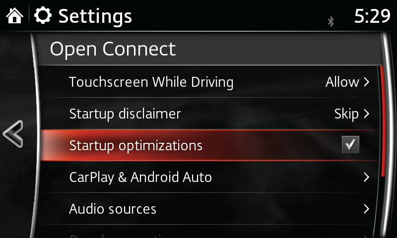

# Startup optimizations

Reduce background logging and stop unused services at startup. Previously called **Base optimizations**; your saved choice is kept.

**Mazda Settings → System → Open Connect → Startup optimizations**

<figure class="oc-screen">
  

  <figcaption>Startup optimizations highlighted (dev.19); shown on, with a fresh-install default of Off.</figcaption>
</figure>

- **Default**: Off.
- **Startup & RAM impact**: **Faster** in dev.7 wired tests: CarPlay dashboard about **3.8 s earlier**, with **+9.9 MiB minimum MemFree** and **+2.58 MiB ending MemFree**.
- **Trade-offs & boot implications**: Stops Aha, Stitcher, DAB and TV. With Wireless CarPlay on, Mazda Navigation starts about **20 s later**, even if no phone connects. Android Auto, DVD, Pandora and SiriusXM stay independent.
- **Applies**: Saved automatically; takes effect on the **next full Mazda Connect startup**. See [restart guidance](settings.md#apply-changes).
- **Evidence & limits**: [Performance evidence](performance.md) links the [dev.7 comparison](base-comparison.md) and later presets’ [memory costs and workload limits](sparse-native-loading.md). These are earlier results, not dev.19 measurements or proof of faster startup than stock. Dev.19 UI bench captures on **74.00.324A NA**; real-car qualification and matched dev.19 benchmarks remain pending. No public download yet.

## Change the setting

Turn **Startup optimizations** on or off and confirm **Enable** or **Disable**.
Turning it off restores Mazda’s original logging and startup behavior on the next full startup; your individual service choices stay saved.

Leave it off if you want Mazda’s usual Navigation startup timing.

MemFree counts free RAM, not memory available to apps. Do not add savings from separate tests.

[Back to Settings](settings.md)
