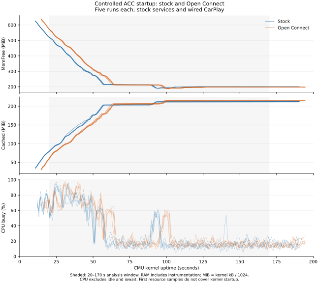

# Startup verification optimization

The first small optimization recovers about **1.2 seconds to Home** and
**2.2 seconds to the wired CarPlay dashboard** relative to the measured dev.4
candidate. It does not recover the stock timings or demonstrate a CPU/RAM saving.

This changes dependency verification: resolve each path, validate each consecutive
private package/composed parent once, then retain every file's canonical-path,
symlink and exact-byte checks. The parent result lives only in that verification
call. Transaction records, original preservation, recovery and uninstall ordering
are unchanged.

## Five-start result

This uses the [first comparison's definitions and instrumentation](startup-comparison.md):
74.00.324A NA, controlled 30-second ACC shutdown, wired CarPlay idle dashboard,
Allow/Skip, product UART/SSH off, unchanged services and locally recorded
180-second system traces. SSH retrieves only after 225 seconds. Actual first
samples are at uptime 14.54–14.72 s; earlier resource pressure remains unobserved.
Five new dev.5 attempts completed and passed postflight/clock checks. Every video
started on the dashboard and returned automatically, without input during startup.

The original **five stock controls are reused**, not five new stock trials.
Dev.4 and dev.5 are sequential blocks on the same bench/phone; order, drift and
the unrecorded phone model/iOS limit attribution and cross-bench reproduction.
The SD installer was temporarily replaced for installation, then the exact
35-file reference payload was restored before the first timed OFF. Other
retained SD folders and peripherals were unchanged.

| Configuration | Median Home bounds (s) | Median dashboard bounds (s) | Median CPU busy | Median minimum MemFree (MiB) |
| --- | --- | --- | --- | --- |
| Stock, original controls | 25.40–25.61 | 48.19–48.40 | 30.01% | 190.58 |
| Dev.4, original candidate | 33.03–33.24 | 56.63–56.85 | 33.60% | 188.92 |
| Dev.5, grouped parent checks | 31.83–32.04 | 54.42–54.63 | 33.51% | 189.09 |

Intervals are adjacent-frame timestamps relative to the host ACC-on command,
rounded outwards. Sensor/display and relay latency remain uncalibrated. CPU/RAM
use the same per-run endpoints inside uptime 20–170 s; MemFree is not MemAvailable.

| Dev.5 run | Home (s) | Dashboard (s) | CPU busy | Minimum MemFree (MiB) |
| --- | --- | --- | --- | --- |
| 1 | 32.22–32.43 | 55.21–55.43 | 33.47% | 189.09 |
| 2 | 31.83–32.04 | 54.02–54.23 | 33.51% | 191.17 |
| 3 | 31.82–32.03 | 54.42–54.63 | 33.43% | 189.29 |
| 4 | 32.43–32.64 | 54.42–54.63 | 33.95% | 188.08 |
| 5 | 31.63–31.84 | 53.82–54.03 | 33.55% | 188.32 |

The dev.5 CPU range is 33.43–33.95%; minimum MemFree ranges 188.08–191.17 MiB.
The original dev.4 high-CPU run remains in its dataset. Similar medians are not
proof of equal CPU use, nor do these RAM counters demonstrate useful savings.



After collection, three read-only warm-cache checks on the installed candidates
measured dependency verification at **2.97–3.06 s, median 3.00 s**, before, and
**1.41–1.60 s, median 1.48 s**, after. These are function timings, not cold-start
measurements; they support the mechanism without explaining every dashboard
timing difference. The new settled workload observed 10/10 injected focus
changes, with all inputs after uptime 300 s. At 5 fps its intervals still do not
resolve physical input latency. Its 59-sample trace has CPU busy 16.63% and minimum
MemFree 200,116 kernel kB; this single workload is not a CPU/RAM speedup claim.

The historical dev.5 shell-library reproducer (`cmu/bench/startup-cost.sh`,
last preserved at commit [`b4ae523`](https://github.com/aeharding/open-connect/blob/b4ae523/cmu/bench/startup-cost.sh))
verified the runtime member bytes before sourcing its dev.5 shell functions,
required the actual boot and installed manifest ID, and ran three bounded
rounds. It was retired after the native C installer consolidation replaced
those shell libraries; the example invocation from that historical run was:

```sh
ssh -T -F /path/to/ssh-config my-cmu \
  'timeout -t 60 sh -s -- BOOT_UUID INSTALLED_MANIFEST_SHA256' \
  < cmu/bench/startup-cost.sh
```

The original before/after probe copies used those exact fixed identities; this
parameterized version is supplied afterwards for reproduction.

## Reproduce and inspect

The exact measured artifact passed normal SD installation, automatic restart,
completion/Open settings, the five ACC starts, and same-version reinstall with
the actual From dev.5 / To dev.5 prompt. Normal Settings Uninstall plus restart
restored all 19 intake hashes/metadata, absent touch NVRAM, original native and
frontend mappings, and read-only physical root. Product state/runtime were absent.
The independent observer restore returned the original stage-1 inode and its
output was absent on the restored startup. Bench owner SSH/recovery remains
separate. The stock software-restart projection-link issue was recovered with a
normal ACC cycle during fixture setup, outside the timed block.

The 134 offline tests passed with two explicit private-input skips. Independent
implementation review also passed 25 targeted tests and six additional host
uninstall/recovery conflict scenarios. These do not qualify deferred physical
input, audio, motion or matching-car operation.

Measured artifact: [CI 44885727877](https://github.com/aeharding/open-connect/actions/runs/44885727877),
source `761afa5eec32e95ad10c0a59ae62133d3313b313`, version **0.3.0-dev.5**.
USB ZIP SHA256 `25b3d02e93aa3289ad241e5a23608406a6b7af208efbcd82d1a36af2b3ff5aaa`;
public manifest `a16e55cc2c273b3bbaa60278e2fcf05755068897faa04e4cc531167f3b7f5eb3`.
Only VERSION, firmware.sh and transaction.sh differ from the pinned dev.4 runtime;
all other members, including native patches, are byte-identical.

Capture, analysis and portable input wrapper use
[`4e72b3a`](https://github.com/aeharding/open-connect/tree/4e72b3a655f9024ed01439bfd504532f6772ee6f).
Follow its [experiment commands](https://github.com/aeharding/open-connect/blob/4e72b3a655f9024ed01439bfd504532f6772ee6f/cmu/bench/STARTUP-COMPARISON.md),
using the verified installed instance ID rather than the public manifest digest.
The local observer bytes are identical to the original comparison. The exported
stock rows retain their actual `58ba042` collection revision.

For analysis, make a local view with `stock/` and its clock directories pointing
to the original reference block, `open-connect-matched/` to the new five runs,
and the corresponding `response-*`/`response-clock-*` recordings. Run the same
`startup_export`, `startup_focus`, `startup_input_export` and `startup_plot`
commands against that view. The exporter reparses raw framing and checks stored
JSON/CSV and boot/clock identity. The plot can also be recreated directly from
the public sample CSV with Matplotlib 3.10.9; it needs no private capture or CMU.

Download [1,704 samples](assets/performance/startup-verification/startup-samples.csv),
[10 run summaries](assets/performance/startup-verification/startup-runs.csv),
[20 timing intervals](assets/performance/startup-verification/startup-timings.csv),
[200 separate-device I/O records](assets/performance/startup-verification/startup-io.csv),
[input intervals](assets/performance/startup-verification/input-response.csv) and
[workload counters](assets/performance/startup-verification/input-workload.csv).
The stock rows in these files are the original controls. Raw captures, personal
map images, OEM files and credentials remain private. This is development-bench
evidence; deferred physical-input and first-car checks remain unqualified.
