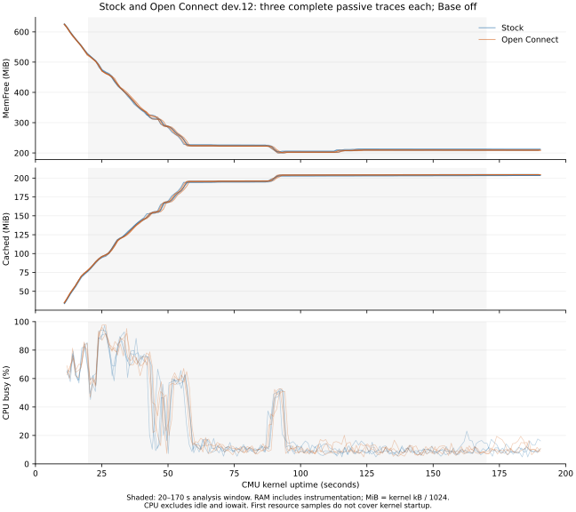

# Stock startup comparison — dev.12

Open Connect's native Service Manager `stage_1` started **0.085 seconds later
than stock**, within the declared 0.10 s margin, in this three-complete-starts-per-
condition comparison. The fully spaced Home
**midpoint estimate was about 0.40 seconds later**, above the 0.20 s margin; its
frame-bound interval straddles that margin. CPU was higher and free RAM lower
with Base off.
[Stock startup parity remains open](https://github.com/aeharding/open-connect/issues/9);
this is a reduction in overhead, not a parity result.

Dev.12 overlaps one verified CPU1 selector with Mazda's existing normal-mode
preparation, then always joins it before Service Manager. Both durable attempt-
record flushes remain. Immutable UIA/JavaScript files use verified persistence
instead of duplicate RAM copies; Settings staging waits until after `stage_3`
on CPU1, with a four-second pause. See [how selection works](how-it-works.md).
The preceding [dev.11 comparison](https://github.com/aeharding/open-connect/blob/79d018d8c5dfa3216dc830ca5c5df53414641036/docs/stock-startup-comparison.md)
retains its own results and original assets; it is not relabeled here.

## Results and attempts

There were **four stock attempts and three active attempts**. Stock attempt 2
retained healthy Home video and one kernel/syslog boot, but SSH retrieval failed
with connection refused. Its RAM trace and clock mapping are unavailable. One
unmeasured ACC recovery restored SSH; stock attempts 3 and 4 completed. All three
active primary attempts completed. There were no observed primary CMU restarts
or failed recordings. Installation, transport recovery and the later Base-on
confirmation are separate setup/check work.

| Median observation, complete traces | Stock | Open Connect dev.12, Base off | Active − stock |
| --- | --- | --- | --- |
| Fully spaced Home, after ACC command | 25.39–25.61 s | 25.79–26.00 s | about +0.40 s |
| Native SM `stage_1` start, logged clock | 8.319 s | 8.404 s | +0.085 s |
| CPU busy, contained 20–170 s window | 24.55% | 25.38% | +0.83 percentage points |
| Minimum MemFree, same window | 203.30 MiB | 200.19 MiB | −3.11 MiB |
| Last MemFree, same window | 211.78 MiB | 209.00 MiB | −2.78 MiB |

The Home midpoint difference is 0.39664 s. Subtracting the median frame-interval
endpoints conservatively gives approximately **+0.196 to +0.598 s**, straddling
the +0.20 s margin. These are observed frame
bounds, not population confidence intervals. The comparison does not establish
Home parity. Including the incomplete stock attempt's valid camera result changes
the midpoint difference to about +0.305 s; it does not supply missing resources
or establish parity either. Camera intervals in tables round outward; displayed
differences round to the nearest stated precision.

| Acquisition order | Home after ACC command | Native SM `stage_1` start | Resource trace |
| --- | --- | --- | --- |
| Stock 1 | 25.58–25.79 s | 8.318 s | complete |
| Stock 2 | 25.80–26.01 s | unavailable | unavailable: SSH fetch failed |
| Stock 3 | 25.39–25.61 s | 8.438 s | complete |
| Stock 4 | 25.20–25.41 s | 8.319 s | complete |
| Dev.12 1 | 25.79–26.00 s | 8.404 s | complete |
| Dev.12 2 | 25.39–25.60 s | 8.390 s | complete |
| Dev.12 3 | 25.79–26.00 s | 8.556 s | complete |

The [attempt table](assets/performance/stock-startup-dev12/startup-attempts.csv)
keeps all seven attempts and maps complete stock trace numbers 1/2/3 to
acquisition attempts 1/3/4. [Unrounded timings](assets/performance/stock-startup-dev12/startup-timings.csv)
and [per-run resources](assets/performance/stock-startup-dev12/startup-runs.csv)
retain individual values. Stock attempt 2's UART contains an sshd bind failure;
the port holder and cause were not identified. It is a transport/retrieval
failure, not evidence of a CMU restart or an Open Connect failure on stock.



[Numeric samples](assets/performance/stock-startup-dev12/startup-samples.csv) and
[per-device I/O](assets/performance/stock-startup-dev12/startup-io.csv) support the
plot. Whole devices and partitions overlap; do not sum them. These sampled
counters start after boot selection and cannot explain earlier storage latency.
As a supplementary settled window, CPU over 50–170 s was 14.38% stock versus
14.73% active (+0.35 percentage points); this does not replace the declared
20–170 s result. See [its endpoints and values](assets/performance/stock-startup-dev12/startup-settled-cpu.csv).

## RAM accounting

MemFree measures free kernel pages, not application PSS or reclaimable RAM.
Its lower active median does not by itself attribute the entire difference to
Open Connect's files or processes. Whole-trace minimum medians were likewise
203.30/200.19 MiB; final-sample medians were 211.69/208.86 MiB. The
[full-coverage summary](assets/performance/stock-startup-dev12/startup-full-memory.csv)
keeps the actual coverage.

| End-of-window median, KiB | Stock | Dev.12 Base off | Difference |
| --- | --- | --- | --- |
| AnonPages | 238308 | 239192 | +884 |
| Cached | 208128 | 209264 | +1136 |
| Shmem | 4188 | 4596 | +408 |
| Slab | 19176 | 19356 | +180 |
| Buffers | 1836 | 1888 | +52 |

These counters describe different, sometimes overlapping categories. Do not
sum them, or add process RSS/PSS to cache and call that an independently measured
private footprint. [Per-run memory accounting](assets/performance/stock-startup-dev12/startup-memory-accounting.csv)
includes first, last, minimum and maximum values; the samples retain AnonPages
as well as the original export fields. This kernel provides no MemAvailable.

A separate Base-off postflight at uptime 277.70 s measured **408 KiB of unique
allocated runtime tmpfs**, including directories and symlink blocks, with shared
hardlinks counted once. The listener had **76 KiB private pages** and the ignition
observer **132 KiB** (208 KiB together). Their alternative PSS values were 86 and
154 KiB; their larger RSS values include shared pages. The
[own-RAM table](assets/performance/stock-startup-dev12/own-ram.csv) keeps these
measurements separate. They are one postflight observation, not another matched
stock subtraction.

Allocated runtime tmpfs fell from the preceding dev.11 layout's 1516 KiB to
408 KiB, about 73%. Serving immutable UIA and system-app.js from verified
persistence saves 844 KiB allocated tmpfs versus the intermediate copied layout.
File-backed mappings still consume resident RAM when used; persistence links do
not make that usage disappear. No zero-RAM-cost claim or owner approval of the
remaining increase is implied.

## Selection and Base-on confirmation

The complete native selector spans were **0.78, 0.64 and 0.80 s**, but all three
finished before Mazda reached the join. Each recorded **0.00 s join wait** at
10 ms stamp resolution. Gate release was 0.02–0.03 s after hook entry. The
[phase CSV](assets/performance/stock-startup-dev12/selector-phases.csv) retains
all stamps, including both durability barriers and OEM-window/join stamps.
The native SM median difference still measured +0.085 s. Selector elapsed time
is not the same quantity as added startup delay.

[Native SM events](assets/performance/stock-startup-dev12/startup-native.csv),
kernel uptime and ACC-relative camera bounds are separate clocks. Do not
subtract across them or equate Home timing with the sampler's launch stamp.

A separate **warm software restart with Base on** confirmed the same CI bundle:
0.81 s selector span, gate at uptime 5.73 s, join at 7.32 s with no recorded wait,
all four DAB/TV/Stitcher leaves stopped, Android Auto/Pandora running, healthy
attempt budget and physical root read-only. Three readbacks each from initialized
MMUI and cpugauge reported enabled level 3 (Warn), retained in
[the logging table](assets/performance/stock-startup-dev12/base-on-logging.csv).
These current readbacks do not prove every initialization order. This is a
functional overlap/logging confirmation, **not a matched Base-on timing, CPU or
RAM qualification**.

## Setup, restoration and limits

The exact CI bundle installed with Allow/Skip enabled, Base/Wireless off,
Android Auto/Pandora on and developer access off. All 41 public member hashes,
the installed instance, original stock-five-field baseline, selected snapshot
and physical read-only root were verified. All static members matched the
reviewed source; six generated assets differed from the Mac build as expected.
The actual CI assets passed the private exact-v74 composition checks before
installation. Live installed Settings opened through Mazda's System page and
Base's actual enable/confirm/restart path worked. The earlier dev.11 delayed-
listener and twelve-second boot-status UI qualification is reused; completion's
Open settings action was not independently requalified in this batch.

Independent installed **dev.12 UI Uninstall at 1ff3fe2**, before the later
read-only plan/hint verification fixes, restored all 20 pinned original hashes
and modes, original loaded UIA/MMUI, saved touchscreen/access state and read-only
root. The helper, product state, runtime and persistence mappings were absent;
all seven checked services ran. It used installed Settings without maintenance
media and qualifies the changed persistent-file/17-member restoration mechanism.
The later advisory-hint and verification changes have affected host/BusyBox tests;
this is not a claim of another final-code Uninstall cycle.

Three complete stock traces preceded installation and three active traces.
One bench, small blocked samples, storage history, recovery and unmeasured drift
limit attribution. The setup restart also needed one unmeasured ACC cycle to
restore SSH despite healthy completion video; it is retained separately from
primary attempts, without an identified product cause. Initial host guard/build
fixture failures and exploratory pilots remain separate evidence, not discarded
primary starts. No projection, audio, route, physical-input, real-car or
long-parked qualification is provided. This does not reproduce Miatafy's wireless
milestone or establish the owner's no-overhead/no-unapproved-RAM requirement.

## Reproduce

Use exactly **74.00.324A NA / cmu150_NA** and the same
[bench instrumentation](cli.md). Hold supply at 12.02 V/2 A, camera exposure105/
gain32, Ethernet and reference FAT SD present, and the paired phone attached to
the Mac. Use native Home with Communication selected, no playing audio or route,
30 seconds ACC-off before each full start, and no input or SSH during primary
collection. Active choices are Allow/Skip1, Base0, Wireless0, Android Auto1,
Pandora1 and UART/SSH0; all seven checked service members must run.

The measured product is [`2fedfcdf`](https://github.com/aeharding/open-connect/tree/2fedfcdf41644e3d888b096838f87227b2d6f275),
[CI 45067694902](https://github.com/aeharding/open-connect/actions/runs/45067694902).
ZIP SHA-256:
`426f9a3e0b527e8aa4abac947c106d00e0eb6f4700c8f344239a64e0e9a2fa6f`.
The 41-member public manifest is
`3e1da846e6ea1f5e8023361f4116753584b0380e0298cb37971480e5f55c608e`.
The installed private instance manifest was
`7d29f83cbe83a6d55060c33b778098e4c4af05155839dce6f93afba985cf5cbf`;
it differs on another CMU.

Use frozen [`95f1eae` capture](https://github.com/aeharding/open-connect/tree/95f1eae00007e59fe5700a2ef08fd8107aa15bde)
and [`802dfcf` annotation/analysis/export](https://github.com/aeharding/open-connect/tree/802dfcf95057785019bc1607c365886bffe849b0).
Capture three complete stock starts, retaining any incomplete attempts:

```sh
python -m open_connect.startup_reference --live --host my-cmu \
  --ssh-config /path/to/ssh-config --condition stock \
  --bundle BATCH/stock/trial-N
```

Install the pinned bundle, check completion/Settings and return to matched Home.
Exclude the setup restart. Collect three ordinary active starts:

```sh
python -m open_connect.startup_reference --live --host my-cmu \
  --ssh-config /path/to/ssh-config --condition open-connect \
  --package ACTUAL_INSTALLED_INSTANCE_MANIFEST --pandora 1 --base 0 --wireless 0 \
  --bundle BATCH/open-connect-matched/trial-N
```

Capture opens UART/video before ACC. The local stage-1 collector runs for 180 s;
SSH retrieval starts at ACC+225 s. The six traces have 172 samples each, covering
uptime 10.78–190.65 s across the batch. CPU excludes idle and iowait. Shared CPU,
RAM and I/O use only samples wholly inside uptime 20–170 s. Earlier resource use
is unobserved; relay-command and sensor latency are uncalibrated.

After each capture closes, obtain the seven-exchange `clock_reference` for its
actual boot into `BATCH/CONDITION/clock-N`. Retrieve `/tmp/smevents.txt` and active
`/tmp/open-connect/startup-times` from that same boot. Select native START/STARTED
for stage_1 and jciMMUI, START for stage_3 and the active Settings worker. Keep
the native and kernel clocks distinct. Score adjacent video frames against a
settled reference: **all five Home icons in their final geometric positions**;
label, clock and highlight fades are not required. The last-before/first-settled
frame pairs were stock 282→283, 283→284 (incomplete), 281→282, 280→281 and active
283→284, 281→282, 283→284. Each interval is about 0.201 s.

```sh
python -m open_connect.startup_annotate TRIAL BEFORE_PTS FIRST_PTS --no-projection
python -m open_connect.startup_export COMPLETE_VIEW EXPORT --runs 3
```

For this export, COMPLETE_VIEW maps stock trial/clock/extra numbers 1/2/3 to
original acquisitions 1/3/4 and active 1/2/3 to 1/2/3, using links without editing
the raw bundles. Published CSV line endings are normalized to LF. The attempt table keeps the missing acquisition. Independently
validate every raw preflight/postflight with `validate_condition`: `stock` for
stock, or `open-connect` with Pandora1/Base0/Wireless0 for active. All twelve
checks passed. Verify fresh boot, one kernel/syslog marker, applied choices and
no conflict/restart; the exporter alone does not impose active selections.

The four generic exported tables are runs, samples, I/O and timings. Add raw
AnonPages from each sample's `/proc/meminfo` by condition/run/sample. For the
memory-accounting table, select the same wholly-contained 20–170 s samples and
report first/last/min/max of MemFree, AnonPages, Cached, Shmem, Slab and Buffers.
For full-memory use all samples; for supplementary CPU use contained 50–170 s
samples. Compute CPU as `100 × (total − idle − iowait) / total` from first/last
aggregate tick deltas; take the median of per-run results, not a pooled sample
median. Record the separate postflight unique-tree `du -sk` and process `smaps`
private/PSS totals without double-counting hardlinks or shared pages.

Render from public samples with
[`b111f19` plotting](https://github.com/aeharding/open-connect/tree/b111f19b24355568e3be066b153a87785ab12434)
and Matplotlib 3.10.9:

```sh
python -m open_connect.startup_plot EXPORT/startup-samples.csv \
  EXPORT/startup-resources.svg \
  --title 'Stock and Open Connect dev.12: three complete passive traces each; Base off'
```
