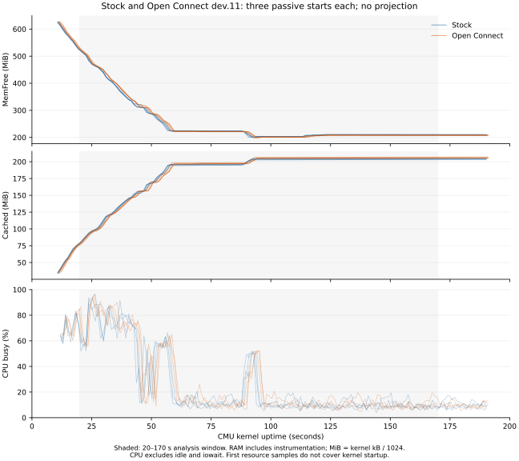

# Stock startup comparison — dev.11

Open Connect reached fully spaced Home about **0.83 seconds later than stock**
in this three-start-per-condition comparison. Native Service Manager's
`stage_1` started **0.621 seconds later**. Both exceed the predeclared margins,
so [stock startup parity remains open](https://github.com/aeharding/open-connect/issues/9).

Dev.11 defers Settings staging until `stage_3` and handles a delayed Settings
backend within the existing twelve-second status budget. It retains the native
selector, synchronous startup placement, integrity checks and both durable
attempt-record flushes. The [earlier pilots](startup-overhead.md#stock-comparison-and-settings-staging)
include the parked compiler/buffer experiment; that change is absent here.

## Results and limits

All **six primary attempts completed** with video, UART, resource retrieval,
same-boot clock mapping and postflight verification. Each had one kernel banner
and one syslog boot marker. There were no primary restarts, failed recordings,
missing traces or discarded attempts. Installation and the separate Settings
readiness check were setup work, outside these six starts.

| Median observation | Stock | Open Connect dev.11 |
| --- | --- | --- |
| First fully spaced Home, after ACC command | 25.39–25.60 s | 26.22–26.43 s |
| Native SM `stage_1` start, logged clock | 8.368 s | 8.989 s |
| CPU busy, contained 20–170 s window | 24.91% | 26.10% |
| Minimum MemFree, same window | 201.25 MiB | 199.22 MiB |
| Last MemFree, same window | 210.08 MiB | 208.04 MiB |

The Home midpoint difference is 0.83016 s. Subtracting the median interval
endpoints conservatively gives **0.62–1.04 s added delay**, beyond the fixed
0.20 s Home margin. The native `stage_1` difference exceeds its separate 0.10 s
margin. These are observed sample medians and frame bounds, not population
confidence intervals. Timing bounds round outward; CPU and RAM round to the
nearest displayed value. [Unrounded frame observations](assets/performance/stock-startup/startup-timings.csv)
and [per-run resources](assets/performance/stock-startup/startup-runs.csv) retain
individual values and actual sampling endpoints.

| Condition / acquisition order | Home after ACC command | Native SM `stage_1` start |
| --- | --- | --- |
| Stock 1 | 25.39–25.60 s | 8.333 s |
| Stock 2 | 25.59–25.80 s | 8.368 s |
| Stock 3 | 25.39–25.60 s | 8.370 s |
| Dev.11 1 | 26.79–27.00 s | 9.460 s |
| Dev.11 2 | 26.22–26.43 s | 8.989 s |
| Dev.11 3 | 26.20–26.41 s | 8.980 s |

The sampled CPU median was 1.19 percentage points higher, and both shared-window
MemFree medians were about 2.04 MiB lower with Open Connect. There is no CPU or
RAM saving claim. Whole-trace minimum MemFree medians were also 201.25/199.22 MiB;
whole-trace final-sample medians were 209.93/207.91 MiB. See the
[full-coverage RAM summary](assets/performance/stock-startup/startup-full-memory.csv).
MemFree measures free kernel pages; it is not application PSS or reclaimable RAM.



[Numeric samples](assets/performance/stock-startup/startup-samples.csv) and
[per-device I/O](assets/performance/stock-startup/startup-io.csv) support the plot.
For example, median `mmcblk0` reads in the shared window were about 31.16 MiB
on stock and 31.36 MiB with Open Connect. Whole devices and their partitions
overlap; do not sum them. These counters start after boot selection and cannot
explain its earlier storage latency.

Three stock starts preceded installation and three active starts. One bench,
small samples, acquisition order, storage history and unmeasured environmental
drift limit attribution. The comparison covers this Allow/Skip configuration,
not other presets, physical-input responsiveness, audio or long-parked behavior.
There was no projection workload, so these measurements do not qualify CarPlay
performance or reproduce Miatafy's wireless timings.

## Remaining selector work

The three active selector spans were **0.96, 0.58 and 0.56 seconds** at 10 ms
stamp resolution. [All phase stamps](assets/performance/stock-startup/selector-phases.csv)
retain the kernel uptime values.

| Elapsed selector phase | Dev.11 1 | Dev.11 2 | Dev.11 3 |
| --- | --- | --- | --- |
| Inputs and policy | 0.15 s | 0.18 s | 0.14 s |
| Checked RAM staging | 0.23 s | 0.23 s | 0.24 s |
| Record written → directory synced | 0.57 s | 0.17 s | 0.18 s |

Record serialization accounts for the remaining 0.01 s in the first start.
Shared stamps indicate sub-resolution work, including completed barriers.
The record is written to a new inode, flushed, closed, renamed and followed by
a parent-directory flush before publication. The observed variation does not
identify its storage cause. Pre-selector CPU, RAM and queue state are unobserved.

[Native SM events](assets/performance/stock-startup/startup-native.csv), kernel
uptime and ACC-relative camera bounds are separate clocks. The visible delay
must not be equated with the selector span or a later sampler-launch stamp.

## Setup checks

The exact CI bundle installed with default Allow/Skip, Base/Wireless off,
Android Auto/Pandora on and developer access off. All 40 public members matched;
the root helper and other native members were byte-identical to qualified
dev.10. The as-found stock-five-field baseline, selected snapshot and physical
read-only root were verified.

A separate real-Opera check exercised completion's **Open settings** action
while its verified RAM listener was stopped for a nominal five-second interval.
The same session was restored, Settings opened, the completion notice cleared
and preferences stayed unchanged. Restoration was verified 5.67 s after the
input transmission; the replacement listener's process began after 5.02 s.
This simulates delayed backend availability, rather than observing a click at
the instant Home renders. Mock-clock checks additionally cover refusal/busy at
11,999 ms completing at 12,000 ms without another request.

Independent compatible dev.10 maintenance restored the preceding experimental
installation to stock before acquisition: all 20 pinned original hashes/modes,
original loaded libraries, saved access/NVRAM state and read-only root matched;
Open Connect's helper and state were removed. The unchanged transaction and
Uninstall mechanism reuse that qualification. Physical-input/audio/car checks
remain deferred.

## Reproduce

Use exactly **74.00.324A NA / cmu150_NA** and the same
[bench instrumentation](cli.md). Hold supply at 12.02 V/2 A, camera exposure105/
gain32, Ethernet and reference FAT SD present, and the paired phone attached to
the Mac. Use native Home with Communication selected, no playing audio or route,
30 seconds ACC-off before each full start, and no input or SSH during primary
collection. Active settings are Allow/Skip1, Base0, Wireless0, Android Auto1,
Pandora1 and UART/SSH0; all seven checked service members must be running.

The tested product is [`db11c8c4`](https://github.com/aeharding/open-connect/tree/db11c8c4a0a92acd171d970e9c60ca6693361d36),
[CI 45037634732](https://github.com/aeharding/open-connect/actions/runs/45037634732),
artifact `14759963605`. ZIP SHA-256:
`e9f87712968b3b7ffbddff08c645dc28b0d08520ccc5735b3eef09961a832c4a`.
The 40-member public manifest is
`cc0b1dd77e30669360a611ec31e2fb2fdbe522ae9bfe63b901c2bd6ca4b82e94`.
Only VERSION, runtime.js and sm-profile.awk differ from the dev.10 control.
Per-install instance manifests differ on another CMU.

Use frozen [`95f1eae` capture](https://github.com/aeharding/open-connect/tree/95f1eae00007e59fe5700a2ef08fd8107aa15bde)
and [`802dfcf` annotation/analysis/export](https://github.com/aeharding/open-connect/tree/802dfcf95057785019bc1607c365886bffe849b0).
For each of three stock starts, collect into `BATCH/stock/trial-N`:

```sh
python -m open_connect.startup_reference --live --host my-cmu \
  --ssh-config /path/to/ssh-config --condition stock \
  --bundle BATCH/stock/trial-N
```

Install the pinned bundle, check completion/Settings and return to matched Home.
Exclude that setup restart. Then collect three ordinary active starts into
`BATCH/open-connect-matched/trial-N`:

```sh
python -m open_connect.startup_reference --live --host my-cmu \
  --ssh-config /path/to/ssh-config --condition open-connect \
  --package ACTUAL_INSTALLED_INSTANCE_MANIFEST --pandora 1 --base 0 --wireless 0 \
  --bundle BATCH/open-connect-matched/trial-N
```

Capture starts UART/video before ACC. Resource collection starts after the
stage-1 observer's guards and runs for 180 s; SSH retrieval begins at ACC+225 s.
The complete traces covered uptime 10.78–191.03 s across the six starts, with
170–172 samples each. CPU excludes idle and iowait. Shared CPU, RAM and I/O use
only samples wholly inside uptime 20–170 s; actual endpoints remain in the CSV.
Earlier resource use is unobserved. Relay-command and camera-sensor latency have
not been calibrated.

After each capture closes, obtain the seven-exchange `clock_reference` for its
actual boot into `BATCH/CONDITION/clock-N`. Retrieve `/tmp/smevents.txt` and, for
active boots, `/tmp/open-connect/startup-times` for that same boot. The native
CSV selects START/STARTED rows for stage_1 and jciMMUI, START for stage_3,
and the active Settings worker's START. The phase CSV transcribes the eight named selector
stamps without mixing clocks. Review adjacent video frames: score all five Home
icons in their final positions; label, clock and highlight fades are not required.

```sh
python -m open_connect.startup_annotate TRIAL BEFORE_PTS FIRST_PTS --no-projection
python -m open_connect.startup_export BATCH EXPORT --runs 3
```

Independently validate each raw preflight and postflight with `validate_condition`:
`stock` for stock; `open-connect`, Pandora1/Base0/Wireless0 for active. Check saved
and applied choices, fresh boot, one kernel/syslog marker and no restart/conflict.
The generic exporter alone does not impose those active feature selections.
Its `startup-runs.csv` RAM fields cover the shared window; `startup_analysis`
reports whole-trace memory for the full-coverage table.

Render from the public samples with
[`b111f19` plotting](https://github.com/aeharding/open-connect/tree/b111f19b24355568e3be066b153a87785ab12434)
and Matplotlib 3.10.9:

```sh
python -m open_connect.startup_plot EXPORT/startup-samples.csv \
  EXPORT/startup-resources.svg \
  --title 'Stock and Open Connect dev.11: three passive starts each; no projection'
```
