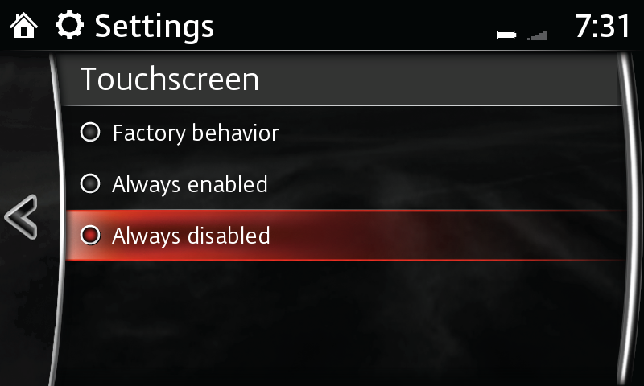

# Touchscreen

Choose how Mazda Connect handles touch input. The Commander knob and normal Mazda controls remain available in every mode.

<dl class="oc-spec">
  

    <dt>Menu</dt>
    <dd>Open Connect</dd>
  

  

    <dt>Default</dt>
    <dd>Always enabled</dd>
  

  

    <dt>Impact</dt>
    <dd>Not measured separately</dd>
  

  

    <dt>Applies</dt>
    <dd>Next full startup</dd>
  

</dl>

<figure class="oc-screen">
  

  <figcaption>Touchscreen choices in 0.3.0-dev.24.</figcaption>
</figure>

## Notes

Choices save automatically and take effect on the <strong>next full Mazda Connect startup</strong>. Use <a href="apply-changes.md">Apply changes</a> to restart right away.

<strong>Always disabled</strong> stops Mazda Connect from reading the touchscreen while keeping the Commander knob working, which is intended for panels with phantom (“ghost”) touches. On bench tests of <strong>0.3.0-dev.24</strong>, it uses +4 KiB of temporary runtime storage and +8 KiB of <code>devices</code> memory only when selected (0 B runtime overhead when set to Factory behavior or Always enabled). See <a href="reverse-engineering.md#boot-scoped-touchscreen-disable-on-v74">implementation notes</a> for details.

<strong>Always disabled</strong> requires the exact supported <strong>74.00.324A NA</strong> input libraries. If you ever need to switch off <strong>Always disabled</strong>, use the Commander knob to return to <strong>Touchscreen</strong> and pick another option, then run <a href="apply-changes.md">Apply changes</a>.

<strong>Qualification limits:</strong> bench tests verified all three choices, software touch suppression, and Commander-only recovery back to working touch on <strong>74.00.324A NA</strong>. Real-car driving, physical ghost-touch panels, physical Commander hardware, and active CarPlay, Android Auto and Navigation touch remain unverified.

## Options

| Choice | Behavior |
| --- | --- |
| **Factory behavior** | Uses the touchscreen setting saved before installation. |
| **Always enabled** (default) | Keeps touch enabled while moving. |
| **Always disabled** | Blocks touchscreen input while keeping Commander navigation working. |

## Upgrading from or using older USB drives

Earlier prereleases (such as **0.3.0-dev.23**) called this setting **Touchscreen While Driving** with only **Allow** and **Factory Default**. Your saved choice migrates automatically when you update to **0.3.0-dev.24**.

To remove **0.3.0-dev.24** while **Always disabled** is saved, use the installed **Uninstall** menu or a **0.3.0-dev.24** (or newer) USB drive. Older USB drives refuse maintenance while **Always disabled** is saved — switch to **Factory behavior** or **Always enabled** first if you need to use an older USB drive.

[Back to Settings](settings.md)
