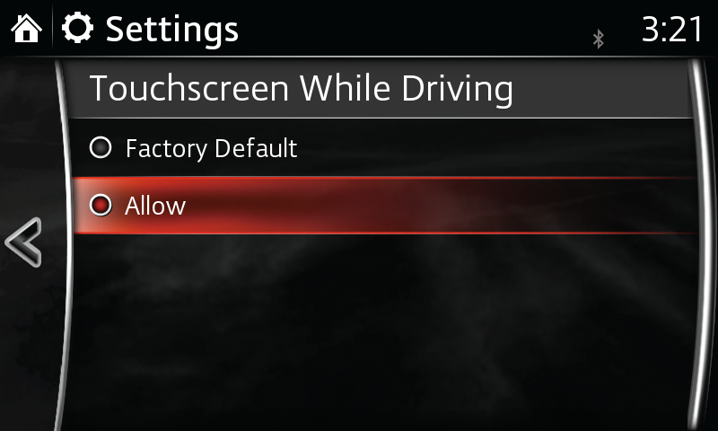

# Touchscreen While Driving

  <strong>Menu:</strong> Mazda Settings → System → Open Connect → Touchscreen While Driving
  <strong>Default:</strong> Allow
  <strong>Takes effect:</strong> Next full restart

## Why it exists

Mazda Connect disables touchscreen input as soon as the vehicle moves above roughly 5 mph, forcing everyone — including a front passenger — to use the rotary commander knob for maps, search, and menus.

**Touchscreen While Driving** removes that speed-based lockout while leaving the commander knob, steering-wheel buttons, and all normal Mazda controls unchanged.

## Choices

| Choice | What it does |
| --- | --- |
| **Allow** · *default* | Keeps touchscreen input active regardless of vehicle speed. |
| **Factory Default** | Restores the exact touchscreen setting recorded before Open Connect was installed. |

<figure class="oc-screen">
  

  <figcaption>Select Allow to keep touch enabled, or Factory Default to restore stock behavior.</figcaption>
</figure>

> **Qualification note:** Targets exact `74.00.324A NA`. Software configuration and uninstall restoration are verified on the bench; physical touch while moving in a real vehicle is not yet qualified. See [Quick start](usb-installer.md) for current release status.

[Back to Settings →](settings.md) · [Install Open Connect →](usb-installer.md)
