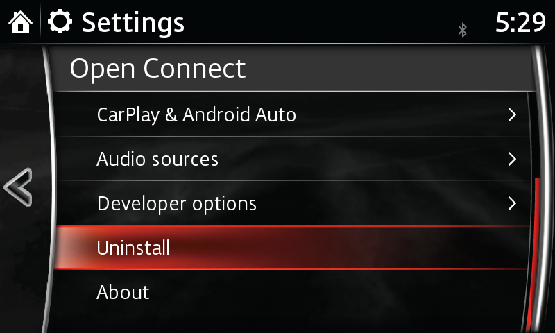

# Uninstall

Remove Open Connect from Mazda Settings. You don’t need a USB drive or computer.

<dl class="oc-spec">
  

    <dt>Menu</dt>
    <dd>Open Connect</dd>
  

  

    <dt>Default</dt>
    <dd>—</dd>
  

  

    <dt>Impact</dt>
    <dd>Restores pre-install</dd>
  

  

    <dt>Applies</dt>
    <dd>Auto restart</dd>
  

</dl>

<figure class="oc-screen">
  

  <figcaption>Uninstall highlighted (dev.19).</figcaption>
</figure>

## Notes

No preference; removal requires confirmation.

<strong>Restores the saved pre-install configuration.</strong> This is a removal action, with no isolated RAM/CPU/startup improvement claimed.

Removes Open Connect, its backups and saved choices. Install again using USB; radio presets, phone pairings and other normal Mazda preferences remain.

Confirming <strong>Uninstall</strong> starts removal and an automatic Mazda Connect restart. Keep the car on until it finishes.

Dev.20 Settings Uninstall and the post-dev.20 PR #149 candidate have bench verification on <strong>74.00.324A NA</strong>; real-car removal remains unqualified. <a href="performance.md">Performance evidence</a> does not measure an isolated uninstall benefit. The screenshot above remains dev.19. <strong>0.3.0-dev.20</strong> is a development prerelease.

## Remove from Settings

1. Select **Uninstall** and confirm **Uninstall**.
2. Keep the car on while Mazda Connect restores the saved configuration and restarts.

<figure class="oc-screen">
  

  <figcaption>Leave power on until the restart finishes (retained dev.17 capture).</figcaption>
</figure>

Uninstall restores the startup, touchscreen and access configuration saved before installation. It then removes Open Connect’s files and backups. Radio presets, phone pairings and other normal Mazda preferences are left alone.

If another modification changed files Open Connect needs to restore, removal stops rather than overwriting them. Keep the message for an [issue report](https://github.com/aeharding/open-connect/issues).

## Remove using USB

If Settings is unavailable, [prepare a USB drive](usb-installer.md) with a compatible bundle. Insert it on Mazda Connect’s main screen and choose **Uninstall**. Keep the drive connected and the car on until restart finishes.

A compatible replacement drive works. You don’t need the original stick.

## Install again

Use USB and choose **Install**. A new installation starts with default preferences.

[Back to Settings](settings.md)
