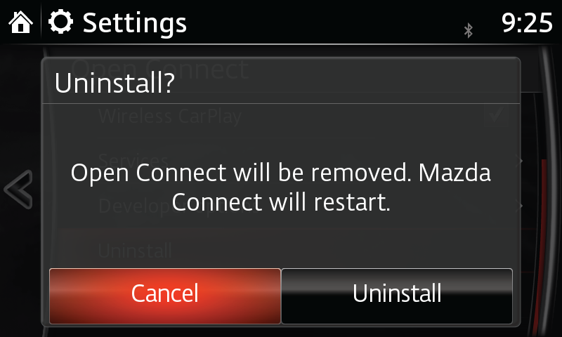

# Uninstall

1. Open **Mazda Settings → System → Open Connect**.
2. Choose **Uninstall**, then confirm **Uninstall**.
3. Leave the power on. Mazda Connect restores the startup and touchscreen
   behavior from before you installed Open Connect, then restarts automatically.

<figure class="oc-screen">
  

  <figcaption>Choose Uninstall. Mazda Connect restarts automatically.</figcaption>
</figure>

The USB drive is not needed for removal through Settings.
After a successful uninstall, Open Connect's files and backups are deleted.

## Remove it using USB

Prepare a drive using [Quick start](usb-installer.md), insert it while Mazda Connect
shows its main screen, and choose **Uninstall**. A replacement drive is fine; you do not need
the original one. Leave it connected until the restart finishes.

If another modification conflicts, Uninstall stops without overwriting it.
Keep the displayed message when [reporting the problem](https://github.com/aeharding/open-connect/issues).

## Install it again

Follow [Quick start](usb-installer.md) and choose **Install**. Your old Open Connect
preferences are not retained.

The earlier v55 development releases have their matching maintenance bundles
in the [release archive](https://github.com/aeharding/open-connect/releases).
The current source targets v74; cross-firmware maintenance is not promised.
