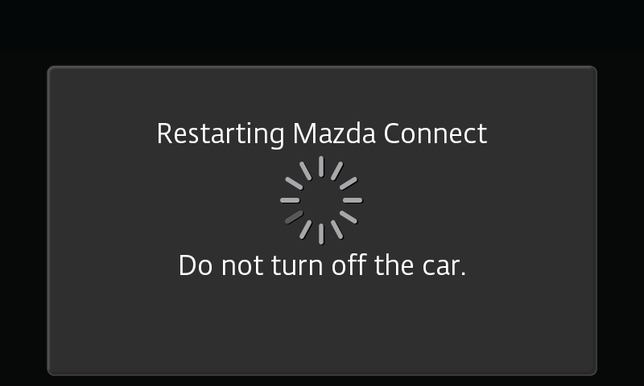

# Uninstall

Remove Open Connect directly from Mazda Settings. You don’t need a USB drive or computer.

<dl class="oc-spec">
  

    <dt>Menu</dt>
    <dd>Open Connect</dd>
  

  

    <dt>Default</dt>
    <dd>—</dd>
  

  

    <dt>Impact</dt>
    <dd>Restores pre-install</dd>
  

  

    <dt>Applies</dt>
    <dd>Auto restart</dd>
  

</dl>

<figure class="oc-screen">
  

  <figcaption>Uninstall highlighted (dev.19).</figcaption>
</figure>

## Notes

Confirming <strong>Uninstall</strong> restores the configuration saved before installation, removes Open Connect and its backups, and automatically restarts Mazda Connect. Keep the car on until the restart finishes.

Your radio presets, phone pairings and other normal Mazda preferences are left untouched. <strong>0.3.0-dev.24</strong> is a development prerelease for <strong>74.00.324A NA</strong>; real-car removal remains unqualified.

## Remove from Settings

1. Select **Uninstall** and confirm **Uninstall**.
2. Keep the car on while Mazda Connect restores the saved configuration and restarts.

<figure class="oc-screen">
  

  <figcaption>Leave power on until the restart finishes (dev.17 capture).</figcaption>
</figure>

If another modification changed files Open Connect needs to restore, removal stops rather than overwriting them. Keep the message shown on screen for an [issue report](https://github.com/aeharding/open-connect/issues).

## Remove using USB

If Settings is unavailable, [prepare a USB drive](usb-installer.md) with a compatible bundle (use **0.3.0-dev.24** or newer if Touchscreen is set to **Always disabled**). Insert it on Mazda Connect’s main screen and choose **Uninstall**. Keep the drive connected and the car on until the restart finishes.

Any compatible USB drive works — you don’t need the original stick.

## Install again

Insert the USB drive and choose **Install**. A new installation starts with default preferences.

[Back to Settings](settings.md)
