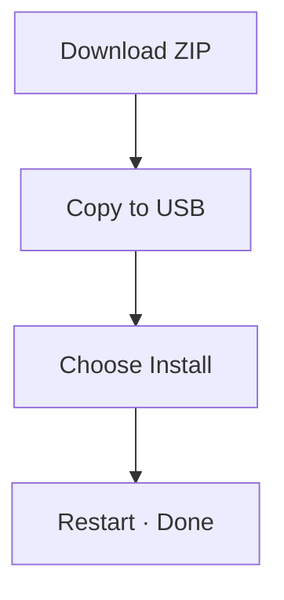

# Quick start

Install Open Connect from a USB drive. It adds two choices to Mazda Settings:
touchscreen access while moving and whether to show the startup disclaimer.

> **Development prerelease · 55.00.750B North America only**
>
> This release is for bench testing. Physical touch while moving is still being
> qualified. **Firmware 74 is not supported yet.**

<a class="md-button md-button--primary" href="https://github.com/aeharding/open-connect/releases/download/v0.2.0-dev.2/open-connect-0.2.0-dev.2-usb.zip">Download USB installer</a> <a class="md-button" href="https://github.com/aeharding/open-connect/releases/tag/v0.2.0-dev.2">Release notes</a>

## 1. Prepare the USB drive

Use a drive formatted as **FAT32**. Extract the downloaded ZIP and copy **all of
its contents** directly onto the drive, outside any extra folder.

The drive should contain the `open-connect` folder and **two small files beside
it**. Keep their original names, including the unusually named `.up` file.
Copy the extracted files, not the ZIP itself. Safely eject the drive.

## 2. Choose Install

Wait for Mazda Connect's **Home** screen, then insert the USB drive.
Choose **Install** when the prompt appears.

<figure class="oc-screen">
  

  <figcaption>Choose Install. Mazda Connect handles the restart.</figcaption>
</figure>

**Leave the power on and the USB drive connected** while installation completes.
Mazda Connect restarts automatically.

## 3. Finish

After the restart, choose **Done** or **Open settings**. You can now remove the
USB drive. Open Connect stays installed for future starts.

<figure class="oc-screen">
  

  <figcaption>Choose Open settings to change either preference.</figcaption>
</figure>

[Change your settings →](settings.md) · [Uninstall →](uninstall.md)

## Updating an existing installation

Prepare a USB drive from the new release in the same way. Insert it at Home and
choose **Install/update**. Your Open Connect preferences are kept.

## No prompt?

Check that you're at Home, the drive is FAT32, and the extracted folder and two
files are directly on the drive. Check the firmware limit above, then reinsert
the drive. If it still does not open,
[report the problem](https://github.com/aeharding/open-connect/issues) with your
firmware version and what appeared on screen.
