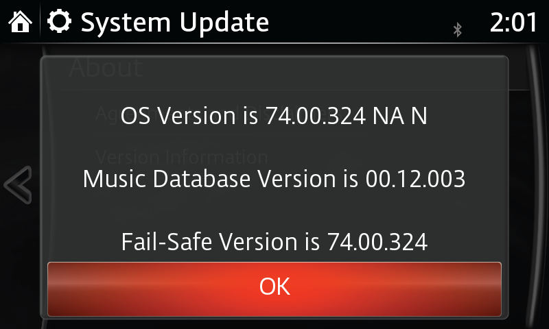

# Quick start

Open Connect installs from a USB drive. After installation, use Mazda Settings to change preferences or uninstall.

**Still in testing. No public download yet.** The menu instructions describe **0.3.0-dev.19**; screenshots show the earlier dev.17 preview. Bench checks do not establish real-car or physical-control qualification.

## 1. Check your firmware version

Open **Mazda Settings → System → About → Version Information**.

<figure class="oc-screen">
  

  <figcaption>Check OS Version: 74.00.324 NA N.</figcaption>
</figure>

Find **OS Version**. It must read **74.00.324 NA N**. This is the North American firmware supported by the current preview, also called **74.00.324A** in development records.

Other versions and regions are unsupported. Check the screen rather than guessing by model year. This guide does not cover firmware upgrades.

## 2. Prepare a USB drive

When a qualified release is available, use its ZIP for your supported version.

Format a USB drive as FAT32, extract the ZIP onto it — the files must be at the root of the drive, not in an extra folder — then eject.

## 3. Install

Wait for **Mazda Connect’s main screen**, then insert the drive. Choose **Install** when prompted.

<figure class="oc-screen">
  

  <figcaption>The development preview’s install prompt.</figcaption>
</figure>

**Leave the USB drive connected and keep the car on** during installation and the automatic restart.

<figure class="oc-screen">
  

  <figcaption>Wait while the installation finishes and Mazda Connect restarts.</figcaption>
</figure>

## 4. Finish

Wait for **Open Connect installed**. You can now remove the USB drive. Choose **Done** or **Open settings**.

<figure class="oc-screen">
  

  <figcaption>Open Connect stays installed after you remove the drive.</figcaption>
</figure>

[Choose your settings](settings.md) · [Remove Open Connect](uninstall.md)

## Updates

Prepare a drive with a compatible bundle and insert it on Mazda Connect’s main screen. Check **From** and **To**, then choose **Update**. Matching versions show **Reinstall** instead. Your preferences are kept.

Keep the drive connected and the car on until completion appears after restart. Any compatible replacement drive works; you don’t need the original.

## Other modifications

Remove conflicting modifications first, including older wireless CarPlay mods. If files don’t match what Open Connect expects, it stops instead of overwriting them. If previous modifications cannot be cleanly removed back to stock, reinstall Mazda firmware **74.00.324 NA N** before installing Open Connect.

## Troubleshooting

Check the version, FAT32 format and extracted files. Make sure Mazda Connect is showing its main screen, then reinsert the drive.

If the prompt still doesn’t appear, [report an issue](https://github.com/aeharding/open-connect/issues). Include your OS Version, bundle version and the message you saw.
