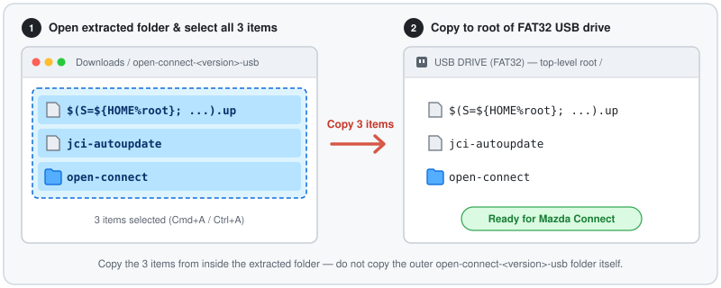
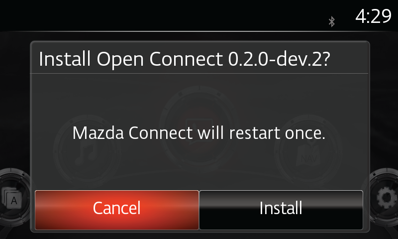
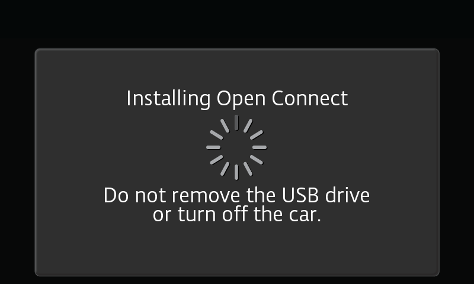
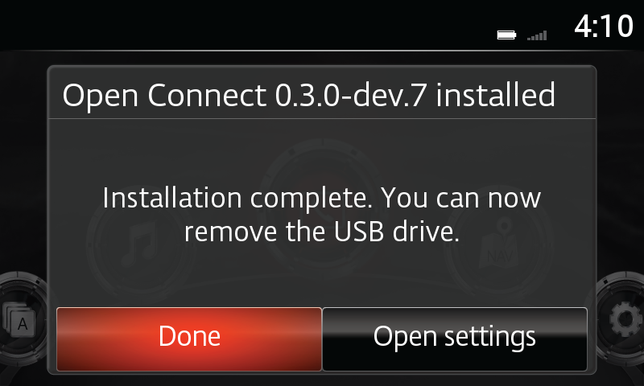

# Quick start

Open Connect installs from a USB drive. After installation, change preferences or uninstall directly from Mazda Settings.

**0.3.0-dev.26** is a development prerelease for North American version **74.00.324 NA N**. Real-car and physical-control qualification remain pending.

## 1. Check your firmware version

Open **Mazda Settings → System → About → Version Information**.

<figure class="oc-screen">
  

  <figcaption>Check OS Version: 74.00.324 NA N.</figcaption>
</figure>

Find **OS Version**. It must read **74.00.324 NA N** (also called **74.00.324A** in development records). Other versions and regions are unsupported. Check the screen rather than guessing by model year. This guide does not cover firmware upgrades.

## 2. Prepare a USB drive

1. Download the latest USB ZIP from [Releases](https://github.com/aeharding/open-connect/releases) and extract it on your computer. It unpacks into a single folder named `open-connect-<version>-usb`.
2. Format a USB drive as **FAT32**.
3. Open the extracted `open-connect-<version>-usb` folder, **select all three items inside** (the `.up` trigger file, `jci-autoupdate`, and the `open-connect` folder), and copy them directly to the **root** of your USB drive — do not copy the outer `open-connect-<version>-usb` folder itself.
4. Safely eject the USB drive.

<figure class="oc-diagram">
  
  <figcaption>Select the three items inside the extracted folder and copy them directly to the root of the FAT32 USB drive.</figcaption>
</figure>

## 3. Install

Wait for **Mazda Connect’s main screen**, then insert the drive. Choose **Install** when prompted.

<figure class="oc-screen">
  

  <figcaption>The install prompt (captured on dev.17).</figcaption>
</figure>

**Leave the USB drive connected and keep the car on** during installation and the automatic restart.

<figure class="oc-screen">
  

  <figcaption>Wait while installation finishes and Mazda Connect restarts.</figcaption>
</figure>

## 4. Finish

Wait for **Open Connect installed**. You can now remove the USB drive. Choose **Done** or **Open settings**.

<figure class="oc-screen">
  

  <figcaption>Open Connect stays installed after you remove the drive.</figcaption>
</figure>

[Choose your settings](settings.md) · [Remove Open Connect](uninstall.md)

## Updates

Prepare a drive with a compatible bundle and insert it on Mazda Connect’s main screen. Check **From** and **To**, then choose **Update** (matching versions show **Reinstall**). Your saved preferences are kept.

Keep the drive connected and the car on until completion appears after restart. Any compatible USB drive works; you don’t need the original stick.

## Other modifications

Remove conflicting modifications first, including older wireless CarPlay tweaks. If system files don’t match what Open Connect expects, it stops instead of overwriting them. If previous modifications cannot be cleanly removed back to stock, reinstall Mazda firmware **74.00.324 NA N** before installing Open Connect.

## Troubleshooting

Check the firmware version, FAT32 format and that the three items (`*.up`, `jci-autoupdate`, and `open-connect`) sit directly at the root of the drive rather than inside `open-connect-<version>-usb`. Make sure Mazda Connect is showing its main screen, then reinsert the drive.

If installation, update or removal stops with an error, Open Connect saves a diagnostic report named `open-connect-error.log` at the root of your USB drive (with no keys or personal data). Attach that file when you [report an issue](https://github.com/aeharding/open-connect/issues), along with your OS Version, bundle version and the message shown.
