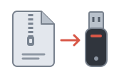
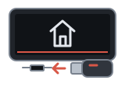

# Quick start

Install Open Connect from a USB drive. It adds two choices to Mazda Settings:
touchscreen access while moving and whether to show the startup disclaimer.

> **Development prerelease · 55.00.750B North America only**
>
> This release is for bench testing. Startup reliability and physical touch while
> moving are still being qualified. **Firmware 74 is not supported yet.**

<a class="md-button md-button--primary" href="https://github.com/aeharding/open-connect/releases/download/v0.2.0-dev.2/open-connect-0.2.0-dev.2-usb.zip">Download USB installer</a> <a class="md-button" href="https://github.com/aeharding/open-connect/releases/tag/v0.2.0-dev.2">Release notes</a>

<ol class="oc-install-flow" aria-label="Installation overview">
  <li>
    
    <strong>1 Prepare the USB</strong>
    
Extract every file onto a FAT32 drive.

  </li>
  <li>
    
    <strong>2 Insert the USB</strong>
    
Wait for Mazda Connect’s main screen, then insert the drive.

  </li>
  <li>
    
    <strong>3 Install and restart</strong>
    
Choose Install. Keep the USB connected and the car on until installation is complete.

  </li>
</ol>

## 1. Prepare the USB drive

Use a drive formatted as **FAT32**. Extract the downloaded ZIP and copy **all of
its contents** directly onto the drive, outside any extra folder.

The drive should contain the `open-connect` folder and **two small files beside
it**. Keep their original names, including the unusually named `.up` file.
Copy the extracted files, not the ZIP itself. Safely eject the drive.

## 2. Choose Install

Wait for **Mazda Connect's main screen**, then insert the USB drive.
Choose **Install** when the prompt appears.

<figure class="oc-screen">
  

  <figcaption>Choose Install. Keep the USB connected and the car on.</figcaption>
</figure>

**Do not remove the USB drive or turn off the car** during installation or the
automatic restart. Wait for the **Installation complete** message.

## 3. Finish

After the restart, wait for **Installation complete**, then choose **Done** or
**Open settings**. You can now remove the USB drive. Open Connect stays installed
for future starts.

<figure class="oc-screen">
  

  <figcaption>You can now remove the USB drive. Choose Open settings to change your preferences.</figcaption>
</figure>

[Change your settings →](settings.md) · [Uninstall →](uninstall.md)

## Updating an existing installation

Prepare a USB drive from the new release in the same way. Insert it while
Mazda Connect shows its main screen and choose **Install/update**.
Your Open Connect preferences are kept.

## No prompt?

Check that Mazda Connect shows its main screen, the drive is FAT32, and the
extracted folder and two files are directly on the drive. Check the firmware
limit above, then reinsert the drive. If it still does not open,
[report the problem](https://github.com/aeharding/open-connect/issues) with your
firmware version and what appeared on screen.
