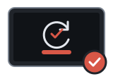
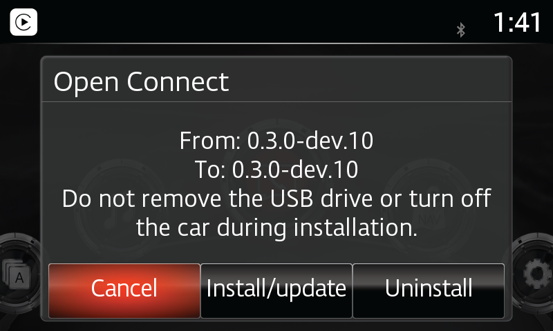

# Quick start

Install Open Connect directly from a FAT32 USB drive — no laptop, serial cable, or network connection required. Once installed, every setting and Uninstall live inside **Mazda Settings**.

  Pre-release · 74.00.324A NA
  Targets exact firmware <strong>74.00.324A North America (cmu150_NA)</strong>. A qualified release download is not published yet; screenshots show <code>0.3.0-dev.17</code> on the bench. <a href="installer-development/">Current limits →</a>

<ol class="oc-install-flow" aria-label="Installation overview">
  <li>
    
    <strong>1 Prepare the USB</strong>
    
Extract every file directly onto a FAT32 drive.

  </li>
  <li>
    
    <strong>2 Insert the USB</strong>
    
Wait for Mazda Connect’s main screen, then plug in the drive.

  </li>
  <li>
    
    <strong>3 Install &amp; restart</strong>
    
Choose Install and leave power and USB connected until completion appears.

  </li>
</ol>

## 1. Prepare the USB drive

Format a USB drive as **FAT32**. Extract the release ZIP and copy **all of its contents** directly to the top level of the drive (not inside an extra folder).

You should see the `open-connect` folder alongside **two small files** — keep their exact names, including the `.up` file. Copy the extracted files rather than the ZIP itself, then safely eject the drive.

## 2. Choose Install

Wait until **Mazda Connect’s main screen** is visible, then plug in the USB drive. Choose **Install** when the prompt appears.

<figure class="oc-screen">
  

  <figcaption>Confirm Install while Mazda Connect’s main screen is showing.</figcaption>
</figure>

**Keep the USB drive plugged in and the car turned on** while Open Connect applies the installation and automatically restarts Mazda Connect.

<figure class="oc-screen">
  

  <figcaption>Mazda’s native progress screen stays up while changes are applied and the system restarts.</figcaption>
</figure>

## 3. Finish

After the restart, wait for **Open Connect installed**, then choose **Done** or **Open settings**. You can now safely remove the USB drive — Open Connect remains installed for future starts.

<figure class="oc-screen">
  

  <figcaption>Installation is complete — remove the USB drive and open Settings to customize features.</figcaption>
</figure>

[Explore Settings →](settings.md) · [Uninstall →](uninstall.md)

## Updating or reinstalling

Prepare a FAT32 USB drive with the release you want and insert it on Mazda Connect’s main screen. The prompt shows **From** (installed version) and **To** (USB version). Choose **Update**, or **Reinstall** if both versions match. All of your Open Connect preferences are preserved automatically.

<figure class="oc-screen">
  

  <figcaption>Verify the installed and target versions before choosing Update or Reinstall.</figcaption>
</figure>

## Existing modifications

Open Connect requires the exact supported OEM files on `74.00.324A NA`. If another mod changed files Open Connect relies on, installation stops safely instead of overwriting them. Remove existing mods (such as legacy wireless CarPlay mods) first, or include your installed mods when [reporting an issue](https://github.com/aeharding/open-connect/issues).

## No prompt?

Double-check that:

- Mazda Connect is showing its main screen,
- The USB drive is formatted as **FAT32**,
- The `open-connect` folder and both companion files are directly in the root of the drive, and
- Your firmware is exact **`74.00.324A` North America**.

Reinsert the drive. If the prompt still doesn’t appear, [open an issue](https://github.com/aeharding/open-connect/issues) with your firmware version and what appeared on screen.
