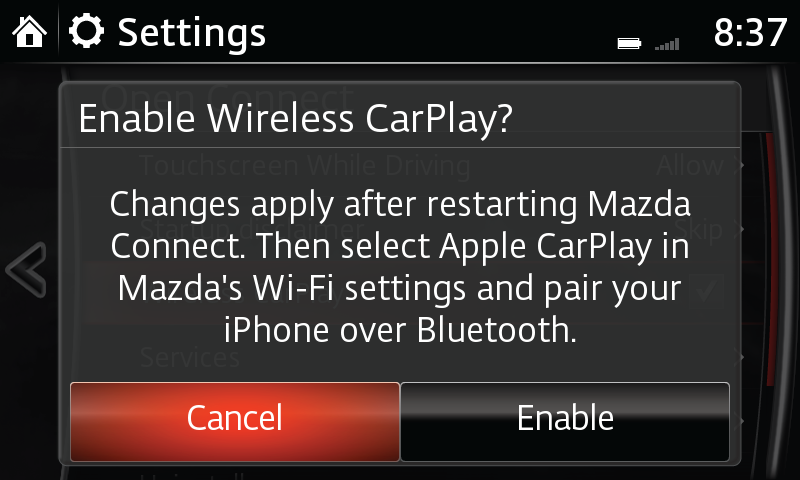
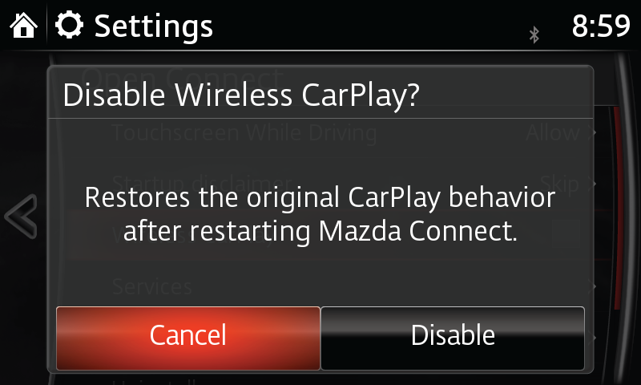

# Wireless CarPlay

  <strong>Menu:</strong> Mazda Settings → System → Open Connect → Wireless CarPlay
  <strong>Default:</strong> Off (or <em>factory enabled</em> on factory-wireless units)
  <strong>Takes effect:</strong> Next full restart

## Why it exists

Mazda Connect `74.00.324A` already contains Mazda’s native wireless CarPlay stack, but hides it on vehicles that did not ship with factory wireless CarPlay enabled.

**Wireless CarPlay** turns on Mazda’s own native wireless CarPlay menus and pairing flow — **without spoofing your vehicle fingerprint or altering your GPS hardware identity**. If your car already has factory wireless CarPlay, Open Connect detects it automatically and displays **factory enabled**.

## Set up an iPhone

1. In **Mazda Settings → System → Open Connect**, check **Wireless CarPlay**, confirm **Enable**, and let Mazda Connect power down completely before starting again.
2. Open **Mazda Settings → Devices → Wi-Fi** and select **Apple CarPlay**.
3. Keep Wi-Fi and Bluetooth on in your iPhone, pair it with Mazda Connect over Bluetooth, and accept the iPhone’s wireless CarPlay prompt if shown.
4. Open **Mazda Settings → Devices → Apple CarPlay**, select your iPhone, and choose **Connect**.

<figure class="oc-screen">
  

  <figcaption>Enable the option in Open Connect, then finish pairing inside Mazda’s own Devices menus.</figcaption>
</figure>

<figure class="oc-screen">
  

  <figcaption>Select Apple CarPlay in Mazda Settings → Devices → Wi-Fi.</figcaption>
</figure>

> **Tip:** If your iPhone was already paired over Bluetooth before enabling Wireless CarPlay and the **Connect** button stays greyed out, remove and re-pair that iPhone once. Other paired devices don’t need to be removed.

On North American firmware, Mazda’s Wi-Fi menu offers **Off** and **Apple CarPlay**. Explicit switching between Wireless CarPlay and a phone/home hotspot is tracked separately in [#54](https://github.com/aeharding/open-connect/issues/54).

## Turning it back off

Clear **Wireless CarPlay** and confirm **Disable** to return to your unit’s original wireless availability on the next full start. Open Connect never erases Mazda’s Wi-Fi preferences or paired-phone records; uninstalling Open Connect also cleanly restores your original startup configuration.

<figure class="oc-screen">
  

  <figcaption>Disabling restores your unit’s original availability on the next full restart.</figcaption>
</figure>

## Qualification & performance

Bench testing verified wireless projection, automatic reconnection across full restarts, controls, and clean uninstall. Real-car audio, physical input, and **long-parked cold-start lag** remain open for real-vehicle testing — see [Wireless startup speed](wireless-startup-speed.md), [Wireless startup baseline](wireless-comparison.md), and the [wireless technical notes](cmu/wireless-carplay.md#installed-development-candidate).

[Pair with Base optimizations →](services.md) · [Back to Settings →](settings.md)
