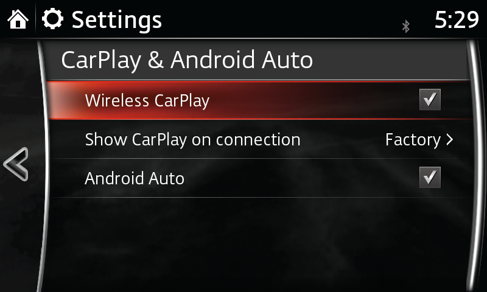

# Wireless CarPlay

Connect your iPhone to CarPlay without plugging in a USB cable. Open Connect enables Mazda’s built-in wireless connection on compatible hardware.

<dl class="oc-spec">
  

    <dt>Menu</dt>
    <dd>Open Connect → CarPlay &amp; Android Auto</dd>
  

  

    <dt>Default</dt>
    <dd>Off</dd>
  

  

    <dt>Impact</dt>
    <dd>+2.2 pp CPU vs stock</dd>
  

  

    <dt>Applies</dt>
    <dd>Next full startup</dd>
  

</dl>

<figure class="oc-screen">
  

  <figcaption>Wireless CarPlay highlighted (dev.19); shown on, with a fresh-install default of Off unless factory enabled.</figcaption>
</figure>

## Notes

Off, unless the unit has factory wireless CarPlay. <strong>factory enabled</strong> units need no change here.

With Wireless CarPlay <strong>on and an iPhone connected</strong>: <strong>+2.2 percentage points boot CPU</strong>, <strong>+3.4 points settled CPU</strong> and approximately <strong>0 MiB available-proxy change versus Stock</strong> (+0.1 MiB observed). Versus Base=0: +1.4/+2.9 CPU points and −0.5 MiB proxy. Home was <strong>34.8 s</strong>, about <strong>5.1 s earlier than Stock Show</strong> or <strong>0.8 s earlier than Base=0 Skip</strong>; this does not establish a wireless startup benefit.

Published <strong>0.3.0-dev.20</strong>, one cold ACC-off boot (<strong>n=1</strong>) against earlier Stock and Base=0 medians; all other installed choices held fixed. Stock used disclaimer <strong>Show</strong>; installed boots used <strong>Skip</strong>. Small timing/CPU differences may be run variation. This sweep is separate from the primary n=3 cohorts. “Available” means the <strong>MemFree + Buffers + Cached + SReclaimable − Shmem proxy</strong>; Linux 3.0.35 has no kernel <code>MemAvailable</code>. It is not guaranteed allocatable RAM, raw <code>MemFree</code> or resident anonymous <code>AnonPages</code>; <code>Committed_AS</code> is the separate commitment counter.

Uses Wi-Fi for CarPlay and requires compatible hardware and phone pairing. Wired CarPlay remains available when this setting is off. In dev.20, Mazda Navigation starts about <strong>20 s later</strong> only when <strong>both</strong> <a href="startup-optimizations.md">Startup optimizations</a> and the <strong>saved Open Connect Wireless CarPlay override</strong> are on, even if no phone connects. An already-checked <strong>factory enabled</strong> row leaves that override off and does not trigger this delay.

Saved automatically; takes effect on the <strong>next full Mazda Connect startup</strong>. See <a href="settings.md#apply-changes">restart guidance</a>.

<a id="testing" href="performance.md#stage-2b-isolated-toggle-sweep-n1">Performance evidence</a> records AP/association/CarPlay-session confirmation separately from visible projection. Automatically show stayed off and Home remained the workload. Real-car audio, physical controls and long-parked reliability remain unqualified. The screenshot above remains dev.19. <strong>0.3.0-dev.22</strong> is a development prerelease for <strong>74.00.324A NA</strong>; real-car qualification remains pending.

## Setup

If Wireless CarPlay is already active, go directly to **Mazda Settings → Devices → Wi-Fi** in step 3. This includes factory wireless CarPlay and wireless already enabled through Open Connect with no pending change. If a saved change needs a restart, complete step 2 first.

1. Open **Mazda Settings → System → Open Connect → CarPlay &amp; Android Auto**. Turn on **Wireless CarPlay** and confirm **Enable**.
2. If a saved change needs a restart, select [**Apply changes**](apply-changes.md) in Open Connect and confirm **Restart**. Keep the car on until Mazda Connect restarts.
3. Open **Mazda Settings → Devices → Wi-Fi** and select **Apple CarPlay**.

    <figure class="oc-screen">
      

      <figcaption>Step 3: select Apple CarPlay in Mazda’s Wi-Fi settings (retained dev.8 capture).</figcaption>
    </figure>

4. Enable Wi-Fi and Bluetooth on your iPhone. Pair it with Mazda Connect over Bluetooth and accept the wireless CarPlay prompt if shown.
5. Open **Mazda Settings → Devices → Apple CarPlay**, select your iPhone and choose **Connect**.

If **Connect** stays greyed out for an already paired iPhone, remove that phone’s pairing and pair it again. Leave other phones paired.

The North American Wi-Fi menu offers **Off** and **Apple CarPlay**. Hotspot switching is not included in this setup.

## Turning it off

If you enabled wireless through Open Connect, clear **Wireless CarPlay** and confirm **Disable**. Your unit’s original wireless availability returns on the next full startup. Saved phone pairings and Wi-Fi preferences stay in place.

[Wireless technical notes](cmu/wireless-carplay.md)

[Back to Settings](settings.md)
