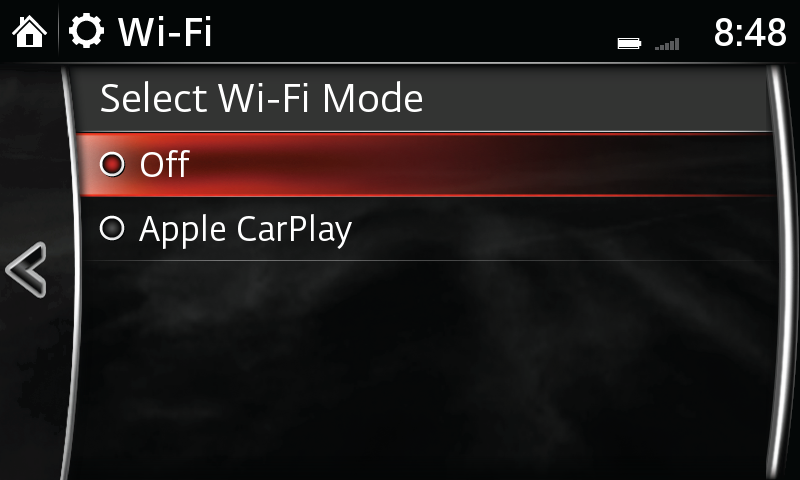

# Wireless CarPlay

Connect your iPhone to CarPlay without plugging in a USB cable. Open Connect enables Mazda’s built-in wireless connection on compatible hardware.

<dl class="oc-spec">
  

    <dt>Menu</dt>
    <dd>Open Connect → CarPlay &amp; Android Auto</dd>
  

  

    <dt>Default</dt>
    <dd>Off</dd>
  

  

    <dt>Impact</dt>
    <dd>Neutral</dd>
  

  

    <dt>Applies</dt>
    <dd>Next full startup</dd>
  

</dl>

<figure class="oc-screen">
  

  <figcaption>Wireless CarPlay highlighted (dev.19); shown on, with a fresh-install default of Off unless factory enabled.</figcaption>
</figure>

## Notes

Off, unless the unit has factory wireless CarPlay. <strong>factory enabled</strong> units need no change here.

<strong>Neutral</strong> — no isolated wireless-enable startup or RAM saving is established.

Uses Wi-Fi for CarPlay and requires compatible hardware and phone pairing. Wired CarPlay remains available when this setting is off. In dev.19, Mazda Navigation starts about <strong>20 s later</strong> only when <strong>both</strong> <a href="startup-optimizations.md">Startup optimizations</a> and the <strong>saved Open Connect Wireless CarPlay override</strong> are on, even if no phone connects. An already-checked <strong>factory enabled</strong> row leaves that override off and does not trigger this delay.

Saved automatically; takes effect on the <strong>next full Mazda Connect startup</strong>. See <a href="settings.md#apply-changes">restart guidance</a>.

<a href="performance.md">Performance evidence</a> records wireless configurations, not an isolated enable-toggle benefit. Earlier builds have connection and full-restart reconnection checks; real-car audio, physical controls and long-parked reliability remain unqualified. Dev.19 UI bench captures on <strong>74.00.324A NA</strong>; real-car qualification and matched dev.19 benchmarks remain pending. <strong>0.3.0-dev.19</strong> is a development prerelease.

## Setup

If Open Connect shows **factory enabled**, start at step 3.

1. Open **Mazda Settings → System → Open Connect → CarPlay &amp; Android Auto**. Turn on **Wireless CarPlay** and confirm **Enable**.
2. Let Mazda Connect shut down completely, then start it again.
3. Open **Mazda Settings → Devices → Wi-Fi** and select **Apple CarPlay**.

    <figure class="oc-screen">
      

      <figcaption>Step 3: select Apple CarPlay in Mazda’s Wi-Fi settings (retained dev.8 capture).</figcaption>
    </figure>

4. Enable Wi-Fi and Bluetooth on your iPhone. Pair it with Mazda Connect over Bluetooth and accept the wireless CarPlay prompt if shown.
5. Open **Mazda Settings → Devices → Apple CarPlay**, select your iPhone and choose **Connect**.

If **Connect** stays greyed out for an already paired iPhone, remove that phone’s pairing and pair it again. Leave other phones paired.

The North American Wi-Fi menu offers **Off** and **Apple CarPlay**. Hotspot switching is not included in this setup.

## Turning it off

If you enabled wireless through Open Connect, clear **Wireless CarPlay** and confirm **Disable**. Your unit’s original wireless availability returns on the next full startup. Saved phone pairings and Wi-Fi preferences stay in place.

[Wireless technical notes](cmu/wireless-carplay.md)

[Back to Settings](settings.md)
