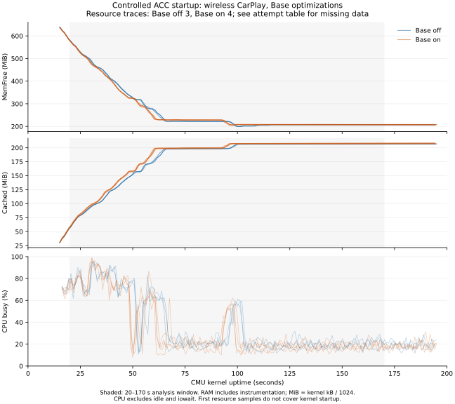

# Wireless CarPlay startup comparison

Across all five scheduled attempts per setting, the first visible wireless
CarPlay dashboard had a median about **3.0 seconds earlier with Base on**.
**One of the five Base-on attempts then watchdog-restarted**, and another took
about 68 seconds to first show the dashboard. This is a startup baseline with
failures, not evidence of reliably usable projection or an isolated Base benefit.
The map palette changed between blocks, and resource retrieval was incomplete.

Minimum `MemFree` in the available matched-window traces was **6.4 MiB higher**
with Base on; ending free RAM differed by only **0.3 MiB**. Resource denominators
are three Base-off and four Base-on traces, separate from five timing attempts
per setting. The earlier wired results are not pooled into these observations.

## Results and every scheduled attempt

All ten attempts reached a visible dashboard. Five Base-off attempts had no
observed restart; four of five Base-on attempts had no observed restart during
the recording. Base-off attempts 4/5 lost Ethernet access, while Base-on attempt
3 restarted through the watchdog and then also lacked Ethernet DHCP access.
Their original camera/UART records and first-appearance timings remain included;
missing resource and kernel-clock values are empty, never zero. No attempts were
replaced or silently excluded.

| Base | Timing attempts / resource traces | Median Home (s) | Median first dashboard (s) | Median CPU busy | Median minimum MemFree (MiB) |
| --- | --- | --- | --- | --- | --- |
| Off | 5 / 3 | 32.21–32.42 | 58.04–58.25 | 36.98% | 199.27 |
| On | 5 / 4 | 31.23–31.44 | 55.05–55.26 | 33.42% | 205.68 |

Times begin at the host ACC-on command; interval bounds are rounded outwards.
The 2.99-second difference uses unrounded median interval midpoints. These are
**first appearances**, including the attempt that later restarted. For context,
the four Base-on attempts without an observed restart have a first-dashboard
median of 56.64–56.85 seconds. This conditional subset does
not replace the five-attempt result or remove its failure. Visible projection
alone does not establish accepted input, audio or uninterrupted readiness.

| Base / attempt | Home (s) | First dashboard (s) | CPU busy | Minimum MemFree (MiB) | Outcome during observation |
| --- | --- | --- | --- | --- | --- |
| Off / 1 | 32.21–32.42 | 59.23–59.44 | 36.98% | 199.27 | Complete trace; no observed restart |
| Off / 2 | 32.03–32.24 | 58.04–58.25 | 37.26% | 199.23 | Complete trace; no observed restart |
| Off / 3 | 32.02–32.23 | 57.63–57.84 | 35.48% | 199.72 | Complete trace; no observed restart |
| Off / 4 | 32.47–32.68 | 60.87–61.08 | — | — | Ethernet fetch failed; no trace |
| Off / 5 | 32.22–32.44 | 57.43–57.64 | — | — | Ethernet fetch failed; no trace |
| On / 1 | 31.01–31.22 | 58.22–58.44 | 32.88% | 204.93 | Complete trace; no observed restart |
| On / 2 | 31.25–31.46 | 55.05–55.26 | 32.18% | 206.96 | Complete trace; no observed restart |
| On / 3 | 31.02–31.23 | 54.82–55.03 | — | — | Watchdog restart; no trace |
| On / 4 | 31.45–31.66 | 55.05–55.26 | 35.20% | 205.83 | Complete trace; no observed restart |
| On / 5 | 31.23–31.44 | 67.96–68.17 | 33.95% | 205.52 | Complete trace; no observed restart |

| Base / resource traces | CPU busy range | Minimum MemFree range (MiB) | Median ending MemFree (MiB) | Median ending Cached (MiB) |
| --- | --- | --- | --- | --- |
| Off / 3 | 35.48–37.26% | 199.23–199.72 | 207.15 | 206.86 |
| On / 4 | 32.18–35.20% | 204.93–206.96 | 207.45 | 208.05 |

The CPU median differs by 3.57 percentage points. Minimum free RAM differs much
more than ending free RAM, so these traces do not show a fixed 6.4 MiB allocation
permanently removed. Trace loss, sequential order, palette drift and one unit
limit attribution. The failed restart has no resource trace to explain its cause.



| Device / Base | Median sectors read (range) | Median sectors written (range) |
| --- | --- | --- |
| `ffx01` / Off | 233464 (231072–233912) | 112 (112–112) |
| `ffx01` / On | 231744 (230432–233192) | 112 (112–112) |
| `mmcblk0` / Off | 63819 (63819–63819) | 196 (188–201) |
| `mmcblk0` / On | 63819 (63818–63819) | 214 (198–220) |

These are native per-device sector deltas, not application-attributed disk bytes.
Do not sum devices and their partitions; SD endpoints that appeared mid-window
have no inferred full-window delta. There is no general I/O-saving claim.

The **1,190 samples** begin at uptime **15.07–15.36 seconds** and end at
**194.16–195.18 seconds**. Early resources are unobserved. Seven mapped kernels,
20 reviewed timing intervals and all ten attempt records are retained. The UART
CSV has 90 rows, including repeated events and explicit missing/unassigned times.

Download [samples](assets/performance/wireless/startup-samples.csv),
[resource summaries](assets/performance/wireless/startup-runs.csv),
[I/O](assets/performance/wireless/startup-io.csv),
[timings](assets/performance/wireless/startup-timings.csv),
[every attempt](assets/performance/wireless/startup-attempts.csv) and
[native events](assets/performance/wireless/wireless-events.csv).


## Configurations and acquisition order

Five starts with Base optimizations off precede five with Base on. Both use the
same installed **0.3.0-dev.8** CI bundle, with native Wireless CarPlay on,
Touchscreen While Driving Allow, Startup disclaimer Skip, Pandora on and product
UART/SSH off. The preset supplies the native Warn prefilter; Base off leaves the
RAM override absent. The pre-existing bench SSH key and collector are separate
instrumentation, retained in both conditions.

The CMU is exact **74.00.324A NA/cmu150_NA**. The iPhone8,4 runs **iOS 15.8.8**;
its USB cable stays connected to the Mac. The CMU has Ethernet and the reference
FAT SD connected. Its phone USB link must be down, Mazda's Wi-Fi mode is Apple
CarPlay, and the existing Bluetooth pairing is retained. The wireless station
count is an outcome, including zero; it is not a reason to discard an attempt.
The idle dashboard has no route or playing audio. Base-off end frames have a
bright map; Base-on setup and primary end frames have a dark map, without an intervening
phone/UI action by us. This concrete workload drift limits the comparison; its
cause is unqualified.

Each start follows 30 seconds of ACC-off at unchanged **12.02 V / 2 A** supply
settings. These are controlled ACC shutdowns, not supply-loss or overnight-car
starts. A separate Base-off pilot and setup restarts are excluded. The pilot
showed at least 134.69 seconds of resource coverage and 157.05 seconds of video
after visible projection, so collection was not extended. Both Base-off transport
failures required additional unmeasured ACC recovery starts: one between attempts
4 and 5, one after attempt 5. Base was then saved on and applied in a separate
unmeasured setup restart before the second block. The failed Base-off captures
show the SSH listener starting, Ethernet with no IP address,
and DHCP ending with “No lease, failing.” The OEM Ethernet script then uses
a static fallback outside the bench subnet and waits without retrying DHCP.
The upstream DHCP failure cause remains unproved. Wireless projection still
returned. No replacement primary starts
are added. Base-on attempt 3 reached CarPlay, then suffered a watchdog restart:
Mazda's service manager reported `jcifav` exiting, stopped feeding the watchdog,
and the video shows a return to the Mazda startup logo before CarPlay returns.
That is a primary restart failure even though its final frame shows projection.
Its RAM/clock data are missing and two boot sequences prevent assigning native
UART event times. Another excluded recovery start precedes Base-on attempt 4.
Sequential blocks, these extra starts and one unit limit attribution.

## Timing and resource definitions

Camera and receive-only UART recording start before ACC-off. Video runs until
ACC+210 seconds with a 260-second total cap. The camera keeps manual exposure
105 and gain 32, at roughly five frames per second. Review adjacent decoded
frames: Home means the fully spaced carousel; dashboard means the first complete
CarPlay cards, while the map can still be loading. Visibility does not establish
accepted input, audio readiness or a smooth early session.

ACC timings begin at the host relay command. A separate seven-exchange clock
mapping bounds each successfully retrieved boot's kernel origin. Missing
mappings leave kernel-relative timings empty while preserving camera/ACC bounds.
Frame spacing and clock bounds are retained; camera/display and relay latency
remain uncalibrated. The recorded last decoded frame, rather than the FFmpeg
duration cap, establishes video coverage.

The unchanged collector starts locally from stage 1, without SSH readiness
polling. It reads system counters for 180 seconds with a one-second minimum
pause. Retrieval begins at ACC+225 seconds; no SSH or GUI input runs during the
primary startup window. CPU/RAM/I/O summaries use actual sample endpoints inside
kernel uptime **20–170 seconds**. The first samples leave early resources
unobserved; no whole-boot RAM peak is inferred.

`MemFree` is not `MemAvailable`, which this kernel lacks. Cached, buffers, shared
memory and slab remain separate; convert native kernel kB to MiB by dividing by
1024. Observer output contributes to RAM. CPU busy excludes idle and iowait.
I/O retains native sector counters per device; do not sum parents and partitions.
Missing trace or endpoint values remain unknown. The resource comparison uses
only complete verified traces, with a separate denominator from camera attempts.
The attempt CSV also retains native syslog markers and Linux boot-banner counts,
so a final visible dashboard cannot hide a restart during observation.

The UART export retains eight named native events, repeated occurrences and
missing records. A unique new-boot syslog marker scopes each capture. Firmware
syslog-ng rewrites the prefix from `R_DATE`: these are receiver wall-clock
timestamps, **not calibrated kernel uptime**. UART buffering/drops remain
possible. DHCP-server startup is not proof of AP readiness; a session event is
not proof of visible or usable projection. No log bodies or phone identifiers
are included in the public CSV.

## Build and reproducible sources

The installed product is source
[`764d76e0`](https://github.com/aeharding/open-connect/tree/764d76e0c52c581894d61336b3d6679c66022398),
[CI 44951500558](https://github.com/aeharding/open-connect/actions/runs/44951500558).
USB ZIP SHA256 is
`d5dc0061a21bf9acdef8478af4032e304de917e42ef7480d1917de216b90aa48`;
public manifest is
`1fbaeb4f5762d8ecde749f083c2cbbae33b7e6a9bb104bfd5c81f06861eda42e`.
The installed private instance manifest also covers its generated instance data;
use that actual hash in capture commands, not the USB manifest hash.

Primary capture is frozen at
[`ab8993a5`](https://github.com/aeharding/open-connect/tree/ab8993a5c1647d0c1a17a44faa425e1f367de81f).
Annotation, partial-attempt export, plotting and UART extraction use
[`4da76e1f`](https://github.com/aeharding/open-connect/tree/4da76e1fea03647b8621a1dc66a41fef3489fb81).
The [wireless method](https://github.com/aeharding/open-connect/blob/4da76e1fea03647b8621a1dc66a41fef3489fb81/cmu/bench/WIRELESS-BASELINE.md)
and [observer setup/independent undo](https://github.com/aeharding/open-connect/blob/ab8993a5c1647d0c1a17a44faa425e1f367de81f/cmu/bench/STARTUP-COMPARISON.md)
are on experimental playground branches. They do not install another product
service. The existing observer preserves the exact original stage-1 script and
has an independent restore command.

Collector SHA256 remains
`04ce5017e08a4e62823135eb6a560cefbc51289edda256ff5f2b1946b3d5a109`.
The analysis revision passed 184 host tests with two explicit local skips and
regenerated all four previously published Base comparison CSVs byte for byte.
Capture provenance remains at its actual earlier revision.

At the capture revision, with an already authenticated trusted SSH alias:

```sh
python -m open_connect.startup_reference --live --host my-cmu \
  --condition open-connect --package INSTALLED_INSTANCE_MANIFEST_SHA \
  --pandora 1 --base 0 --wireless 1 --bundle runs/wireless/pilot
python -m open_connect.startup_batch --live --host my-cmu \
  --condition open-connect --package INSTALLED_INSTANCE_MANIFEST_SHA \
  --pandora 1 --base 0 --wireless 1 --bundle runs/wireless/wireless-base-off
# Save Base on, then complete one separate unmeasured setup restart.
python -m open_connect.startup_batch --live --host my-cmu \
  --condition open-connect --package INSTALLED_INSTANCE_MANIFEST_SHA \
  --pandora 1 --base 1 --wireless 1 --bundle runs/wireless/wireless-base-on
```

The flags verify already-applied preferences; they do not change settings. A
batch stops on a failed retrieval. Retain that attempt and resume only the next
scheduled number with `startup_reference`; do not rerun the whole batch. Collect
its `clock-N` with `clock_reference` only when the trace is retrieved. Complete
visual annotations before exporting at the analysis revision:

```sh
python -m open_connect.startup_export runs/wireless runs/wireless-public --wireless
python -m open_connect.startup_plot runs/wireless-public/startup-samples.csv \
  runs/wireless-public/startup-resources.svg
python -m open_connect.startup_wireless \
  runs/wireless/wireless-base-off/trial-{1,2,3,4,5} \
  runs/wireless/wireless-base-on/trial-{1,2,3,4,5} \
  > runs/wireless-public/wireless-events.csv
```

The standalone plot uses Matplotlib 3.10.9 (`python -m pip install matplotlib==3.10.9`).
Use `startup_frames` and `startup_annotate` for adjacent-frame bounds. Explicit
`--camera-only` retains valid ACC observations without a missing clock mapping.
Export checks raw resource framing/digests, saved traces and policy, available
clock replies, adjacent PTS and annotation arithmetic. These checks do not replace
visual review. Only reviewed numeric exports and the standalone chart are public;
OEM inputs, credentials, raw video/UART and personal map images stay private.
Public CSV line endings are normalized to LF.

## Separate settled input-source check

After the passive 5+5 starts, one additional Base-on/Wireless-on ACC start tested
one raw Right/Left virtual-commander pair at uptime 197.15–199.33 seconds. Right
visibly outlined the map and Left returned focus to the sidebar. The existing
collector had finished; no second sampler was launched. This establishes that
the software input source can reach settled wireless CarPlay. One pair does not
qualify early-start latency, physical input, motion behavior or audio. Those
remain separate work; no primary boot contains injected input.

## Miatafy comparison

[Miatafy's benchmark page](https://miatafy.com/screentune/boot-benchmarks/), checked
November 21, 2026, reports typical wireless session times of about 71 seconds for
stock and 55 seconds for ScreenTune. It uses an internal uptime-based profiler
and a customer configuration with unused services disabled. These trials compare
Base off/on within Open Connect, with Pandora and other service choices fixed.
Our camera-visible dashboard and receiver-clock UART events do not reproduce its
profiler triggers or establish a direct product comparison. Usable input, audio,
long-parked behavior and a matched Miatafy configuration remain unqualified.
