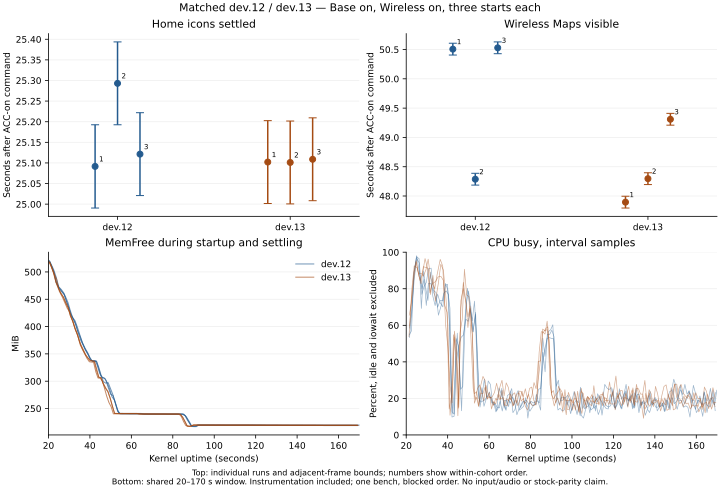

# Wireless CarPlay startup speed

Three starts per version reached visible Maps with no reboot or persistent black
screen observed in the recorded window. The median Maps midpoint moved from
**50.51 to 48.30 seconds after ACC-on**, about **2.21 seconds earlier**. Home was
unchanged within the camera bounds. This comes with **1.16 percentage points more
CPU busy** in the shared startup window; it is not an overall efficiency win.
Minimum and ending MemFree were about 0.10 MiB higher, within the run spread.
Measured Open Connect file and process RAM components were identical.

This compares **0.3.0-dev.12 with dev.13**, both with Base optimizations and
Wireless CarPlay enabled. It is not a stock comparison. It does not qualify
accepted input, audio, long-parked behavior or a real-car release; the remaining
stock-overhead work in [#9](https://github.com/aeharding/open-connect/issues/9)
and wireless reliability in [#8](https://github.com/aeharding/open-connect/issues/8)
remain open.

## What changed

Only the combined Base-on/Wireless-on preset changes its service policy:

- BDS waits for USBMGR instead of stage_3, retaining settings and dmserver.
- The Wi-Fi stage retains stage_3 but stops waiting for the unrelated Aha branch.
- CarPlay and MMUI may run on either CPU. Other service affinities stay unchanged.

Settings also uses loopback port 15555, below the firmware's ephemeral range.
The old port, 35555, could be held by MMUI's outgoing connection to Service
Manager, preventing Settings from listening. USB maintenance preserves a verified
legacy endpoint for that boot, including cancellation or arrival before the old
Settings worker starts. The next boot uses 15555. This adds no listener or RAM
record; native selection, durable state and recovery are unchanged.

The retained XML input is unchanged. Wider affinities, earlier device/network or
MMUI startup, and firewall replacement were explored and parked. Their single-start
results selected this candidate; they are outside the matched result below.

## Results

| Version / run | Home bounds (s) | Maps bounds (s) | CPU busy (%) | Min MemFree (MiB) | End MemFree (MiB) |
| --- | --- | --- | --- | --- | --- |
| dev.12 / 1 | 24.99–25.19 | 50.41–50.61 | 29.50 | 217.46 | 219.25 |
| dev.12 / 2 | 25.19–25.39 | 48.19–48.39 | 31.14 | 216.79 | 218.73 |
| dev.12 / 3 | 25.02–25.22 | 50.43–50.63 | 31.40 | 217.61 | 219.55 |
| dev.13 / 1 | 25.00–25.20 | 47.79–48.00 | 32.30 | 217.68 | 219.64 |
| dev.13 / 2 | 25.00–25.20 | 48.20–48.40 | 32.49 | 217.55 | 219.36 |
| dev.13 / 3 | 25.01–25.21 | 49.21–49.41 | 31.33 | 217.04 | 218.89 |

The median Home midpoint difference was **−0.019 s**, with frame-difference
bounds **−0.221..+0.182 s**. The Maps difference was **−2.210 s**, bounded by
**−2.412..−2.009 s**. These are frame brackets, not statistical confidence
intervals. Individual midpoint ranges overlap: dev.12 Maps 48.29–50.53 s and
dev.13 47.90–49.31 s. Three starts per condition are a small sample.

Native SM stage_1 medians were 8.519 and 8.495 s on its own logging clock.
The selector spanned 0.76–1.28 s in dev.12 and 0.67–1.28 s in dev.13; all six
kernel-uptime join waits were 0.00 s at the saved 10 ms resolution. Native assets
and selection code are unchanged; no pre-SM or stock-parity gain is claimed.

[Per-attempt outcomes](assets/performance/wireless-startup-speed/attempts.csv),
[frame bounds](assets/performance/wireless-startup-speed/timings.csv),
[window summaries](assets/performance/wireless-startup-speed/summary.csv),
[all resource samples](assets/performance/wireless-startup-speed/samples.csv),
[device I/O deltas](assets/performance/wireless-startup-speed/io.csv),
[selector phases](assets/performance/wireless-startup-speed/selector-phases.csv),
[native SM events](assets/performance/wireless-startup-speed/native-services.csv)
and [wireless log events](assets/performance/wireless-startup-speed/native-wireless.csv)
retain individual results rather than a best-run selection.

The shared-window CPU medians were **31.14% → 32.30%**. Individual values
were 29.50–31.40% and 31.33–32.49%. A **post-hoc** split of the same traces
gave 20–60 s medians of 60.47% → 61.68%, and 60–170 s medians of
20.57% → 21.71%. The increase remains in the later startup window, after all
visible Maps milestones. The owner explicitly accepted this candidate's
+1.15-point later-window CPU tradeoff for earlier Maps, flat Home, unchanged
measured own-RAM components and the permanent Settings port fix. This is a
specific integration decision, with #9 kept open; it does not waive the rule for
future changes. These traces do not identify its mechanism or qualify
indefinite steady-state behavior. See the [split-window CSV](assets/performance/wireless-startup-speed/cpu-windows.csv).

| Memory category | dev.12 minimum / ending (KiB) | dev.13 minimum / ending (KiB) |
| --- | --- | --- |
| MemFree | 222676 / 224512 | 222776 / 224620 |
| Cached | 83488 / 208400 | 83972 / 208328 |
| Shmem | 1320 / 4204 | 1328 / 4208 |
| AnonPages | 70120 / 231364 | 71044 / 231456 |
| Slab | 12140 / 19256 | 12172 / 19236 |
| Buffers | 1064 / 1820 | 1072 / 1824 |

Each cell is the median of three per-run minima/endpoints, not a simultaneous
system balance sheet. MemFree differed by +100 KiB minimum / +108 KiB ending;
the cohort spreads overlap. No useful RAM gain or new total-memory cost is
resolved by these six runs.

[Own-RAM snapshots](assets/performance/wireless-startup-speed/own-ram.csv) at
kernel uptime 300.26 / 300.31 s were identical: **436 KiB** of unique tmpfs-file
allocation across 39 inodes; **72 KiB private** for the listener and **132 KiB
private** for the ignition observer. Their separate PSS values were 84 / 153 KiB
and RSS 492 / 660 KiB. Shared pages, kernel metadata, persistent-file cache and
other application mappings prevent treating this as an exhaustive stock-overhead
total. PSS/RSS are alternatives, not additional costs to add to private pages.
The former XML cleanup was dropped; no 16 KiB saving is claimed.

## Conditions and definitions

Captured November 22, 2026 (America/Chicago; November 23 UTC). One
v74.00.324A NA / cmu150_NA bench, supply unchanged at 12.02 V, Ethernet and
FAT SD connected. The same paired iPhone8,4 running iOS 15.8.8 remained USB-connected to the Mac, with
Wi-Fi/Bluetooth enabled and wireless projection to the CMU. No phone or cable
moves occurred within the matched blocks. Full-screen Maps used the same dark
appearance, sidebar and saved view. Individual Android Auto and Pandora services
stayed enabled; touchscreen Allow and disclaimer Skip were enabled; product
UART/SSH controls were off. Existing bench access was independent.

Acquisition order was three dev.12 controls, an excluded CI dev.13 upgrade/setup
boot, then three dev.13 starts. These are **30-second ACC-off starts with B+
retained**, not full supply-loss or long-parked trials. Block order, one phone and
one unit limit causal attribution and generalization.

The receive-only UART and fixed camera started before ACC-off. Primary collection
sent no UI input and opened no SSH during startup; SSH retrieved the local
stage_1 trace after ACC+225 seconds. Video covered ACC+210 seconds. Every attempt,
recording or retrieval failure belongs in the denominator. Upgrade/setup and
later UI/sanity/undo checks are separate from timing starts.

- **Home:** all five carousel icons reach their final geometric positions.
  Text/color fades are not required. Adjacent frames were checked against later
  settled frames, using the same criterion in both cohorts.
- **Maps:** the CarPlay sidebar and roads around the central position marker are
  visible and remain present in the next two frames. Blank central tiles or
  edge-only map content do not qualify. This is a visual milestone, not proof that
  an input has been accepted.
- **Camera time:** adjacent frames at approximately 5 fps bound the event after
  the transmitted ACC-on command. The midpoint is an estimate; sensor/relay
  latency is uncalibrated. Report the bounds as well as the midpoint difference.
- **CPU/RAM/I/O:** samples wholly contained in kernel uptime **20–170 seconds**;
  CPU uses the first/last cumulative counters, excluding idle and iowait.
  Minimum and ending memory both use this window, rather than the full trace.
  Kernel kB are KiB; divide by 1024 for MiB. MemFree is not available memory.
- **Native times:** SM and UART syslog events retain their own native logging
  clock, separately from kernel uptime and camera/ACC. Delivery buffering and
  dropped log lines apply. Discard UART times if either boot-marker count or
  Linux-banner count is not exactly one, even if an event row says single_boot.

The collector starts after stage_1; its per-run first/last samples are published.
It cannot describe CPU/RAM before that first sample. Device/partition I/O rows
are separate counters and must not be summed across a disk and its partitions.
No per-core context-switch claim is made: this kernel lacks /proc/sched_debug.

## Reproduce

Control: exact dev.12 [CI 45067694902](https://github.com/aeharding/open-connect/actions/runs/45067694902),
source `2fedfcdf41644e3d888b096838f87227b2d6f275` (ZIP SHA-256
`426f9a3e0b527e8aa4abac947c106d00e0eb6f4700c8f344239a64e0e9a2fa6f`).
Candidate: exact dev.13 [CI 45101730725](https://github.com/aeharding/open-connect/actions/runs/45101730725),
source `54ee059d504107af7cb00d6b4168fc0e4addf496` (ZIP SHA-256
`69329bf9c81136a30b2de16d3959e72a161138e76a324e71d59b1cb06c6dd048`;
public manifest SHA-256
`c9c5522bf1efcf19cdb3422589037b0942efe8e25b905d59f05411632aca16a3`).
The later evidence commit changes documentation only; it does not relabel the
installed artifact. All twelve native assets are byte-identical between bundles.

Use capture revision
[`95f1eae`](https://github.com/aeharding/open-connect/tree/95f1eae00007e59fe5700a2ef08fd8107aa15bde)
and analysis revision
[`802dfcf`](https://github.com/aeharding/open-connect/tree/802dfcf95057785019bc1607c365886bffe849b0).
Keep those trees unchanged and set PYTHONPATH to their tooling/ directory and
OC_WORKSPACE to the corresponding checkout. Install the declared preset, dismiss
its setup notice, visually restore Maps, then repeat the command with a fresh
trial directory for each start. PACKAGE is the actual installed private manifest
digest, not the public USB manifest digest.

~~~sh
python -m open_connect.startup_reference --live --host cmu-bench \
  --ssh-config YOUR_PINNED_CONFIG --condition open-connect --package PACKAGE \
  --pandora 1 --base 1 --wireless 1 --bundle COHORT/trial-N --label LABEL
# After the primary process closes, switch to the analysis checkout:
python -m open_connect.clock_reference --live --host cmu-bench \
  --ssh-config YOUR_PINNED_CONFIG --expect-boot ACTUAL_BOOT --bundle COHORT/clock-N
python -m open_connect.startup_frames COHORT/trial-N START_PTS STEP
python -m open_connect.startup_annotate COHORT/trial-N \
  HOME_BEFORE_PTS HOME_FIRST_PTS MAPS_BEFORE_PTS MAPS_FIRST_PTS --projection maps
python -m open_connect.startup_analysis COHORT/trial-N
python -m open_connect.startup_wireless COHORT/trial-N
~~~

Read /tmp/open-connect/startup-times and /tmp/smevents.txt only after the primary
capture closes, checking the same boot, selected snapshot and read-only physical
root. Confirm the four Base leaves stopped and Android Auto/Pandora still running.
The annotation command takes exact adjacent **video PTS values**, not frame numbers.
The analysis reparses the saved retrieval and verifies the trace, memory CSV,
clock exchanges and annotation arithmetic. Capture verifies the transmitted
BOOT_TRACE_SHA digest. Raw camera/UART/phone captures remain private; the published
files contain authored numeric derivatives only.

For the published memory summaries, read the same saved trace with this small
extraction; the older analysis command's memory summary covers its full trace.

~~~sh
python - COHORT/trial-N/trace.json <<'PYTHON'
import json, re, sys
trace = json.load(open(sys.argv[1]))
window = [s for s in trace["samples"]
          if s["uptime_start_s"] >= 20 and s["uptime_end_s"] <= 170]
values = [dict((m[1], int(m[2])) for m in re.finditer(
    r"^([A-Za-z_()]+):\s+(\d+) kB$", s["files"]["/proc/meminfo"][0], re.M))
    for s in window]
for name in ("MemFree", "Cached", "Shmem", "AnonPages", "Slab", "Buffers"):
    print(name, "minimum KiB", min(v[name] for v in values),
          "ending KiB", values[-1][name])
print("window", window[0]["uptime_start_s"], window[-1]["uptime_end_s"])
PYTHON
~~~

For own RAM, take a separate postflight snapshot. Enumerate regular files under
/tmp/open-connect and sum stat blocks once per **device/inode**, including feature,
session and ignition files. Do not sum du output across hardlinked directories.
For the listener and ignition processes, verify PID, start time, executable and
owned socket/lock before summing Private_Clean + Private_Dirty in /proc/PID/smaps.
Report PSS separately; it is an alternative measure, not another additive cost.
Keep snapshot uptime and component scope with the result.

## Functional checks and limits

The exact CI dev.12 → CI dev.13 update retained the original stock-five baseline,
all feature/service choices and developer-access settings. Both rendered profiles
matched the selected snapshot, physical root stayed read-only, and the owned
listener used 15555. All observed CarPlay/MMUI task masks were 0–1; a separate
15.15 s late postflight check found 26 CarPlay threads with that mask. This is
scheduling evidence, not accepted-input timing.

The normal **Mazda Settings → System → Open Connect** row opened the installed
page using the real 15555 service. After saving Base=0/Wireless=0 and restarting,
both profiles restored the original BDS/Wi-Fi dependencies, observed CarPlay/MMUI
tasks were back on CPU0, the Warn override was absent, all seven checked
Base/Android Auto/Pandora members were running, and the same Settings page worked.
This is a one-boot sanity check, not matched Base-off timing/CPU qualification.

The installed Settings page then selected **Uninstall** and confirmed it once
through the normal dialog. Its automatic restart produced a new stock kernel.
An independent read-only check verified original hashes/modes, original loaded
UIA/MMUI and Opera/SM startup, absent original touchscreen key, the seven services
running, physical root read-only, and removal of the product helper, persistent
package/snapshot/record directory, RAM runtime and Open Connect mappings. Existing
bench SSH and the separate startup observer were preserved. Uninstall began
from the Base-off/Wireless-off sanity state; it is not a new physical USB-insertion
check or a factory reset. Private support is under
`runs/carplay-speed-20261122/qualification/`: `ci13-upgrade/`, `ci13-setup/`,
`installed-settings/`, `base0-wireless0-sanity-v2/`, `base0-installed-settings/`,
`uninstall-prompt/`, `uninstall-confirm/` and `stock-restoration.out`.

All six primary attempts completed: **3/3 per cohort**, 1,031 resource samples,
six verified videos and one kernel/syslog boot boundary per start. No watchdog
restart, missing resource retrieval or recording failure occurred in this batch.
Earlier exploratory and setup attempts are separate from these six declared
starts. Non-primary helper invocation/guard mistakes were corrected after fresh
state checks; their raw failures remain private and are not CMU failures.

Host CI on the measured candidate ran 304 tests (303 passed, one skipped), plus
strict ES5/UI checks and the ARM release build. Exact-firmware composition checks
covered 64 cases; the 48 with either Base or Wireless off retained byte-identical
profiles. The source review and final evidence review are linked from
[PR #127](https://github.com/aeharding/open-connect/pull/127). This retains existing
qualification for unchanged install/recovery mechanisms rather than repeating
unrelated lifecycle checks. Physical input/audio, Android-phone, actual vehicle
and long-parked behavior remain open.
